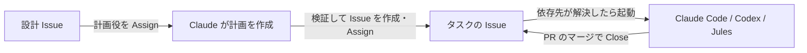

# Coding Agent の自動起動

設計 Issue に計画役のアカウントを Assign すると、Claude が実装計画を立てて Issue を作成し、各 Issue を担当の Coding Agent が依存関係の順に解決していきます。

| 役割 | ワークフロー | 書き込みを行うもの |
| --- | --- | --- |
| 計画 (Claude) | [coding-agent-planner.yml](../workflows/coding-agent-planner.yml) | 自作の GitHub App (Issue の作成) |
| Claude Code | [coding-agent-claude-code.yml](../workflows/coding-agent-claude-code.yml) | 自作の GitHub App (PR の作成) |
| Codex | [coding-agent-codex.yml](../workflows/coding-agent-codex.yml) | 自作の GitHub App (PR の作成) |
| Jules | [coding-agent-jules.yml](../workflows/coding-agent-jules.yml) | Jules の GitHub App (PR の作成) |

共通の処理は、次の Reusable Workflow にまとめています。

- [coding-agent-gate.yml](../workflows/coding-agent-gate.yml): 起動条件の判定と二重起動の防止
- [coding-agent-publish.yml](../workflows/coding-agent-publish.yml): Claude Code と Codex の変更を push し、PR を作成する

どのエージェントにも書き込み権限を持つトークンは渡さず、エージェントの出力を受け取った別のジョブが GitHub App のトークンで書き込みます。

## 起動条件

次の条件をすべて満たしたときに起動します。計画役も同じ条件で起動します。

- Issue が Open で、エージェントのアカウントが Assignee に含まれている
- すべての依存先 (Sub Issue と Blocked by の Issue) が Close されている (Completed / Not planned などの理由は問わない)
- 依存先に紐づく PR に、Open のまま残っているものが無い
  - マージされずに Close された PR は、破棄されたものとして無視します
- 依存先を持たない Issue は、Assign された時点で起動します

判定は次のイベントで行います。

- `issues.assigned`: Assign された Issue 自身を判定する
- `issues.closed`: Close された Issue の親 Issue と、その Issue が Blocking していた Issue を判定する
  - 1 回の Close で複数の Issue が起動できるようになることがあるため、条件を満たした Issue ごとにワークフローを手動実行 (`workflow_dispatch`) し直します

### 注意点

- 起動したエージェントは Issue に印となるコメントを残し、同じ Issue では二度と自動起動しません。再実行したい場合は、ワークフローを手動実行し、Issue 番号を指定して `force` を有効にしてください。手動実行でも起動条件は判定します
- 書き込み権限を持たないユーザーの操作 (自分の Issue を Close したなど) では起動しません。Issue を作成する GitHub App と、起動し直す GitHub Actions は例外として扱います
- 依存先を Close した後に紐づく PR をマージした場合や、依存関係を後から外した場合はイベントが発生しないため、手動実行してください
- Issue の本文はそのままプロンプトに含まれます。エージェントを Assign する前に、本文に不審な指示が無いか確認してください

## 実装計画からの Issue 作成

設計 Issue に計画役のアカウント (`PLANNER_ASSIGNEE`) を Assign すると、次の順に処理します。

1. Claude が設計 Issue の本文とリポジトリ内の設計書を読み、計画を [plan-schema.json](plan-schema.json) の形式で出力する (読み取り専用のトークンのみ)
2. 別のジョブが計画を検証する。問題があれば Issue を 1 件も作らず、設計 Issue にコメントで知らせる
3. GitHub App のトークンで、次の順に書き込む
   1. すべての Issue を作成し、親タスク (または設計 Issue) の Sub Issue にする
   2. Blocked by の関係を設定する
   3. 担当エージェントのアカウントを Assign する (ここで各エージェントのワークフローが起動する)
4. 作成した Issue の一覧を設計 Issue にコメントする

Assign を最後にしているのは、依存関係を設定する前にエージェントが起動しないようにするためです。

### 計画の検証内容

- 想定外の項目が無いこと、必須項目がそろっていること
- タスク数 (`PLANNER_MAX_TASKS`、既定は 30 件)、タイトル・本文の長さが上限を超えないこと
- `agent` が、Assignee を設定済みのエージェントであること
- `parent` と `blocked_by` が計画内のタスクを指していること
- 親子関係が循環せず、深さが 4 階層以内で、Sub Issue の数が GitHub の上限 (100 件) を超えないこと
- タスクどうしが互いの完了を待ち合わないこと (親タスクは子タスクの完了を待つものとして判定する)

### 再実行

作成した Issue の本文には、実行ごとのマーカーを埋め込んでいます。Issue の作成ジョブが途中で失敗した場合は、そのジョブを再実行 (Re-run failed jobs) すれば、作成済みの Issue や関係を飛ばして続きから処理します。

`agent` が `null` のタスク (人が対応するタスクや、子タスクをまとめるだけのタスク) は Assign しません。これらを Blocked by に指定したタスクは、人が Close するまで起動しません。

## セットアップ

### 1. Assignee 用のアカウント

計画役と各エージェントに対応する GitHub アカウント (マシンユーザーなど) を用意し、リポジトリのコラボレーターに招待して Assign できる状態にしてください。計画役には、どのエージェントとも別のアカウントを使ってください。

### 2. 1Password

1Password のサービスアカウントを作成し、次のアイテムを読み取れるようにしてください。

- Anthropic API キー (計画役と Claude Code で共用)
- OpenAI API キー
- Jules API キー
- GitHub App の秘密鍵

### 3. GitHub App

GITHUB_TOKEN で作成した PR では CI が起動せず、GITHUB_TOKEN で Assign してもエージェントのワークフローが起動しないため、書き込みには GitHub App を使います。App が未設定の場合、Issue の作成ジョブと PR の作成ジョブは失敗します。

- Repository permissions: Contents (Read and write)、Issues (Read and write)、Pull requests (Read and write)
- このリポジトリにインストールし、秘密鍵を 1Password に保存する
- エージェントが `.github/workflows` 配下を変更した場合は push に失敗します (Workflows 権限は意図的に付与していません)

### 4. Jules

[Jules](https://jules.google.com) でこのリポジトリを接続し、API キーを発行してください。

### 5. GitHub の Secrets と Variables

Secrets:

| 名前 | 内容 |
| --- | --- |
| `OP_SERVICE_ACCOUNT_TOKEN` | 1Password のサービスアカウントトークン |

Variables:

| 名前 | 内容 |
| --- | --- |
| `PLANNER_ASSIGNEE` | 計画役のアカウントのログイン名 |
| `CLAUDE_CODE_ASSIGNEE` | Claude Code 用アカウントのログイン名 |
| `CODEX_ASSIGNEE` | Codex 用アカウントのログイン名 |
| `JULES_ASSIGNEE` | Jules 用アカウントのログイン名 |
| `OP_ANTHROPIC_API_KEY_REF` | Anthropic API キーの参照 (例: `op://CI/Anthropic/credential`) |
| `OP_OPENAI_API_KEY_REF` | OpenAI API キーの参照 |
| `OP_JULES_API_KEY_REF` | Jules API キーの参照 |
| `CODING_AGENT_APP_CLIENT_ID` | GitHub App の Client ID |
| `CODING_AGENT_APP_SLUG` | GitHub App の slug (App の URL の末尾。Bot アカウント名 `<slug>[bot]` の判定に使う) |
| `OP_CODING_AGENT_APP_PRIVATE_KEY_REF` | GitHub App の秘密鍵の参照 |
| `PLANNER_MAX_TASKS` | 1 回の計画で作成できるタスクの上限 (省略時は 30) |
| `PLANNER_MODEL` | 計画役が使う Claude のモデル (省略時は Claude Code Action の既定) |

`*_ASSIGNEE` が未設定のエージェントは起動せず、計画でも担当に選ばれません。使わないエージェントは未設定のままにしてください。

## エージェントの出力

Claude Code と Codex は [result-schema.json](result-schema.json) の形式で、コミットメッセージと PR の説明を出力します。出力が得られなかった場合は、既定のコミットメッセージで PR を作成します。
