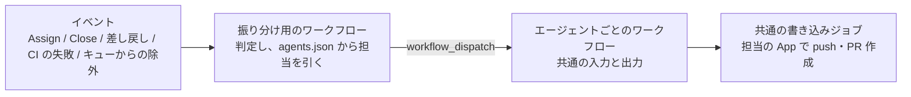
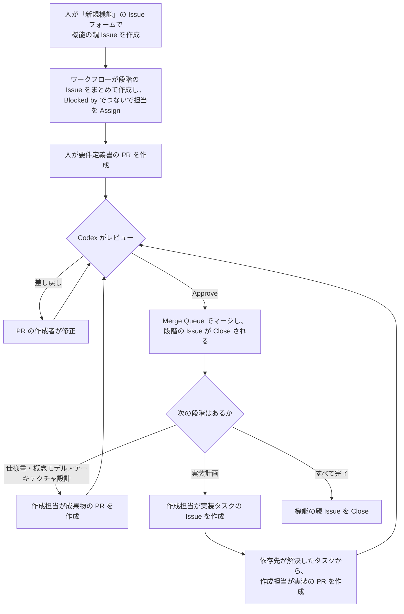

# Coding Agent による開発フローの仕様

この文書は、[README](../../README.md) の「開発フロー」に書かれた要件を、GitHub 上の仕組みとしてどう実現するかを定めた仕様です。

- 要件は README の擬似コードで、この文書はそれを実現する方法を表します
- 仕組みを作る順番と、今の進み具合は「[既存の実装からの移行と作る順番](#15-既存の実装からの移行と作る順番)」にまとめています

## 1. 前提

このリポジトリはテンプレートリポジトリで、仕組みが動くのは、テンプレートから作ったリポジトリ (以下「利用するリポジトリ」) である。

- 利用するリポジトリは、GitHub Organization が所有する public リポジトリとする
- 開発は Issue ドリブンで進める。どの作業も Issue から始まる
- 利用するリポジトリでは、`develop` を既定ブランチにする。エージェントが扱うのは `develop` までで、`main` へのマージは人が行う
  - `Closes #N` などのキーワードは、既定ブランチに向けた PR でしか働かない。PR と Issue を確実につなぐため、`develop` を既定ブランチにする

テンプレート自体は、次のように扱う。

- `main` を既定ブランチのまま、人が仕組みを開発する。`develop` は作らない
- テンプレート自体では仕組みを動かさない。Variables の `CODING_AGENT_ENABLED` が `true` でなければ、どのワークフローも何もせずに終わる (13 章)
- テンプレートから作ったときに引き継がれないもの (ブランチ、ルールセット、Variables、Secrets、ラベル) は、利用するリポジトリのセットアップで用意する (14 章)
- 動作確認は、テンプレートから作った確認用のリポジトリで行い、テンプレートに確認用の Issue や成果物を残さない

## 2. 役割

| 役割 | 担当 | 内容 |
| --- | --- | --- |
| 人 | 機能の親 Issue の作成者 | 要件定義書の作成と修正、レビューが上限を超えたときの対応、`main` へのマージ |
| 作成担当 | Claude | 仕様書、概念モデル、アーキテクチャ設計、実装計画、実装と、それぞれの修正 |
| レビュー担当 | Codex | 成果物と実装のレビュー、PR の Approve とマージ |

### 2.1 エージェントの登録

仕組みは、特定のエージェントに依存しないように作る。「PR を作るのは Claude だけ」のような前提には頼らない。

- エージェントは登録制にする。登録先は `.github/coding-agent/agents.json` とし、JSON Schema (`agents-schema.json`) で形式を検証する。Schema で表せない関係 (担当が登録済みか、レビュー担当が作成担当と別か、Bot 名などがエージェントどうしで重複していないか) は、設定を読み込むスクリプトで検証する
- どの段階をどのエージェントが担当するかも、同じファイルで決める
- PR の作成者やレビューの投稿者がどのエージェントかは、GitHub App の Bot 名から引き当てる

```json
{
  "coordinator": {
    "bot": "example-coordinator-app[bot]",
    "appClientId": "Iv23li..."
  },
  "agents": {
    "claude": {
      "name": "Claude Code",
      "assignee": "example-claude",
      "bot": "example-claude-app[bot]",
      "workflow": "coding-agent-claude.yml",
      "appClientId": "Iv23li..."
    },
    "codex": { "...": "..." }
  },
  "roles": {
    "author": {
      "specification": "claude",
      "domain-model": "claude",
      "architecture": "claude",
      "planning": "claude"
    },
    "implementers": ["claude"],
    "reviewer": "codex"
  }
}
```

| 項目 | 内容 |
| --- | --- |
| `coordinator` | 進行役の GitHub App の Bot 名と Client ID (2.3) |
| `assignee` | Issue に Assign するアカウント。GitHub App の Bot は Assignee にできないため、マシンユーザーを使う |
| `bot` | GitHub App の Bot 名 |
| `workflow` | そのエージェントを動かすワークフローのファイル名 |
| `appClientId` | GitHub App の Client ID |
| `roles.author` | 段階ごとの作成担当 |
| `roles.implementers` | 実装計画で実装タスクに割り当ててよいエージェント |
| `roles.reviewer` | レビュー担当 |

- このファイルには秘密の値を書かない。GitHub App の秘密鍵や API キーは Secrets に置く (2.4)
- 運用中に調整したい値 (修正の上限など) は Variables に置く
- 段階の Issue をワークフローがまとめて作るため、起動に Assign は必須ではない。それでも、誰が担当しているかを Issue で分かるようにするため、マシンユーザーを Assign する。Organization では、マシンユーザーをメンバーかコラボレーターとして追加する

### 2.2 エージェントの呼び出し方

イベントを受けて「どのエージェントに何をさせるか」を判定する部分と、エージェントを動かす部分を分ける。



- **振り分け用のワークフロー**: 起動の判定、レビュー対象の判定、修正の回数の確認など、エージェントに依存しない処理を受け持つ
- **エージェントごとのワークフロー**: 決まった形式の入力 (作成か修正か、対象の Issue や PR、指示の内容) を受け取り、決まった形式の出力 (変更の差分、コミットメッセージ、PR の説明) を返すことだけを受け持つ
- **共通の書き込みジョブ**: 出力を受け取り、`agents.json` で引いた担当の GitHub App のトークンで、push と PR の作成を行う。PR の本文に `Closes #N` を入れるのもこのジョブで、どのエージェントでも確実に入るようにする

エージェントを追加するときは、この形式に従ったワークフローを 1 つ書き、`agents.json` に登録する。

`workflow_dispatch` の入力は文字列しか渡せず、数にも上限がある。そのため、振り分け用のワークフローは、エージェントに渡す資料を含む依頼の全体を、Artifact (`coding-agent-requests`) に `<依頼の識別子>.json` として保存する。エージェントのワークフローには、それを取りに行くための情報と、チェックアウトなどに必要な最小限の情報だけを入力として渡す。

| 入力 | 内容 |
| --- | --- |
| `mode` | `create` (作成) か `fix` (修正) |
| `stage` | 段階 (`specification`、`domain-model`、`architecture`、`planning`、`implementation`) |
| `issue-number` | 対象の Issue の番号 |
| `pull-request-number` | 修正の対象の PR の番号。作成のときは空 |
| `target-sha` | 作業を始めるコミット |
| `request-run-id` | 依頼の Artifact を保存した、振り分け用のワークフローの実行の ID |
| `request-id` | 依頼の識別子 (Artifact の中のファイル名) |

エージェントのワークフローは、`request-run-id` を指定して Artifact をダウンロードし (`actions: read` の権限が必要)、`<request-id>.json` を読む。

`workflow_call` では呼び出すファイルを `uses:` に固定で書く必要があり、設定ファイルから選べない。そのため、エージェントのワークフローは `workflow_dispatch` で呼び出す。

### 2.3 GitHub App

- GitHub App はエージェントごとに用意し、`agents.json` に登録する
- エージェントとは別に、進行役 (coordinator) の GitHub App を 1 つ用意し、`agents.json` の `coordinator` に登録する
  - 振り分け用のワークフローの書き込み (段階の Issue の作成、ラベル付け、Assign、親 Issue の Close、実装タスクの Issue の作成) に使う。必要な権限は Issues と Pull requests の読み書きと、Contents の読み取り。PR の変更されたファイルやレビューを読むほか、PR へのコメント、ラベル付け、Assign (修正の依頼や人への引き継ぎ) に Pull requests の書き込み権限が要る
  - 「自分たちの GitHub App が作った Issue」は、進行役の App の Bot が作った Issue を指す。エージェントの App を使い回さないのは、エージェントを差し替えても、段階の Issue を見分ける基準が変わらないようにするため
  - 進行役の App のトークンを使うのは、振り分け用のワークフローの決まった処理だけで、LLM には渡さない
  - 振り分け用のワークフローは、まず読み取り専用の GITHUB_TOKEN で処理するイベントか判定し、処理するときだけ進行役の App のトークンを発行する
  - 進行役の App の Bot 名は、どのエージェントの Bot 名とも別にする。`agents.json` の検証で確認する
  - PR の作成者は、自分の PR を Approve できない。作成担当とレビュー担当の App を分けることで、レビュー担当が Approve できるようにする
  - そのため、`roles.reviewer` のエージェントは、`roles.author` と `roles.implementers` のどのエージェントとも別にする。`agents.json` の検証で確認する
- エージェントには、読み取り専用のトークンだけを渡す。書き込みは、エージェントの出力を受け取った別のジョブが、GitHub App のトークンで行う
- GITHUB_TOKEN で行った操作では次のワークフローが起動しないため、Issue の作成、Assign、push、PR の作成、レビュー、マージには GitHub App のトークンを使う

### 2.4 秘密の値

GitHub App の秘密鍵とエージェントの API キーは、GitHub の Secrets に置く。

- Organization の Secrets に登録し、利用するリポジトリを選んで共有する。リポジトリが増えても、同じ値を何度も登録せずに済む
  - 同じ名前の Secrets がリポジトリにもあれば、リポジトリのものが使われる。特定のリポジトリだけ別の値にしたいときは、リポジトリの Secrets に登録する
- Secrets の名前は固定にし、ワークフローの中に直接書く。名前を設定ファイルから読んで実行時に選ぶ書き方 (`secrets[<式>]`) は、公式のドキュメントで確認できないため使わない
- 進行役の App の秘密鍵は、振り分け用のワークフローが読む。エージェントの App の秘密鍵と API キーは、エージェントごとのワークフローが読み、共通の書き込みジョブには必要なものだけを渡す

| 名前 | 内容 | 読むワークフロー |
| --- | --- | --- |
| `CODING_AGENT_COORDINATOR_PRIVATE_KEY` | 進行役の GitHub App の秘密鍵 | 振り分け用のワークフロー |
| `CODING_AGENT_<エージェント>_PRIVATE_KEY` | エージェントの GitHub App の秘密鍵 (例: `CODING_AGENT_CLAUDE_PRIVATE_KEY`) | エージェントごとのワークフロー |
| `ANTHROPIC_API_KEY`、`OPENAI_API_KEY` など | エージェントの API キー | エージェントごとのワークフロー |

## 3. 全体の流れ



## 4. Issue の構成

### 4.1 Issue の階層

機能の親 Issue の直下に、各段階の Issue を横並びの Sub Issue として置く。段階の順序は Blocked by で表す。

```
機能の親 Issue                    (feature)
├── 要件定義                      (stage:requirements)
├── 仕様書                        (stage:specification)  Blocked by 要件定義
├── 概念モデル                    (stage:domain-model)   Blocked by 仕様書
├── アーキテクチャ設計            (stage:architecture)   Blocked by 概念モデル
└── 実装計画                      (stage:planning)       Blocked by アーキテクチャ設計
    └── 実装タスク                (stage:implementation)
        └── 子タスク …
```

- GitHub の Sub Issue は 8 階層までのため、段階を入れ子にはしない
- 実装タスクの階層の上限は、固定値にせず「8 から実装計画の Issue の深さを引いた値」として計算する

### 4.2 段階と担当

| 段階 | ラベル | 担当 (Assignee) | 担当に渡す資料 | 成果物 | レビュー |
| --- | --- | --- | --- | --- | --- |
| 要件定義 | `stage:requirements` | 機能の親 Issue の作成者 | 機能の親 Issue | `requirements.md` | あり |
| 仕様書 | `stage:specification` | 作成担当 | 要件定義書 | `specification.md` | あり |
| 概念モデル | `stage:domain-model` | 作成担当 | 仕様書 | `domain-model.md` | あり |
| アーキテクチャ設計 | `stage:architecture` | 作成担当 | 要件定義書、仕様書、概念モデル | `architecture.md` | あり |
| 実装計画 | `stage:planning` | 作成担当 | 仕様書、概念モデル、アーキテクチャ設計 | 実装タスクの Issue | なし |
| 実装タスク | `stage:implementation` | 実装計画で決めた担当 | タスクの Issue、仕様書、概念モデル、アーキテクチャ設計 | ソースコード | あり |

- 担当に渡す資料は、README の擬似コードの引数に対応する。修正のときも、作成のときと同じ資料と指摘内容を渡す

- 実装計画にレビューが無いのは意図どおり (README の要件のとおり)
- 段階の種類は、`stage:*` ラベルと「Issue の作成者が進行役の GitHub App (2.3) であること」の組み合わせで判定する。Issue の作成者は後から変えられないため、人が別の Issue に段階のラベルを付けても、段階の Issue としては扱わない

### 4.3 機能の開始

1. 人が「新規機能」の Issue フォーム (`.github/ISSUE_TEMPLATE/` に置く YAML) で、機能の親 Issue を作成する
   - フォームでは、機能名 (英小文字とハイフン。例: `user-login`) と概要を入力する
   - フォームから作った Issue には、`feature` ラベルが自動で付く
2. `feature` ラベルの付いた Issue の作成をきっかけに、ワークフローが起動する
   - 書き込み権限の無いユーザーが作った Issue では起動しない
   - Issue の本文から機能名を取り出し、形式を確認する。フォームでは形式を確認できず、API や `gh` コマンドではフォームを通らずに Issue を作れるため、ワークフローでも確認する。形式が正しくなければ段階の Issue を作らず、親 Issue にコメントで知らせる
   - 本文が編集されたときも、段階の Issue をまだ作っていなければ、改めて処理する。機能名を直して本文を保存すれば、段階の Issue が作られる
   - 段階の Issue を作り始めた後は、本文を編集しても何もしない (成果物のディレクトリを変えないため)
3. ワークフローが、進行役の GitHub App で 5 つの段階の Issue をまとめて作成する
   - タイトルは `<段階の名前>: <機能の親 Issue のタイトル>`、本文には作業内容、成果物のパス、参考資料 (前の段階の成果物のパス) を書く
   - 機能の親 Issue の Sub Issue にし、Blocked by で順につなぐ
   - 最後に各段階の担当を Assign する。Assign できなかった場合 (コラボレーターでないなど) は、ワークフローに警告を出す
   - 作成した段階の Issue の一覧を、機能の親 Issue にコメントする
   - 作成済みの段階の Issue や関係は飛ばすため、途中で失敗しても、もう一度処理すれば続きから作成する
   - 同じ Issue のイベントは 1 つずつ処理し、段階の Issue を二重に作らないようにする

段階の Issue を最初にまとめて作り、担当も Assign しておく。あとは「依存先がすべて Close されたら起動する」判定だけで、段階が順に進む。

### 4.4 Issue の Close

- 段階の Issue と実装タスクの Issue は、紐づく PR がマージされたときに `Closes #N` で Close される
- 実装計画の Issue は、すべての実装タスクの Issue が Close されたら、ワークフローが Close する
- 機能の親 Issue は、すべての段階の Issue が Close されたら、ワークフローが Close する。この状態を「機能の実装が完了した」とみなす

GitHub は、Sub Issue がすべて Close されても親 Issue を自動では Close しないため、ワークフローで Close する。

- Issue が Close されたら、その親 Issue を判定する。親 Issue が実装計画の Issue (進行役の App が作ったもの) か機能の親 Issue で、Sub Issue がすべて Close されていれば、コメントを残して Close する
- 実装計画の Issue を Close すると、そのイベントで機能の親 Issue が改めて判定される

## 5. 成果物の配置

ドキュメント形式の成果物は、ファイルとして PR で管理する。package by feature の考え方で、機能ごとにディレクトリを分ける。

```
docs/features/<機能の親 Issue の番号>-<機能名>/
├── requirements.md     要件定義書
├── specification.md    仕様書
├── domain-model.md     概念モデル
└── architecture.md     アーキテクチャ設計
```

ディレクトリ名に Issue の番号と機能名の両方を入れ、Issue との対応と内容の両方が分かるようにする。

- 各段階の成果物は、上の 1 ファイルにまとめる
- 図は、Mermaid などテキストで書ける形式で、文書の中に書く (Mermaid に限らない)
- 画像、動画、音声などの非構造的なデータは置かない

### 5.1 段階ごとに変更してよいファイル

段階ごとに、変更してよいファイルと変更してはいけないファイルを `.github/coding-agent/stages.json` に glob で定義する。`agents.json` (誰が担当するか) とは関心ごとが違うため、ファイルを分ける。

```json
{
  "featureRoot": "docs/features",
  "stages": {
    "requirements": { "allow": ["{featureDir}/requirements.md"] },
    "specification": { "allow": ["{featureDir}/specification.md"] },
    "domain-model": { "allow": ["{featureDir}/domain-model.md"] },
    "architecture": { "allow": ["{featureDir}/architecture.md"] },
    "implementation": {
      "allow": ["**"],
      "deny": [".github/**", "{featureRoot}/**", "AGENTS.md", "CLAUDE.md", ".claude/**"]
    }
  }
}
```

- `{featureRoot}` は `featureRoot` の値 (`docs/features`) に置き換える
- `{featureDir}` は、機能の親 Issue の番号と機能名から決まるディレクトリ (`<featureRoot>/<番号>-<機能名>`) に置き換える
- 機能名は、英小文字・数字とハイフンで、50 文字以内とする
- 設計の段階では、その段階の成果物だけを変更できる
- 実装タスクでは、変更するファイルを前もって決められないため、変更してはいけないファイルを決める

| 実装タスクで変更してはいけないファイル | 理由 |
| --- | --- |
| `.github/**` | 自動化の仕組みや設定 (`agents.json` など) を、エージェントが書き換えられないようにするため |
| `docs/features/**` | レビューを通った設計の成果物を、実装の段階で書き換えられないようにするため |
| `AGENTS.md`、`CLAUDE.md`、`.claude/**` | 次に動くエージェントへの指示を、エージェント自身が書き換えられないようにするため |

`.github/workflows/` は、GitHub App に Workflows の権限を与えなければ push できない。それでもレビューの前に機械的に判定し、理由が分かるメッセージで差し戻す。

### 5.2 前の段階の成果物を直したいとき

前の段階に戻る仕組みは設けない。例えば、アーキテクチャ設計の途中で仕様書の誤りに気づいた場合は、次のようにする。

- エージェントは前の段階の成果物を変更できない (5.1)。気づいた点を PR の説明に書く
- 前の段階の成果物は、人が別の Issue と PR で直す

## 6. 段階の起動

作成担当のエージェントは、次の条件をすべて満たしたときに起動する。

- 進行役の App が作った、Open の段階の Issue で、その段階の作成担当が Assignee に含まれている
  - 文書の段階と実装計画の作成担当は、`roles.author` で決まる
  - 実装タスクの作成担当は、`roles.implementers` のうち、Issue に Assign されているエージェント (実装計画で割り当てたもの) とする。該当するエージェントがいない (人が対応するタスクや、子タスクをまとめるだけのタスク) か、2 つ以上いる場合は起動しない
- すべての依存先 (Sub Issue と Blocked by の Issue) が Close されている
- 依存先に紐づく PR に、Open のまま残っているものが無い (マージされずに Close された PR は、破棄されたものとして扱う)

判定は、次のイベントで行う。

| イベント | 判定する Issue |
| --- | --- |
| Issue の Close | Close された Issue を待っていた Issue (親 Issue と、Blocking していた Issue)。起動できるものごとに、振り分け用のワークフローを Issue の番号を指定して手動実行し直し、その実行で改めて判定する |
| Issue の Assign | Assign された Issue。Assign されたのが作成担当のエージェントのときだけ判定する |
| 振り分け用のワークフローの手動実行 | 指定した Issue。人が段階を起動し直すときにも使う |

- 1 回の Close で複数の Issue が起動できるようになることがあるため、Issue ごとに手動実行し直す。振り分け用のワークフローは Issue ごとの `concurrency` で 1 つずつ処理されるので、同じ Issue を同時に起動しない
- 書き込み権限の無いユーザーの操作 (自分の Issue を Close したなど) では起動しない。進行役とエージェントの App (マージによる Close など) と、手動実行し直す GitHub Actions は信頼する
- 起動したら、進行役の App が Issue に印となるコメントを残す。同じ Issue では、エージェントを一度しか自動で起動しない (二重起動の防止)。起動し直したいときは、振り分け用のワークフローを、Issue の番号を指定し `force` を有効にして手動実行する
- 起動したイベントが過ぎてしまった Issue (仕組みを入れる前に前の段階が完了した場合など) も、手動実行で起動できる
- 文書の段階 (仕様書、概念モデル、アーキテクチャ設計)、実装計画、実装タスクを起動する。要件定義は人が作るため起動しない

起動すると、作成担当に次の資料を渡す (2.2 の依頼の Artifact に含める)。

- 段階の Issue と、機能の親 Issue の本文
- 作成する成果物のパス、参考資料 (前の段階の成果物のパス)、変更してよいファイル (5.1)
  - 実装タスクでは、成果物のパスは無く、参考資料は仕様書、概念モデル、アーキテクチャ設計 (4.2)
- 作業を始めるコミット (既定ブランチの最新のコミット)

### 6.1 作成担当のワークフロー

- 作成担当のワークフローは、作業を始めるコミットをチェックアウトし、そこでエージェントにファイルを編集させる
- 作成の指示 (`.github/coding-agent/prompts/create/`) やスクリプトは、既定ブランチのものを使い、作業ディレクトリの外に置く (変更内容に含めないため)
  - 指示は、すべての段階に共通する指示 (`common.md`) に、段階の種類ごとの指示を続けて組み立てる。文書の段階は、文書の段階に共通する指示 (`documents.md`) と段階ごとの指示 (`<段階>.md`) を続ける。実装計画は `planning.md` を続ける。実装タスクは、実装の指示 (`implementation.md`) と、作成のときの出力の指示 (`implementation-output.md`) を続ける
  - 実装の出力の指示を別のファイルにするのは、修正のときに `implementation.md` だけを参考として添えるため (9.3)
- 文書の段階では、エージェントにはファイルの読み書きだけを許可し、コマンドは実行させない
- 実装計画では、エージェントには読むことだけを許可し、ファイルは変更させない。計画を `plan-schema.json` の形式で出力させる (10.1)
- 実装タスクでは、作成と修正のどちらでも、ファイルの読み書きに加えて、コマンドの実行 (Bash) を許可する (6.3)
- エージェントは、変更のほかに、コミットメッセージと PR の説明 (`result-schema.json` の形式) を出力する
- 作業を始めたコミットとの差分をまとめ、共通の書き込みジョブ (`coding-agent-publish.yml`) に渡す

### 6.2 共通の書き込みジョブ

- エージェントのワークフローから、エージェントの App の秘密鍵を Secrets として受け取り、その App のトークンで書き込む
- 作成のときは、`coding-agent/<エージェント>/issue-<番号>-<実行の ID>` のブランチに差分をコミットして push し、既定ブランチに向けた PR を作成する
  - PR のタイトルは、コミットメッセージの 1 行目にする
  - コミットメッセージは 1 行目だけにする (修正のときも同じ)。`develop` には squash で PR のタイトルだけが残る (11.1) ため、本文はどこにも残らない。本文の行の長さで commitlint が失敗しないよう、本文を含めない。変更の説明は、PR の説明と修正のコメントに残る
  - PR の本文には、エージェントが出力した説明に加えて、`Closes #<段階の Issue の番号>` を必ず入れる (エージェントに任せず、確実に入れる)
- エージェントが変更を作らなかった場合は、Issue にコメントで知らせ、ワークフローを失敗させる
- 修正のときは、PR のブランチに push する (9.3)

### 6.3 実装タスクでのコマンドの実行

実装タスクでは、エージェントがビルドとテストを手元 (作成担当のワークフローのランナー) で実行して確かめる。アプリケーションの CI は当面作らない (15.3) ため、テストが通ることは、エージェントの実行と PR の説明への報告、レビュー担当の確認で担保する。

- 変更に見合ったテストを追加し、作業の最後にリポジトリのビルドとテストをすべて実行するよう指示する
- テストを通せなかった場合も PR は作り、通せなかったテストと理由を PR の説明に書かせる。差し戻すかどうかは、レビュー担当が判断する
- 実行環境は、GitHub のランナー (`ubuntu-latest`) に最初から入っているツール (Java、Node.js、Docker など) をそのまま使い、セットアップのステップは設けない。使うバージョンは、実装計画や土台のタスクで決まるため
- 時間の上限は、文書の段階より長い 90 分にする (文書の段階と実装計画は 60 分)

コマンドを実行できると、Issue の本文などに紛れ込んだ指示や、依存パッケージのインストール時のスクリプトで、秘密の値を読み出して外部に送られるおそれがある。次のように守る。

| 対象 | 対策 |
| --- | --- |
| API キー | コマンドから読めることを前提にし、漏れたときの被害を抑える。利用するリポジトリでは、使える金額に上限を設けた専用の API キーを使う (セットアップの手順書で案内する) |
| GITHUB_TOKEN | 読み取りだけの権限で、ジョブが終わると失効するトークンだけを渡す |
| ほかの秘密の値 | エージェントのジョブには、API キーのほかに秘密の値を置かない。GitHub App の秘密鍵は、共通の書き込みジョブだけが受け取る |
| 書き込み | エージェントのジョブには、書き込み権限を持つトークンを渡さない。push と PR の作成は、共通の書き込みジョブが行う (6.2) |
| 指示の乗っ取り | 依頼と無関係な指示に従わないよう、プロンプトで指示する (12 章) |

- ネットワークは制限しない。Gradle や npm などの依存関係をダウンロードする必要があるため
- Claude Code の `CLAUDE_CODE_SUBPROCESS_ENV_SCRUB` (子プロセスの環境変数から認証情報を取り除く設定) は使わない。Linux では、この設定を有効にすると、すべてのコマンドが Claude Code のサンドボックスの中で動き、外に出す設定も無視される。サンドボックスの中では、許可したドメインにしか通信できず、プロキシを使わない通信 (データベースへの接続など) と Docker も使えない。そのため、Docker やデータベースを使うテストを確かめられなくなる

## 7. 要件定義

1. 人が要件定義書を書き、要件定義の Issue を Close する PR (`Closes #N`) を作成する
   - 書いている途中は Draft の PR にしておき、書き終えたら Ready for review にする。Draft の PR はレビューしない
2. Codex がレビューする。差し戻されたら人が修正し、push すると再びレビューされる
3. Approve されたら、レビュー担当がマージする。要件定義の Issue が Close され、仕様書の段階が起動する

要件定義書の PR は人が作るため、レビューの上限 (9.4) は適用しない。

## 8. レビュー

### 8.1 起動するきっかけ

振り分け用のワークフローが、`pull_request_target` イベントの次のアクションで起動する。

- `pull_request` ではなく `pull_request_target` を使うのは、振り分けの処理を既定ブランチのものに固定するため。`pull_request` では PR のブランチのワークフローが動くため、PR の変更で振り分けの処理を書き換えられてしまう
- 振り分け用のワークフローでは PR のコードを実行しない。API で PR の情報を読むだけにする

| アクション | 起動する理由 |
| --- | --- |
| `opened` / `reopened` | PR が作られた |
| `ready_for_review` | Draft が解除された |
| `synchronize` | 修正が push された |
| `unlabeled` (`needs-human` が外されたときだけ) | 人が解決し、自動のループを再開する |

- Draft の PR と、`needs-human` ラベルが付いている PR はレビューしない
- 同じ PR のレビューは、PR ごとの `concurrency` (`cancel-in-progress: true`) で最新のコミットだけに絞る。振り分け用のワークフローと、レビュー担当のワークフローの両方で絞る
- フォークからの PR は対象外とする (Secrets を使えないため)
- CI の結果は待たず、CI と並行してレビューする。CI が失敗するコードもレビューすることになるが、仕組みを単純に保つため。トークンの消費が問題になったら見直す

### 8.2 レビュー対象の PR の判定

次の順に確認し、1 つでも満たさなければ何もせずに終わる。

1. PR の作成者が、書き込み権限を持つ人か、登録済みのエージェントの GitHub App である
2. PR が Close する Issue (GraphQL の `closingIssuesReferences`) がちょうど 1 件である
   - 0 件なら、通常の PR として何もしない
   - 2 件以上なら、PR にコメントで知らせる
3. その Issue の作成者が進行役の GitHub App で、`stage:*` ラベルが付いている
4. 変更されたファイルが、段階ごとに決めた範囲 (5.1) に収まっている
   - 例: 要件定義の PR では `docs/features/<親 Issue の番号>-<機能名>/requirements.md` だけ
   - 範囲外のファイルが変更されていたら、Codex を呼ばずに差し戻す。機械的に判定でき、API の料金もかからない

段階の種類に応じて、Codex に渡すレビューの観点と参考資料 (前の段階までの成果物) を切り替える。

### 8.3 Approve とマージ

1. レビュー担当のワークフローは、既定ブランチと、レビューする PR の head の SHA を、別々のディレクトリにチェックアウトする
   - レビューの指示 (`prompts/review/`) やスクリプトは、既定ブランチのものを使う。PR の変更で書き換えられないようにするため
   - レビュー担当は、PR の head のディレクトリで、読み取りだけを許可して動かす (Codex の `permission-profile` を `:read-only` にする)。ファイルの編集やネットワークへの接続はさせない
2. 変更してよい範囲の外にあるファイルが変更されていれば、Codex を呼ばずに、範囲外のファイルごとに must の指摘を作る (8.2)
3. Codex の出力を受け取った別のジョブが、レビュー担当の GitHub App でレビューを投稿する
4. 投稿する直前に PR の head を取得し直し、レビューした SHA と同じか確認する。違えば投稿しない (新しい push で起動したレビューに任せる)
5. レビューした SHA を `commit_id` に指定して、Approve か Request changes を投稿する
6. Approve した場合は、`expectedHeadOid` を指定して、自動マージを有効にする (GraphQL の `enablePullRequestAutoMerge`)。必要な条件がそろうと、GitHub が PR を Merge Queue に入れる
   - 必要な条件がすでにそろっている PR では、自動マージを有効にできないため、`enqueuePullRequest` で直接 Merge Queue に入れる (こちらも `expectedHeadOid` を指定する)

レビューしていないコミットがマージされるのを、次の仕組みで防ぐ。

| 時間帯 | 防ぐ仕組み |
| --- | --- |
| レビューしている途中 | Approve の直前に head を確認し、変わっていれば Approve しない |
| 自動マージを有効にするとき | `expectedHeadOid` により、head が変わっていれば GitHub が拒否する |
| 自動マージを有効にした後 | ブランチ保護により、新しい push で承認が取り消され、承認が無いとマージできない |

### 8.4 レビューの観点

すべての段階に共通する観点は、次のとおり。

- PR が Close する Issue の依頼内容を満たしているか
- 前の段階までの成果物と矛盾していないか
  - 漏れていないか (前の段階で決めたことが反映されているか)
  - 余計なものが増えていないか (前の段階に無い要素が勝手に加わっていないか)
- 曖昧な表現が無く、後の段階の担当者がこの文書だけを頼りに作業できるか
- リポジトリの規約 (`AGENTS.md` の文章のルールなど) に従っているか

段階ごとの観点と、レビュー担当に渡す参考資料は、次のとおり。

| 段階 | 主な観点 | 参考資料 |
| --- | --- | --- |
| 要件定義 | 機能要件と非機能要件がそろっているか、各要件を確認できる形で書かれているか、範囲と範囲外が明確か、実現方法に踏み込みすぎていないか | 機能の親 Issue |
| 仕様書 | すべての要件が仕様に反映されているか、異常系や境界値も含めて振る舞いが決まっているか | 要件定義書 |
| 概念モデル | 仕様に出てくる概念と関係を表せているか、用語が仕様と一致しているか、DB のテーブルなど実装の都合が混ざっていないか | 仕様書 |
| アーキテクチャ設計 | 非機能要件を満たせるか、概念モデルと対応しているか、既存の技術構成 (React と Javalin) と整合しているか、判断の理由が書かれているか | 要件定義書、仕様書、概念モデル |
| 実装タスク | タスクの受け入れ条件を満たしているか、アーキテクチャ設計と概念モデルに沿っているか、テストが追加されているか、タスクの範囲を超えていないか | タスクの Issue、仕様書、概念モデル、アーキテクチャ設計 |

- レビュー担当は、PR の差分だけでなく、リポジトリ全体を読み取り専用で参照できる
- 段階ごとのレビューの指示は、`.github/coding-agent/prompts/review/<段階>.md` にファイルで置く。ワークフローを変えずに観点を調整でき、変更も PR で記録される。`.github/**` に置くため、実装タスクのエージェントは書き換えられない (5.1)

### 8.5 差し戻す基準

指摘は重要度で分け、修正しないと次の段階に進めない指摘があるときだけ差し戻す。

| 重要度 | 内容 | 扱い |
| --- | --- | --- |
| must | 誤り、矛盾、漏れなど | 1 件でもあれば差し戻す |
| should | 改善の提案 | コメントとして残し、Approve する |
| nit | 細かな表現など | コメントとして残し、Approve する |

細かな指摘でも差し戻すと、修正のたびに新しい指摘が出て、修正の上限 (9.4) にすぐ達してしまうため。

### 8.6 レビュー担当の出力

レビュー担当は、次の形式で出力する。形式は `.github/coding-agent/review-schema.json` に JSON Schema で定義し、出力時に強制する。

```json
{
  "summary": "レビュー全体の所見 (Markdown)",
  "findings": [
    {
      "severity": "must",
      "path": "docs/features/12-user-login/specification.md",
      "line": 42,
      "body": "要件 R-3 のパスワードの再設定が、仕様に反映されていません。"
    }
  ]
}
```

- `severity` は `must`、`should`、`nit` のどれか (8.5)
- `path` と `line` は、ファイルや行に紐づかない指摘では `null` にする

出力は、別のジョブが次のように GitHub に投稿する。

- 合否はレビュー担当に出力させず、機械的に決める。`must` の指摘が 1 件でもあれば差し戻し (Request changes)、無ければ Approve する。合否を別に出力させると、「`must` の指摘があるのに Approve」のような食い違いが起こり得るため
- `should` と `nit` の指摘も投稿する。Approve する場合も、指摘はコメントとして残す
- `must` と `should` の指摘のうち、`path` と `line` が PR の差分に含まれるものは、行へのコメントとして投稿する。GitHub のレビューの API では、差分に含まれない行にはコメントを付けられないため、投稿する前にスクリプトで確認する
- 差分の外にある指摘、行に紐づかない指摘、`nit` の指摘は、レビューの本文にまとめて載せる。`nit` を行へのコメントにしないのは、PR が読みにくくならないようにするため

### 8.7 再レビュー

修正後の再レビューでは、そのレビュー担当の GitHub App がこれまでに投稿したレビューを、レビュー担当に渡す。そのうえで、次のように指示する。

- 前回の `must` の指摘が解消されたかを、まず確認する
- 新しく `must` を出すのは、修正で新たに生じた問題か、前回見落としていた重大な問題に限る

レビューのたびに基準が変わって新しい指摘が出続け、修正が終わらなくなるのを防ぐため。

## 9. 修正

### 9.1 修正を起動するきっかけ

次のどれかが起きたら、PR を作ったエージェントに修正させる。

| きっかけ | エージェントに渡すもの |
| --- | --- |
| レビュー担当の GitHub App が差し戻し (Request changes) のレビューを投稿した | そのレビューの本文と行へのコメント |
| PR の CI が失敗した (当面は作らない。9.2) | 失敗したログ |
| PR が Merge Queue から外された (`pull_request.dequeued`) | 外された理由 (コンフリクトなら `develop` を取り込んで解消させ、CI の失敗ならログを渡す) |

- レビュー担当のワークフローは、差し戻しを投稿したら、PR の番号を指定して振り分け用のワークフローを手動実行する。振り分け用のワークフローが、修正の条件を確かめて依頼する
  - `pull_request_review` イベントを使わないのは、そのイベントでは PR のブランチのワークフローとスクリプトが動き、PR の変更で振り分けの処理を書き換えられてしまうため
  - 人が PR の番号を指定して振り分け用のワークフローを手動実行しても、同じように修正を依頼する (修正の仕組みを入れる前に差し戻された PR など)
- 修正を依頼するのは、次のすべてを満たすとき
  - 仕組みで扱う PR (Draft でなく、`needs-human` ラベルが無いなど) で、レビュー担当以外の登録済みのエージェントが作った
  - レビュー担当の最新のレビューが差し戻しで、今の head に対するもの
  - そのレビューについて、まだ修正を依頼していない。依頼したら、進行役の App が PR に印となるコメントを残す。依頼し直すときは、`force` を有効にして手動実行する
- PR の作成者が登録済みのエージェントでなければ (人が作った PR なら)、何もしない。レビューの結果は GitHub が作成者に通知する
- エージェントには、レビュー担当の GitHub App が投稿したレビューだけを渡す。第三者のコメントは渡さない (コメントでエージェントに指示を出せないようにするため)
- `must` の指摘は必ず直すよう指示する。`should` と `nit` の指摘は、直すかどうかを修正担当の判断に任せる
- 修正を始める前に、レビューした SHA と今の head が同じか確認する。違えば修正しない
- 修正のジョブは、起動したきっかけに関係なく、その時点の head の SHA に対する理由 (レビュー担当の差し戻しと CI の失敗) をすべて集めて渡す。PR ごとの `concurrency` で 1 つずつ実行する
  - 差し戻しと CI の失敗が同じコミットに対してほぼ同時に起こると、後から起動した修正は head が変わっているため止まる。理由をまとめて渡すことで、片方の理由が修正から漏れないようにする

### 9.2 CI の失敗の検知

アプリケーションの CI は当面作らない (15.3) ため、この節の仕組みも作らない。テストのフェーズを検討するときに、この節の方針を出発点にする。

- CI の失敗を検知する専用のワークフロー (`.github/workflows/coding-agent-ci-failure.yml`) を用意し、その `on.workflow_run.workflows` に、CI とみなすワークフローを名前で登録する
  - `workflow_run` は、対象のワークフローを YAML に固定の名前で書く必要があり、設定ファイルからは指定できない。そのため、CI を登録するときに編集するのは、この専用のワークフローの数行だけにする
- `workflow_run` の `completed` で、次のすべてを満たすものを検知する
  - `conclusion` が `failure`
  - 元のイベントが `pull_request`
  - PR の作成者が、登録済みのエージェントの GitHub App
- 同じ head の SHA の CI がすべて終わっているかを確認し、まだ動いているものがあれば何もせずに終わる。最後に終わった CI の `workflow_run` が修正を起動し、失敗したすべての CI のログをまとめて渡す
- 不安定なテストに備えて、失敗した CI は一度だけ自動で再実行する (失敗したジョブだけ)。再実行しても失敗したら、修正を起動する。再実行は修正の回数 (9.4) に数えない

ほかの方法を採らない理由は、次のとおり。

- `check_suite` イベントは、GitHub Actions が作ったチェックスイートではワークフローを起動しない
- CI のワークフローに失敗を知らせるジョブを足す方法は、CI を書くたびに自動化の仕組みの都合を持ち込むことになる

### 9.3 修正の流れ

1. 作成担当のワークフロー (6.1) が、PR の head をチェックアウトし、エージェントが読み取り専用のトークンで修正する
   - 修正の指示は `prompts/fix/common.md` で、段階ごとの作成の指示 (`prompts/create/<段階>.md`) を参考として添える。修正の指示は、文書の段階と実装タスクの両方で使えるように書く
   - 実装タスクでは、修正の後にビルドとテストを実行し直すよう指示する (6.3)
   - 指摘と関係の無い部分は変えないよう指示する。修正のたびに関係の無い部分が変わると、新しい指摘が増えて修正が終わらなくなるため
2. 共通の書き込みジョブ (6.2) が、そのエージェントの GitHub App のトークンで、PR のブランチに push する。新しい PR は作らない
   - push する直前に PR の head を確かめ、修正を始めたコミットから進んでいれば push しない。push は fast-forward だけにする
   - push したら、修正の内容と印 (9.4) を含むコメントを PR に残す
3. push により `synchronize` が発生し、Codex が再びレビューする (前回のレビューを渡す再レビュー、8.7)

### 9.4 修正の上限

エージェントどうしのループが終わらないのを防ぐため、エージェントが修正する回数に上限を設ける。

- 上限は「エージェントが修正する回数」とし、Variables の `REVIEW_MAX_FIX_ROUNDS` (既定は 3) で変えられるようにする
  - 3 なら、エージェントが 3 回まで修正し、4 回目に修正が必要になった時点で人に引き継ぐ
- 修正のきっかけ (差し戻し、CI の失敗、Merge Queue からの除外) に関係なく、同じ上限で数える
- 上限は、エージェントが作った PR だけに適用する
- 回数は PR のタイムラインから数え、別の場所には保存しない
  - 修正用のジョブは、修正を push するたびに、そのエージェントの GitHub App で PR に印となるコメントを残す
  - 作成者が登録済みのエージェントの GitHub App で、印を含むコメントだけを数える。他の人が同じ文字列のコメントを書いても数えない

上限を超えたら、次のように人に引き継ぐ。

1. 自動のループを止め、PR に `needs-human` ラベルを付ける (修正の依頼の代わりに、振り分け用のワークフローが行う)
2. 機能の親 Issue の作成者を PR に Assign し、理由をコメントする
3. 人が修正を push するなどして対応する
4. 人が `needs-human` ラベルを外したら「解決した」とみなし、Codex が再びレビューする
5. 修正の回数は、最後に `needs-human` が外された時点から数え直す (Issue のイベントの一覧で、ラベルが外された日時を確かめる)

ラベルを外すことを再開の合図にすることで、人の作業の途中の push でループが動き出さないようにする。

## 10. 実装計画と実装

### 10.1 実装計画

1. 実装計画の段階が起動すると (6 章)、作成担当が仕様書、概念モデル、アーキテクチャ設計と既存のコードを読み、実装タスクに分割した計画を `plan-schema.json` の形式で出力する
   - 依頼には、実装タスクの担当に選べるエージェント (`roles.implementers`) と、タスクの数と親子関係の深さの上限を含める
   - タスクの担当は、`roles.implementers` のエージェントか、人が対応するタスクや子タスクをまとめるだけのタスクでは `null` にする
2. 作成担当のワークフローの後に、共通の Issue の作成ジョブ (`coding-agent-tasks.yml`) が計画を機械的に検証する。問題があれば Issue を 1 件も作らず、実装計画の Issue にコメントで知らせる
   - タスクの数の上限は Variables の `PLANNER_MAX_TASKS` (既定は 30)、親子関係の深さの上限は、Sub Issue の階層の上限 (8) から実装計画の Issue の深さを差し引いた値にする
   - 本文に仕組みの印 (`<!-- coding-agent` で始まる HTML コメント) を含む計画は受け付けない。印を偽造して、作成済みの Issue と取り違えさせないため
3. 進行役の App のトークンで、次の順に書き込む。進行役の App で作るのは、実装タスクも段階の Issue として見分けられるようにするため
   1. 実装タスクの Issue を、`stage:implementation` ラベルを付けて作成し、実装計画の Issue (または親タスク) の Sub Issue にする
   2. Blocked by の関係を設定する
   3. 担当を Assign する (Assign を最後にし、依存関係を設定する前にエージェントが起動しないようにする)
   4. 計画の概要と、作成した実装タスクの一覧を、実装計画の Issue にコメントする
   - 本文に実行の ID とタスクの key の印を埋め込み、作成済みの Issue や関係を飛ばす。途中で失敗しても、同じ実行を再実行すれば続きから作成する
4. 担当が人のタスクは Assign しない。人が対応して Close する
5. 実装計画の Issue は、すべての実装タスクが Close されたら Close する (4.4)

実装計画は、README の要件のとおり Codex のレビューを行わない。

### 10.2 実装

- 依存先が解決したタスクから、並行して進める
  - 実装タスクは、段階の起動 (6 章) と同じ仕組みで起動する。担当は、実装計画で割り当てて Assign したエージェント
  - タスクの Issue が Close されると、それを待っていたタスク (Blocked by でつながるタスクと親タスク) の起動を判定する
  - 親タスクは、すべての子タスクが Close されてから起動する。担当の無い親タスク (子タスクをまとめるだけのもの) は起動せず、今は人が Close する (15.3)
- 各タスクの `実施` は、レビュー担当が PR をマージし、Issue が Close されるまでを指す
- 実装の PR にも、8 章のレビューと 9 章の修正の流れを適用する
- エージェントは、ビルドとテストを手元で実行して確かめる (6.3)

## 11. ブランチ保護

### 11.1 `develop`

ルールセットで次を有効にする。

- PR を必須にする
- 承認を必須にする
- 新しいコミットが push されたら、それまでの承認を取り消す (Dismiss stale pull request approvals)
- 必須のステータスチェック
- Merge Queue を必須にする

あわせて、次のようにする。

- CI のワークフローを `merge_group` イベントでも起動する。Merge Queue は、他の PR とあわせた状態でテストする
- Codex のレビューは `merge_group` では起動しない
- 「マージ前にブランチを最新にする」の設定は使わない (Merge Queue が同じ役割を果たすため)
- マージの方法は squash にする。エージェントの PR は作成のコミットに修正のコミットが積み重なるが、`develop` には Issue ごとに 1 つのコミットが残る
  - squash のコミットメッセージは、PR のタイトルだけにする (リポジトリの設定の `squash_merge_commit_title` を `PR_TITLE`、`squash_merge_commit_message` を `BLANK` にする)。PR の説明は 1 行が長く、commitlint の本文の行の長さの上限を超えることがあるため
  - そのため、commitlint のワークフローでは PR のタイトルも検証する
- 必須にするステータスチェックは、次の 2 つを満たすものにする
  - パスの条件で起動を絞っていない。条件に合わない PR ではチェックが報告されず、いつまでも待ち続けてしまうため
  - `merge_group` イベントでも動く。Merge Queue のテストで報告されないと、キューが進まないため
- テンプレートに含まれる `commitlint` は、この 2 つを満たしており、既定で必須にする。アプリケーションの CI は当面作らない (15.3)。作る場合は、テンプレートから作った後に各リポジトリで用意し、セットアップのスクリプトの引数で必須のチェックに加える

### 11.2 `main`

人だけがマージできるように保護する。`main` へのマージは、人が `develop` から PR を作って行う。

- ルールセットの「更新の制限 (Restrict updates)」で、`main` の更新を例外として指定した人だけに限定する。エージェントの GitHub App は書き込み権限を持つため、ワークフローの誤りなどで `main` を更新しないよう、仕組みで防ぐ
- 例外は、Organization のオーナーと、セットアップのスクリプトで指定した Team とする。どちらも PR を通した更新だけを許可する (`bypass_mode` を `pull_request` にする)
  - リポジトリのロール (Maintain など) を例外にするには、ロールの数値の ID が必要だが、公式のドキュメントで値を確認できないため使わない

## 12. セキュリティ

- エージェントには書き込み権限を持つトークンを渡さない。書き込みは、エージェントの出力を受け取った別のジョブが行う
- 書き込み権限の無いユーザーの操作では、エージェントを起動しない
- フォークからの PR は対象外とする
- エージェントに渡すレビューは、レビュー担当の GitHub App が投稿したものだけにする
- 段階の Issue かどうかは、ラベルだけでなく Issue の作成者でも判定する
- 段階ごとに変更してよいファイルを決め、範囲外の変更はレビューの前に機械的に差し戻す
- Issue の本文はエージェントのプロンプトに含まれる。プロンプトでは、依頼と無関係な指示 (秘密情報の出力など) に従わないよう指示する

## 13. 設定

| 名前 | 種類 | 内容 | 既定値 |
| --- | --- | --- | --- |
| `CODING_AGENT_ENABLED` | Variables | `true` のときだけ仕組みを動かす。テンプレート自体では設定しない | (未設定) |
| `REVIEW_MAX_FIX_ROUNDS` | Variables | エージェントが修正する回数の上限 | 3 |
| `PLANNER_MAX_TASKS` | Variables | 1 回の実装計画で作成できる実装タスクの上限 | 30 |

設定ファイルは次のとおり。秘密の値は設定ファイルに書かず、Secrets に置く (2.4)。

| ファイル | 内容 |
| --- | --- |
| `.github/coding-agent/agents.json` | エージェントの登録と、段階ごとの担当 (2.1)。形式は `agents-schema.json` |
| `.github/coding-agent/stages.json` | 段階ごとに変更してよいファイル (5.1)。形式は `stages-schema.json` |
| `.github/workflows/coding-agent-ci-failure.yml` | CI とみなすワークフロー。`on.workflow_run.workflows` に名前で登録する (9.2。当面は作らない) |
| `.github/coding-agent/review-schema.json` | レビュー担当の出力の形式 (8.6) |
| `.github/coding-agent/prompts/review/<段階>.md` | 段階ごとのレビューの指示 (8.4) |

`CODING_AGENT_ENABLED` は、ワークフローのジョブの `if` で判定する。ジョブの `if` ではリポジトリのファイルを読めないため、設定ファイルではなく Variables に置く。未設定のリポジトリでは、ランナーも起動しない。

## 14. セットアップ

テンプレートから作ったときに引き継がれないものは、利用するリポジトリの管理者が、セットアップのスクリプトを一度実行して用意する。

- スクリプトは `.github/scripts/coding-agent/setup-repository.mjs` で、`gh` コマンドにログインした状態で実行する。ルールセットや既定ブランチの変更には管理者の権限が必要なため、ワークフローではなく、管理者が手元で実行する
- 何度実行しても同じ状態になるようにする。ラベルやルールセットが既にあれば更新する
- Organization が所有する public リポジトリでなければ、何もせずに終わる (Merge Queue を使うため)
- スクリプトで行うことは、次のとおり
  - `develop` の作成と、既定ブランチの変更 (1 章)
  - リポジトリの設定: 自動マージを有効にする、squash のコミットメッセージを PR のタイトルだけにする、マージしたブランチを自動で削除する (11.1)
  - ラベルの作成 (`feature`、`stage:*`、`needs-human`)
  - `develop` と `main` のルールセット (Merge Queue を含む) の設定 (11 章)

```bash
node .github/scripts/coding-agent/setup-repository.mjs --repo <owner>/<name> [--required-check <名前>]... [--main-bypass-team <slug>]... [--dry-run]
```

| オプション | 内容 |
| --- | --- |
| `--repo` | セットアップするリポジトリ |
| `--required-check` | `develop` で必須にするステータスチェック。複数指定できる。省略すると `commitlint` だけを必須にする |
| `--main-bypass-team` | `main` を更新できる Team。複数指定できる。Organization のオーナーは常に更新できる |
| `--dry-run` | 変更の内容を表示するだけで、変更しない |

- 次のものは、スクリプトの対象外とし、手順書で案内する
  - GitHub App の作成とインストール、マシンユーザーの用意 (2.1、2.3)
  - GitHub App の秘密鍵と API キーの、Organization の Secrets への登録と、利用するリポジトリへの共有 (2.4)
  - `agents.json` の編集と、Variables の設定 (13 章)

## 15. 既存の実装からの移行と作る順番

### 15.1 既存の実装からの移行

この仕様を決める前に作った実装は、すべて作り直すか削除した。

| 既存のもの | 扱い |
| --- | --- |
| `coding-agent-gate.yml`、`resolve-target.mjs`、`claim-issue.mjs`、`dispatch-issues.mjs` | 振り分け用のワークフロー (`coding-agent-router.yml`) に作り直し、削除した |
| `coding-agent-planner.yml`、`apply-plan.mjs` | 実装計画の段階 (10.1) として作り直し、削除した。`plan-validation.mjs` と `plan-schema.json` は使い続ける |
| `coding-agent-claude-code.yml` | Claude 用のワークフロー (`coding-agent-claude.yml`) に作り直し、削除した |
| `coding-agent-codex.yml` | 実装担当からレビュー担当に作り直した |
| `coding-agent-publish.yml` | 共通の書き込みジョブ (6.2) に作り直した |
| `result-schema.json` | 作成担当の出力の形式として使い続ける |
| `coding-agent-jules.yml` | Jules を Claude に置き換えたため、削除した |
| `.github/coding-agent/README.md` (古いセットアップ手順) | 古い仕組み (1Password など) の手順で混乱を招くため、削除した。新しいセットアップ手順は、後片付けで書く |

Variables と Secrets は、次のように整理した。

- `*_ASSIGNEE`、`CODING_AGENT_APP_*`、`PLANNER_MODEL` は `agents.json` に移した
- `OP_*_REF` と Secrets の `OP_SERVICE_ACCOUNT_TOKEN` (1Password) は使わない。秘密の値は Secrets に直接置く (2.4)
- `PLANNER_MAX_TASKS` は、運用中に調整したい値のため Variables に残した

### 15.2 作る順番と進み具合

各段階で、確認用のリポジトリで本来の流れのまま動作を確認しながら進める。

| 順番 | 内容 | 状態 |
| --- | --- | --- |
| 1. 土台 | `agents.json`、`stages.json` とそれぞれの Schema、設定の読み込みと検証、テスト、振り分け用のワークフローの骨組み | 完了 |
| 2. セットアップ | セットアップのスクリプト (14 章)、確認用のリポジトリと、テンプレートの変更の取り込み | 完了 |
| 3. 機能の開始 | Issue フォーム、段階の Issue の作成、親 Issue の Close | 完了 |
| 4. レビュー | レビュー対象の判定、Codex のレビュー、Approve と Merge Queue へのマージ | 完了 |
| 5. 作成 | 段階の起動、Claude 用のワークフロー (文書の段階)、共通の書き込みジョブ | 完了 |
| 6. 修正のループ (前半) | レビューの差し戻しの修正、修正の上限、`needs-human` | 完了 |
| 7a. 実装計画 | 計画の作成と、実装タスクの Issue の作成 | 完了 |
| 7b. 実装タスク | 実装タスクの起動と、コマンドの実行を含む実装 | 完了 |
| 8. 修正のループ (後半) | Merge Queue からの除外 (コンフリクトなど) の修正。CI の失敗は、CI を作らないため対象外 (15.3) | 未着手 |
| 9. 後片付け | 新しいセットアップ手順の作成など | 未着手 |

確認用のリポジトリへの反映は、次のように行う。

- テンプレートの変更は、`.github/scripts/coding-agent/sync-sandbox.mjs` で確認用のリポジトリの `develop` に取り込む。`--ref` でブランチを指定すれば、マージ前の変更も取り込める
- `develop` はルールセットで保護されているため、取り込みを push する間だけルールセットを無効にし、必ず有効に戻す
- 確認用のリポジトリに固有の設定 (`agents.json`) と、成果物を置くディレクトリ (`stages.json` の `featureRoot`) は、テンプレートの内容で置き換えずに残す。`--agents` で手元のファイルを指定すると、`agents.json` をそのファイルで置き換える
- push する前に、取り込んだ後の設定ファイルを検証し、問題があれば何もせずに終わる

作る順番を決めた理由は、次のとおり。

- レビュー (4) を作成 (5) より先に作るのは、最初の段階 (要件定義) は人が PR を作るため、エージェントの作成が無くてもレビューを本来の流れで確かめられるから。レビューが動けば、要件定義書のマージをきっかけに仕様書の段階が起動するので、作成も本来の流れのまま確かめられる
- 共通の書き込みジョブは、最初の利用者である Claude 用のワークフローと一緒に作った (5)。実際に動かして確かめられるようにするため
- 修正のループの後半 (8) を実装タスク (7b) より後に作るのは、コンフリクトが、アプリケーションのコードが加わり、実装タスクが並行して進むときに初めて起きるから。先に作っても、本来の流れで確かめられない

### 15.3 残っている検討事項

**アプリケーションの CI とテスト (当面は対象外)**

- 今の目標は、機能の実装が完了するまでの流れを作ることで、テストのフェーズはまだ想定していない。そのため、アプリケーションの CI は当面作らない (決定済み)
  - エージェントは、ビルドとテストを手元で実行して確かめる (6.3)
  - CI の失敗の修正 (9.2) と、CI を必須のチェックに加えること (11.1) も、当面は作らない
- テストのフェーズを検討するときに、次を決める
  - アプリケーションの CI を誰が作るか。実装タスクでは `.github/**` を変更できない (5.1) ため、エージェントは CI のワークフローを追加できない
  - CI の失敗の修正 (9.2 の方針を出発点にする)

**7b. 実装タスクの確認**

- 確認用のリポジトリでは、実装計画から実装タスク (#11〜#27) が作られている。依存先の無い #11 と #22 は、実装タスクの起動を取り込んだ後に、振り分け用のワークフローの手動実行で起動する

**実装タスクの親子関係**

- 子タスクをまとめるだけの親タスク (担当が `null`) は、子タスクがすべて完了しても自動では Close されない (4.4 で自動で Close するのは、実装計画の Issue と機能の親 Issue だけ)。Close されないと、実装計画の Issue も Close されない。計画の形式では「まとめるだけのタスク」と「人が対応するタスク」を区別できないため、自動で Close するかどうかを、親子関係のある計画が出てきたときに決める

**8. 修正のループ (後半)**

- コンフリクト: エージェントの変更は差分 (パッチ) で受け渡しているが、`develop` の取り込みにはマージのコミットが要る。作成担当のワークフローで `develop` をマージしてエージェントにコンフリクトを解消させ、解消後のファイルを受け渡す。書き込みジョブは、同じ `develop` のコミットでマージをやり直し、解消後のファイルで置き換えてコミットする

**9. 後片付け**

- 新しい仕組みのセットアップ手順を書く (GitHub App の作成、Secrets、Variables、`agents.json`、セットアップのスクリプト)。API キーは、使える金額に上限を設けた専用のものを使うよう案内する (6.3)
- 振り分け用のワークフローを、明らかに対象外のイベント (段階の Issue の作成など) ではジョブの `if` で起動しないようにする
- `agents.json` の `assignee` を、Issue を Assign しないレビュー担当では省略できるようにする
- レビューの `should` の指摘が直されないまま残る点の扱いを、運用しながら見直す
