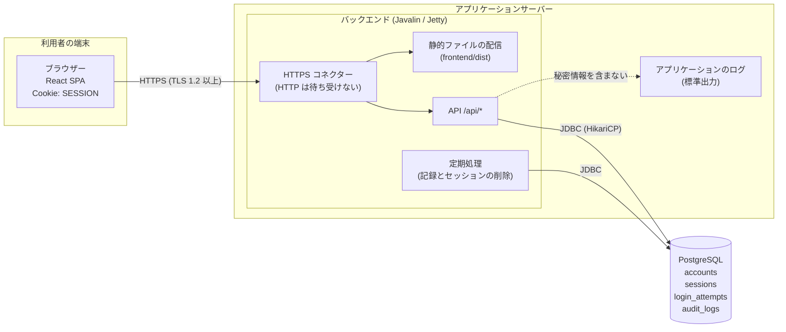
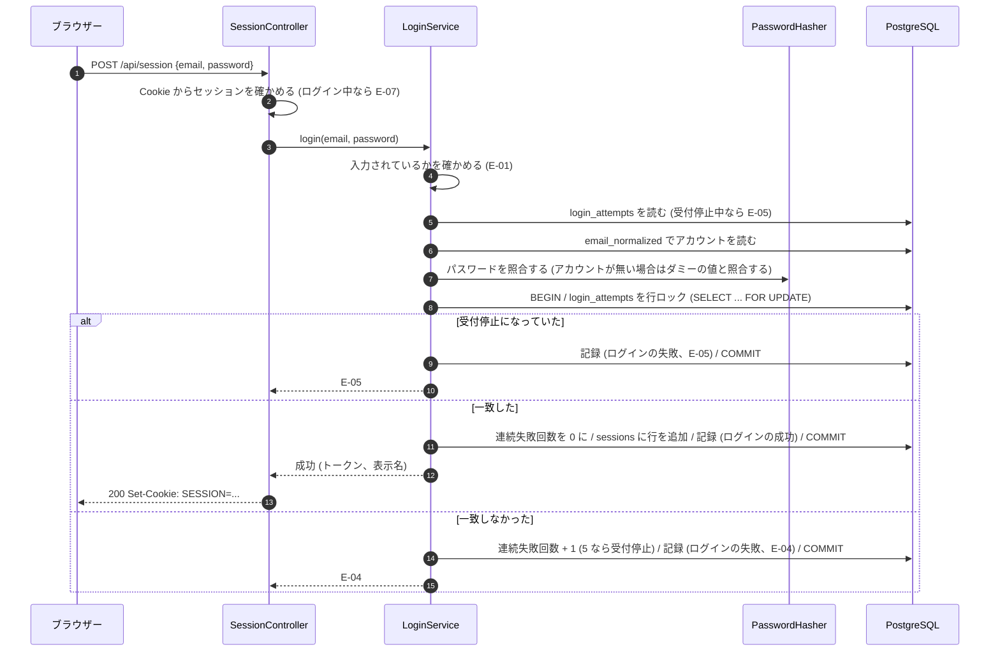
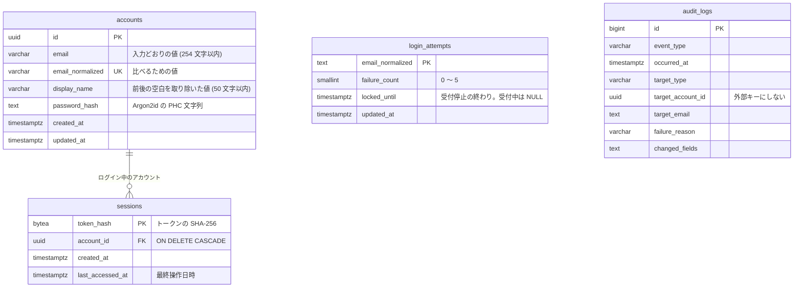

# アーキテクチャ設計: ユーザーの認証機能

## 1. この文書について

この文書は、[要件定義書](requirements.md)、[仕様書](specification.md)、[概念モデル](domain-model.md) をもとに、ユーザーの認証機能を実現するアーキテクチャを定める。後の実装計画と実装は、この文書に沿って行う。

- 振る舞い (処理の順番、知らせる内容、境界値) は、仕様書を正とする。この文書は、その振る舞いを「どの構成要素が、どのデータを使って実現するか」を定める
- 文中の OP-n、E-nn は仕様書の操作と異常の番号、FR-n、NFR-n は要件定義書の要件の番号、A-n、L-n、C-n、O-n、R-n、S-n は概念モデルの制約の番号を指す

### 1.1 リポジトリの今の状態と前提

この文書を書いた時点で、リポジトリにはアプリケーションのコード (フロントエンド、バックエンド) がまだ無い。ルートの `package.json` は、コミットメッセージの検査 (commitlint、husky) と Coding Agent のスクリプトのためのもので、アプリケーションとは関係しない。`.gitignore` には、Node.js (Vite) と Java (Maven / Gradle) の出力を除外する設定がある。

そのため、この機能でアプリケーションの土台も作る。技術構成は、このリポジトリで決まっている「フロントエンドは React、バックエンドは Javalin」に従う。

## 2. 全体の構成

### 2.1 構成要素

| 構成要素 | 技術 | 役割 |
| --- | --- | --- |
| ブラウザー | ― | 利用者が使う。React で作った画面 (SPA) を動かし、バックエンドの API を呼ぶ。ログイン中の状態を表す情報を Cookie として持つ |
| フロントエンド | React + TypeScript、Vite でビルド | 画面と、API の呼び出し。ビルドした静的ファイル (HTML、JavaScript、CSS) をバックエンドが配信する |
| バックエンド | Java 21、Javalin、Jetty (Javalin に組み込み) | HTTPS の終端、静的ファイルの配信、API の処理、ログイン状態の管理、記録の書き込み、定期的な削除処理 |
| データベース | PostgreSQL 16 | アカウント、ログイン状態 (セッション)、ログインの受付、記録を保存する |
| アプリケーションのログ | 標準出力 (Logback) | 動作の確認と障害の調査のためのログ。仕様書 11 章の「記録」とは別のもの |

### 2.2 構成図



### 2.3 構成要素の間のやり取り

| やり取り | 方式 | 内容 |
| --- | --- | --- |
| ブラウザー → バックエンド (画面) | HTTPS の GET | `index.html` と、ビルドした JavaScript、CSS を受け取る。API 以外のパスは、すべて `index.html` を返す (SPA のルーティングのため) |
| ブラウザー → バックエンド (API) | HTTPS、JSON (`Content-Type: application/json`) | 5 章の API。ログイン中の状態を表す情報は、Cookie `SESSION` で送る。JavaScript からは読めない (HttpOnly) |
| バックエンド → データベース | JDBC。コネクションプールは HikariCP | アカウントの読み書き、セッションの作成、確認、削除、ログインの受付の更新、記録の書き込み。1 つの操作の状態の変化と記録は、1 つのトランザクションで書く (8.3) |
| 定期処理 → データベース | JDBC | 90 日を過ぎた記録、期限の切れたセッション、不要になったログインの受付の行を削除する (9.6) |
| バックエンド → アプリケーションのログ | SLF4J + Logback、標準出力 | 要求の方法、パス、応答の状態、処理時間、例外。パスワードとセッションの情報は書かない (9.3) |

フロントエンドとバックエンドは同じオリジン (同じホスト名とポート) から配信する。CORS の設定は行わない (ほかのオリジンからの API の呼び出しは許さない)。

### 2.4 操作の流れの例: OP-2 ログイン



## 3. ディレクトリとモジュールの構成

### 3.1 リポジトリのディレクトリ

```text
/
├── package.json            (既存。commitlint と husky のため。変更しない)
├── compose.yaml            (開発用の PostgreSQL を起動する)
├── backend/                (Javalin のアプリケーション)
│   ├── settings.gradle.kts
│   ├── build.gradle.kts
│   ├── gradlew, gradlew.bat, gradle/wrapper/
│   └── src/
│       ├── main/java/com/example/app/...
│       ├── main/resources/
│       │   ├── db/migration/   (Flyway のマイグレーション)
│       │   └── logback.xml
│       └── test/java/com/example/app/...
├── frontend/               (React のアプリケーション)
│   ├── package.json
│   ├── vite.config.ts
│   ├── tsconfig.json
│   ├── index.html
│   └── src/...
└── perf/                   (性能試験のスクリプト)
    └── auth.js             (k6)
```

### 3.2 バックエンドのパッケージ

ルートのパッケージは `com.example.app` とする。機能ごとにパッケージを分け、各パッケージの中で「API (Controller)」「処理 (Service)」「データの読み書き (Repository)」を分ける。

```text
com.example.app
├── Main.java                     起動。設定を読み、各クラスを組み立てて Javalin を起動する
├── config/
│   └── AppConfig.java            環境変数から設定を読む (4 章)
├── web/
│   ├── WebServer.java            Javalin の設定 (HTTPS、静的ファイル、ルート、ハンドラーの登録)
│   ├── ErrorCode.java            E-01 ～ E-08、E-90 の列挙。HTTP の状態とメッセージを持つ
│   ├── ApiException.java         異常を表す例外。ErrorCode と、入力ごとの誤り (FieldError の一覧) を持つ
│   ├── FieldError.java           入力の名前と、知らせる内容
│   ├── ErrorHandler.java         ApiException と想定外の例外を、5.2 のエラーの応答に変える
│   ├── JsonBody.java             要求の本文を読む。JSON でない、または形が違う場合は空のオブジェクトとして扱う
│   ├── SecurityHeaders.java      応答に共通のヘッダーを付ける (9.1)
│   └── RequestLogger.java        アプリケーションのログに要求の概要を書く (9.3)
├── db/
│   ├── Database.java             HikariCP と Jdbi の組み立て、Flyway の実行
│   └── Tx.java                   トランザクションの補助
├── auth/
│   ├── value/
│   │   ├── EmailAddress.java     メールアドレス。入力どおりの値と、比べるための値 (normalized) を持つ
│   │   ├── DisplayName.java      表示名。前後の空白を取り除いた値を持つ
│   │   ├── RawPassword.java      入力されたパスワード。toString() は "********" を返す
│   │   └── InputValidator.java   仕様書 5.1 の検査。FieldError の一覧を返す
│   ├── password/
│   │   └── PasswordHasher.java   Argon2id によるハッシュの作成と照合
│   ├── account/
│   │   ├── Account.java          アカウント (id、email、displayName、passwordHash)
│   │   ├── AccountRepository.java
│   │   └── AccountService.java   OP-1、OP-4 ～ OP-7 の処理
│   ├── session/
│   │   ├── Session.java          セッション (tokenHash、accountId、lastAccessedAt)
│   │   ├── SessionRepository.java
│   │   ├── SessionService.java   トークンの発行、確認、最終操作日時の更新、削除
│   │   ├── SessionCookie.java    Cookie の発行と消去
│   │   └── CurrentSession.java   要求ごとの、確かめた結果 (ログイン中か、どのアカウントか)
│   ├── login/
│   │   ├── LoginAttempt.java     ログインの受付 (emailNormalized、failureCount、lockedUntil)
│   │   ├── LoginAttemptRepository.java
│   │   └── LoginService.java     OP-2 の処理
│   ├── audit/
│   │   ├── AuditEvent.java       記録 1 件 (出来事の種類、日時、対象、失敗の理由、変更した項目)
│   │   ├── AuditLogRepository.java
│   │   └── AuditLogger.java      記録を書き込む
│   ├── api/
│   │   ├── AccountController.java   POST /api/accounts、/api/accounts/{accountId}...
│   │   ├── SessionController.java   POST /api/session、DELETE /api/session
│   │   ├── MeController.java        /api/me 以下
│   │   └── dto/                     要求と応答の record
│   └── maintenance/
│       └── CleanupJob.java       定期的な削除処理 (9.6)
```

依存の向きは `api` → `account` / `login` / `session` → `audit` / `password` / `value` → (なし) とする。`Repository` は `Jdbi` だけに依存し、ほかの機能のパッケージに依存しない。日時は、すべて `java.time.Clock` を受け取って求める (試験で時刻を進められるようにするため)。

### 3.3 フロントエンドの構成

```text
frontend/src
├── main.tsx                  起動。AuthProvider と Router を組み立てる
├── App.tsx                   ルートの定義 (下表)
├── api/
│   ├── client.ts             fetch の共通処理。JSON の送受信と、エラーの応答を ApiError に変える
│   ├── types.ts              API の要求と応答の型、ErrorCode の型
│   └── auth.ts               5 章の各 API を呼ぶ関数 (register、login、logout、getMe、updateProfile、changePassword、deleteAccount)
├── auth/
│   ├── AuthContext.tsx       ログイン状態 (確認中 / 未ログイン / ログイン中) と、ログイン中のアカウントの表示名とメールアドレスを持つ
│   ├── RequireAuth.tsx       ログイン中でなければ /login へ移る
│   └── RequireGuest.tsx      ログイン中なら /account へ移る
├── pages/
│   ├── RegisterPage.tsx      OP-1
│   ├── LoginPage.tsx         OP-2
│   ├── AccountPage.tsx       OP-4 と OP-5 (今の値を表示し、変更する)
│   ├── PasswordPage.tsx      OP-6
│   └── DeleteAccountPage.tsx OP-7
└── components/
    ├── FieldError.tsx        入力ごとの誤りの表示
    ├── Message.tsx           操作の結果 (成功、異常) の表示
    └── LogoutButton.tsx      OP-3
```

| パス | 画面 | ガード |
| --- | --- | --- |
| `/register` | 利用者登録 | RequireGuest |
| `/login` | ログイン | RequireGuest |
| `/account` | 自分のアカウントの情報の表示と変更 | RequireAuth |
| `/account/password` | パスワードの変更 | RequireAuth |
| `/account/delete` | アカウントの削除 | RequireAuth |
| `/` とそれ以外 | ログイン中なら `/account`、未ログインなら `/login` へ移る | ― |

フロントエンドの決まり:

- 起動したときに `GET /api/me` を呼び、200 ならログイン中、E-06 なら未ログインとする。結果が出るまでは「確認中」とし、ガードは画面を出さずに待つ
- どの API の応答でも E-06 を受け取ったら、AuthContext を未ログインにして `/login` へ移り、E-06 のメッセージを表示する (期限切れ、ほかのブラウザーでの削除を含む)。入力していた内容は送り直さない (仕様書 6.8)
- 入力の検査は、フロントエンドでは行わない。`<form noValidate>` とし、HTML の `required` や `maxLength` も付けない。誤りは、API の応答の `fieldErrors` をそのまま入力の近くに表示する
- パスワードの入力欄は `type="password"` とし、送信の後は (成功しても失敗しても) 空にする。異常の応答を受けても、パスワードの入力欄に値を戻さない (NFR-3、仕様書 7.1)
- 成功と異常のメッセージは、API の応答の `message` をそのまま表示する。メッセージの文言をフロントエンドに持たない
- ログイン中の状態を表す情報 (Cookie) は HttpOnly のため、JavaScript から読まない。localStorage や sessionStorage にも、ログインに関わる情報を保存しない

## 4. 設定

バックエンドは、次の環境変数から設定を読む (`AppConfig`)。必須の値が無い場合は、起動を中止する。

| 環境変数 | 必須 | 既定値 | 意味 |
| --- | --- | --- | --- |
| `APP_HTTPS_PORT` | いいえ | `8443` | HTTPS で待ち受けるポート |
| `APP_TLS_CERT_PATH` | はい | ― | サーバー証明書 (PEM) のパス |
| `APP_TLS_KEY_PATH` | はい | ― | 秘密鍵 (PEM) のパス |
| `APP_DB_URL` | はい | ― | JDBC の URL (例: `jdbc:postgresql://localhost:5432/app`) |
| `APP_DB_USER` | はい | ― | データベースの利用者名 |
| `APP_DB_PASSWORD` | はい | ― | データベースのパスワード |
| `APP_DB_POOL_SIZE` | いいえ | `20` | コネクションプールの最大の数 |
| `APP_STATIC_DIR` | いいえ | `../frontend/dist` | フロントエンドのビルド結果のディレクトリ |

開発の環境では、`compose.yaml` で PostgreSQL を起動し、自己署名の証明書を使う。フロントエンドの開発では Vite の開発サーバー (`http://localhost:5173`) を使い、`/api` を `https://localhost:8443` へ中継する (`vite.config.ts` の `server.proxy`、`secure: false`)。`localhost` はブラウザーが安全なコンテキストとして扱うため、`Secure` 付きの Cookie も使える。

## 5. API

### 5.1 共通の決まり

- すべての API は `/api` の下に置く。要求と応答の本文は JSON (UTF-8) とする
- 本文を送る要求 (POST、PUT) は、`Content-Type: application/json` でなければ、本文が無いものとして扱う (すべての入力が「入力されていない」になる)。本文が JSON として読めない場合、JSON のオブジェクトでない場合も同じとする。入力の値が文字列でない (数値、null など) 場合は、その入力が無いものとして扱う
- 要求の本文の大きさの上限は 64 KB とする (Javalin の `http.maxRequestSize`)
- ログイン中の状態を表す情報は、Cookie `SESSION` で受け渡す (6.2)。応答の本文には含めない
- 応答には、すべて `Cache-Control: no-store` を付ける
- 成功の応答には、利用者に知らせる内容を `message` に入れる
- 対象のアカウントを指定する入力 (アカウントの ID など) は、どの API にも設けない (仕様書 7.2)。アカウントの ID は、API の入力にも出力にも現れない

### 5.2 エラーの応答

異常系では、次の形の本文を返す。

```json
{
  "error": {
    "code": "E-01",
    "message": "入力に誤りがあります",
    "fieldErrors": [
      { "field": "email", "message": "メールアドレスの形式で入力してください" },
      { "field": "password", "message": "パスワードは 12 文字以上で入力してください" }
    ]
  }
}
```

- `fieldErrors` は E-01 のときだけ付ける。ほかの異常では付けない
- 本文には、入力されたパスワードも、ログイン中の状態を表す情報も含めない (NFR-3、S-1)。入力の値そのものは返さない (フロントエンドは、パスワード以外の入力欄の値を消さずに残すことで、入力し直さずに済むようにする)

| 番号 | HTTP の状態 | `message` | 補足 |
| --- | --- | --- | --- |
| E-01 | 400 | 入力に誤りがあります | `fieldErrors` に、入力ごとの内容 (5.3) を入れる |
| E-02 | 400 | パスワードが正しくありません | |
| E-03 | 409 | このメールアドレスは使えません | |
| E-04 | 401 | メールアドレスまたはパスワードが正しくありません | どちらが誤っているかは知らせない |
| E-05 | 429 | 続けてログインに失敗したため、しばらくログインできません | `Retry-After` ヘッダーは付けない (再開までの時間の目安を知らせない) |
| E-06 | 401 | ログインが必要です | |
| E-07 | 409 | 既にログインしています | |
| E-08 | 403 | その操作は行えません | 対象のアカウントがあるかどうかで内容を変えない |
| E-90 | 503 | 処理できませんでした。時間をおいてやり直してください | 原因の詳細は返さない。想定外の例外もすべて E-90 とする |

E-04 と E-06 はどちらも 401 だが、フロントエンドは `code` で見分ける。

### 5.3 入力ごとの誤りの内容

`fieldErrors` の `field` と `message` は次のとおりとする。検査の規則 (1 つの入力につき、番号の小さい条件の内容だけを返す、など) は仕様書 5.1 のとおりとする。

| API | `field` | 条件を満たさない場合の `message` (上から順に検査する) |
| --- | --- | --- |
| OP-1、OP-5 | `email` | メールアドレスを入力してください / メールアドレスは 254 文字以内で入力してください / メールアドレスの形式で入力してください |
| OP-1、OP-5 | `displayName` | 表示名を入力してください / 表示名は 50 文字以内で入力してください |
| OP-1 | `password` | パスワードは 12 文字以上で入力してください / パスワードは 128 文字以内で入力してください |
| OP-6 | `newPassword` | パスワードは 12 文字以上で入力してください / パスワードは 128 文字以内で入力してください |
| OP-2 | `email` | メールアドレスを入力してください |
| OP-2 | `password` | パスワードを入力してください |
| OP-6 | `currentPassword` | パスワードを入力してください |
| OP-7 | `password` | パスワードを入力してください |

- 「入力されていない」は、入力が無い、または空文字列 (0 文字) であることをいう。OP-2 の `email` と、照合に使うパスワード (OP-2 の `password`、OP-6 の `currentPassword`、OP-7 の `password`) は、1 文字以上あれば、空白だけでも入力されているものとする
- OP-1 の `password` と OP-6 の `newPassword` が入力されていない場合は、0 文字として「12 文字以上で入力してください」を返す (仕様書 5.1 の表のとおり)
- 文字数は、Unicode の符号位置の数 (`String.codePointCount`) で数える
- 表示名の前後の空白は `String.strip()` で取り除く (`Character.isWhitespace` が真の文字。半角スペース、全角スペース U+3000、タブ、改行を含む)
- メールアドレスの形式の検査は、仕様書 5.1 の 4 つの条件をそのまま実装する。正規表現のライブラリーや `jakarta.mail` などの検査は使わない。「空白」は、`Character.isWhitespace` または `Character.isSpaceChar` が真の文字とする

### 5.4 操作と API の対応

| 操作 | メソッドとパス | ログイン状態の条件 | 成功の状態 |
| --- | --- | --- | --- |
| OP-1 利用者登録 | `POST /api/accounts` | 未ログイン (ログイン中なら E-07) | 201 |
| OP-2 ログイン | `POST /api/session` | 未ログイン (ログイン中なら E-07) | 200 |
| OP-3 ログアウト | `DELETE /api/session` | 問わない | 200 |
| OP-4 自分のアカウントの情報を見る | `GET /api/me` | ログイン中 (でなければ E-06) | 200 |
| OP-5 表示名とメールアドレスの変更 | `PUT /api/me/profile` | ログイン中 (でなければ E-06) | 200 |
| OP-6 パスワードの変更 | `PUT /api/me/password` | ログイン中 (でなければ E-06) | 200 |
| OP-7 アカウントの削除 | `POST /api/me/delete` | ログイン中 (でなければ E-06) | 200 |
| (ほかのアカウントの指定) | すべてのメソッドの `/api/accounts/{accountId}`、`/api/accounts/{accountId}/*` | ログイン中 (でなければ E-06) | (常に E-08) |

「ログイン中」とは、要求の Cookie `SESSION` のトークンに対応するセッションがあり、最終操作日時から 30 分未満であることをいう (6.3)。

### 5.5 異常を判断する順番

1 つの要求が複数の異常に当てはまる場合は、次の順番で最初に当てはまったものを返す。E-90 は、どの時点でも起こりうる。

1. ログイン状態の条件 (E-06、E-07)
2. ほかのアカウントの指定 (E-08)
3. 入力の検査 (E-01)
4. 操作ごとの判断 (E-05、E-04、E-02、E-03。各操作の項に書く順番)

### 5.6 各 API

#### 5.6.1 `POST /api/accounts` (OP-1 利用者登録)

要求:

```json
{ "email": "User@Example.com", "displayName": "山田 太郎", "password": "correct horse battery" }
```

成功 (201):

```json
{
  "message": "アカウントを作成し、ログインしました",
  "account": { "email": "User@Example.com", "displayName": "山田 太郎" }
}
```

- `Set-Cookie: SESSION=...` を付ける (6.2)
- `displayName` は前後の空白を取り除いた後の値、`email` は入力どおりの値を返す

処理 (`AccountService.register`):

1. ログイン中なら E-07 (5.5)
2. 入力を検査する。誤りがあれば E-01
3. パスワードのハッシュを作る (トランザクションの外で行う)
4. トランザクションを始める
   1. `accounts` に行を追加する。`email_normalized` の一意制約に違反したら、ロールバックして E-03
   2. `sessions` に行を追加する (`last_accessed_at` は今の日時)
   3. 記録「利用者登録の成功」を書く
5. コミットする。失敗したら E-90 (アカウントもセッションも残らない)

異常: E-01、E-03、E-07、E-90

#### 5.6.2 `POST /api/session` (OP-2 ログイン)

要求:

```json
{ "email": "user@example.com", "password": "correct horse battery" }
```

成功 (200):

```json
{ "message": "ログインしました", "account": { "displayName": "山田 太郎" } }
```

- `Set-Cookie: SESSION=...` を付ける。要求に古い `SESSION` (期限切れ、または対応するセッションが無いもの) が付いていた場合も、新しいトークンで上書きする

処理 (`LoginService.login`)。比べるためのメールアドレス (`email_normalized`) の作り方は 7.2 のとおり。

1. ログイン中なら、記録「ログインの失敗」(理由 E-07、対象はログイン中のアカウント) を書き、最終操作日時を更新して (6.4) E-07
2. `email` と `password` が入力されているかを確かめる。無ければ記録「ログインの失敗」(理由 E-01) を書いて E-01。対象は、`email` が無ければ「特定できない」(メールアドレスが入力されていない)、`email` があれば 7.4 の規則による
3. `login_attempts` を読む。`locked_until` があり、今の日時が `locked_until` より前なら、記録「ログインの失敗」(理由 E-05) を書いて E-05。パスワードは照合しない
4. `accounts` を `email_normalized` で読む。アカウントがあれば、そのパスワードのハッシュと照合する。無ければ、起動時に作ったダミーのハッシュと照合し、結果は常に「一致しない」とする (応答の時間で、アカウントがあるかどうかが分からないようにするため。FR-6)
5. トランザクションを始め、`login_attempts` の行を、無ければ追加したうえで `SELECT ... FOR UPDATE` で読む
   1. `locked_until` があり、今の日時が `locked_until` より前なら (手順 3 の後に、ほかの要求で受付停止になった場合)、記録「ログインの失敗」(理由 E-05) を書いてコミットし、E-05
   2. `locked_until` があり、今の日時が `locked_until` 以降なら、`failure_count` を 0、`locked_until` を空にする (受付停止が終わった後は 0 から数え直す)
   3. 手順 4 で一致し、かつアカウントの行が残っていて `password_hash` が手順 4 で照合した値と同じなら成功とする。`failure_count` を 0 にし、`sessions` に行を追加し、記録「ログインの成功」を書く
   4. それ以外は失敗とする。`failure_count` を 1 増やし、5 になったら `locked_until` を今の日時 + 15 分にする。記録「ログインの失敗」(理由 E-04) を書く
6. コミットする。成功なら 200、失敗なら E-04

E-90 の扱い: 手順 1 ～ 6 のどこかで E-90 になった場合は、そのトランザクションをロールバックしたうえで、別のトランザクションで記録「ログインの失敗」(理由 E-90) を 1 回だけ書こうとする。書けなくても、応答は E-90 のままとする (仕様書 7.4)。E-90 では、連続失敗回数を増やさない。

異常: E-01、E-04、E-05、E-07、E-90

#### 5.6.3 `DELETE /api/session` (OP-3 ログアウト)

要求: 本文なし

成功 (200):

```json
{ "message": "ログアウトしました" }
```

- Cookie `SESSION` に対応するセッションがあれば、`sessions` から行を削除する。無ければ (未ログイン、期限切れ、既に削除されたもの) 何もしない
- 成功の応答では、Cookie `SESSION` を消す `Set-Cookie` (`Max-Age=0`) を付ける
- 削除に失敗したら E-90 とし、Cookie を消さない。セッションの行も残る (ログイン中のまま。仕様書 6.3)
- ほかのブラウザーのセッションは削除しない (L-5)

異常: E-90

#### 5.6.4 `GET /api/me` (OP-4 自分のアカウントの情報を見る)

成功 (200):

```json
{ "account": { "email": "User@Example.com", "displayName": "山田 太郎" } }
```

- ログイン中のセッションの `account_id` でアカウントを読む。最終操作日時を更新する (6.4)
- 仕様書 6.4 に知らせる内容の定めが無いため、`message` は付けない

異常: E-06、E-90 (E-08 は 5.6.8 のパスでだけ起こる)

#### 5.6.5 `PUT /api/me/profile` (OP-5 表示名とメールアドレスの変更)

要求:

```json
{ "email": "new@example.com", "displayName": "山田 花子" }
```

成功 (200):

```json
{
  "message": "アカウントの情報を変更しました",
  "account": { "email": "new@example.com", "displayName": "山田 花子" }
}
```

処理 (`AccountService.updateProfile`):

1. ログイン中でなければ E-06
2. 要求の本文に `accountId` という名前の項目があれば、値によらず E-08 (5.6.8)
3. 入力を検査する。誤りがあれば E-01
4. トランザクションを始め、ログイン中のアカウントの行を `SELECT ... FOR UPDATE` で読む。行が無ければ (同時に OP-7 が成功した場合) E-06
5. `email`、`email_normalized`、`display_name`、`updated_at` を 1 つの `UPDATE` で変える (A-6)。`email_normalized` の一意制約に違反したら、ロールバックして E-03。自分の今のメールアドレスと同じ値 (大文字と小文字だけが違う値を含む) は、自分の行のため一意制約に違反しない
6. 最終操作日時を更新し、記録「アカウントの情報の変更」(変更した項目: 表示名、メールアドレス) を書く
7. コミットする

異常: E-01、E-03、E-06、E-08、E-90

#### 5.6.6 `PUT /api/me/password` (OP-6 パスワードの変更)

要求:

```json
{ "currentPassword": "correct horse battery", "newPassword": "another long passphrase" }
```

成功 (200):

```json
{ "message": "パスワードを変更しました" }
```

処理 (`AccountService.changePassword`):

1. ログイン中でなければ E-06
2. 本文に `accountId` があれば E-08
3. `currentPassword` が入力されているか、`newPassword` が仕様書 5.1 を満たすかを検査する。誤りがあれば E-01 (両方に誤りがあれば両方を返す)
4. `newPassword` のハッシュを作る (トランザクションの外で行う)
5. トランザクションを始め、アカウントの行を `SELECT ... FOR UPDATE` で読む。行が無ければ E-06
6. `currentPassword` を、行の `password_hash` と照合する。一致しなければ、ロールバックして E-02 (連続失敗回数には数えない)
7. `password_hash` と `updated_at` を変え、最終操作日時を更新し、記録「アカウントの情報の変更」(変更した項目: パスワード) を書く
8. コミットする。セッションは削除しない (L-5)

行ロックの中で照合するため、同じアカウントへの OP-6 が同時に行われても、1 つずつ順に照合と変更が行われる (仕様書 7.3)。

異常: E-01、E-02、E-06、E-08、E-90

#### 5.6.7 `POST /api/me/delete` (OP-7 アカウントの削除)

要求:

```json
{ "password": "correct horse battery" }
```

成功 (200):

```json
{ "message": "アカウントを削除し、ログアウトしました" }
```

処理 (`AccountService.deleteAccount`):

1. ログイン中でなければ E-06
2. 本文に `accountId` があれば E-08
3. `password` が入力されていなければ E-01
4. トランザクションを始め、アカウントの行を `SELECT ... FOR UPDATE` で読む。行が無ければ E-06
5. `password` を `password_hash` と照合する。一致しなければ、ロールバックして E-02
6. 記録「アカウントの削除」を書き、`accounts` の行を削除する。`sessions` の外部キーの `ON DELETE CASCADE` により、そのアカウントのすべてのブラウザーのセッションが同じトランザクションで削除される (L-4)
7. コミットする。成功の応答では Cookie `SESSION` を消す

OP-5、OP-6 と同じ行を `FOR UPDATE` で取り合うため、仕様書 7.3 のとおり順に処理される。OP-7 が先にコミットされた場合、後の OP-5、OP-6 は手順 4 で行が無いため E-06 になる。

異常: E-01、E-02、E-06、E-08、E-90

#### 5.6.8 ほかのアカウントの指定 (E-08)

仕様書 7.2 の「何らかの方法で自分以外のアカウントを指定した」場合を、次の 2 つとして扱う。

- `/api/accounts/{accountId}` と `/api/accounts/{accountId}/*` への、すべてのメソッドの要求。未ログインなら E-06、ログイン中なら `accountId` の値やアカウントがあるかどうかによらず E-08 とする。データベースは検索しない
- `/api/me/profile`、`/api/me/password`、`/api/me/delete` の要求の本文に `accountId` という項目がある場合。E-08 とし、操作は行わない

E-08 で終わった要求は、ログイン中のため最終操作日時を更新する (6.4)。

## 6. ログイン状態の実現

### 6.1 方式

ログイン状態は、データベースの `sessions` テーブルに置く、サーバー側のセッションで表す。

- ログイン中の状態を表す情報は、`SecureRandom` で作った 32 バイトの乱数を、Base64URL (パディングなし) にした文字列 (以下「トークン」) とする
- トークンは Cookie `SESSION` でブラウザーに渡す。データベースには、トークンそのものではなく、SHA-256 のハッシュ (`token_hash`) を保存する
- 要求のたびに、Cookie のトークンの SHA-256 を求めて `sessions` を検索する

### 6.2 Cookie

| 属性 | 値 | 理由 |
| --- | --- | --- |
| 名前 | `SESSION` | |
| `HttpOnly` | 付ける | JavaScript から読めないようにする (NFR-3) |
| `Secure` | 付ける | 暗号化された通信でだけ送る (NFR-4) |
| `SameSite` | `Strict` | ほかのサイトからの要求に Cookie を付けない |
| `Path` | `/api` | API にだけ送る |
| `Max-Age`、`Expires` | 付けない | ブラウザーを閉じたら消える。期限はサーバー側で判断する |

ログアウトと削除の成功では、同じ名前と属性で `Max-Age=0` の Cookie を返して消す。

### 6.3 ログイン中かどうかの判断

すべての `/api/*` の要求の前に、Javalin の `before` ハンドラーで `SessionService.resolve` を呼び、結果を `CurrentSession` として要求に持たせる。

1. Cookie `SESSION` が無ければ未ログイン
2. トークンの SHA-256 で `sessions` を検索する。行が無ければ未ログイン (ログアウト、削除の後のトークンを含む。L-6)
3. 今の日時が `last_accessed_at` + 30 分以降なら、未ログインとする。その行は削除する (削除に失敗しても、未ログインとして扱い続ける)。最終操作日時は更新しない (仕様書 6.8)
4. それ以外はログイン中とし、`account_id` を持たせる

この時点では、最終操作日時を更新しない (6.4)。

### 6.4 最終操作日時の更新

仕様書 6.8 では、ログイン中の利用者の操作は、成功しても異常系 (E-90 を除く) で終わっても最終操作日時を更新し、E-90 で終わった操作は更新しない。これを次のように実現する。

| 操作の結果 | 更新の仕方 |
| --- | --- |
| 成功 (OP-4 ～ OP-6) | 操作の状態の変化と同じトランザクションで `UPDATE sessions SET last_accessed_at = 今の日時` を行う。コミットに失敗すれば、ほかの変化と一緒に取り消され、E-90 になる |
| 異常系 E-01 ～ E-08 (ログイン中に行った操作) | これらの異常では、アカウントの状態を変えない (仕様書 7.1)。エラーの応答を返す前に、別のトランザクションで最終操作日時を更新する。OP-2 の E-07 では、記録の書き込みと同じトランザクションで更新する。更新に失敗した場合は、応答を E-90 に変える (状態の変化は何も残らない) |
| E-90 | 更新しない。トランザクションはロールバックする |
| OP-3、OP-7 の成功 | セッションを削除するため、更新しない |

### 6.5 セッションを作る、終える

| きっかけ | 処理 |
| --- | --- |
| OP-1、OP-2 の成功 | 新しいトークンを作り、`sessions` に行を追加する。ログインのたびに新しいトークンにする (以前のトークンを使い回さない) |
| OP-3 | そのブラウザーのセッションの行を削除する |
| OP-7 | `accounts` の行の削除に連動して、そのアカウントのすべてのセッションの行が削除される (`ON DELETE CASCADE`) |
| 期限切れ | 6.3 の手順 3 で削除する。要求が来ないまま残った行は、定期処理で削除する (9.6) |
| OP-6 | セッションは変えない (L-5) |

## 7. データの持ち方

### 7.1 テーブルの一覧

データベースは PostgreSQL とし、スキーマの作成と変更は Flyway のマイグレーション (`backend/src/main/resources/db/migration/V1__create_auth_tables.sql`) で行う。日時はすべて `timestamptz` (UTC) とし、値はアプリケーションの `Clock` で求めて渡す (SQL の `now()` は使わない)。



`login_attempts` と `audit_logs` は `accounts` と外部キーで結ばない。ログインの受付はアカウントがあるかどうかによらず存在し (C-1)、記録はアカウントを削除した後も残す (R-6) ため。

### 7.2 `accounts` (アカウント)

| 列 | 型 | 制約 | 内容 |
| --- | --- | --- | --- |
| `id` | `uuid` | 主キー | アプリケーションで `UUID.randomUUID()` により作る。API には出さない |
| `email` | `varchar(254)` | NOT NULL | 利用者が入力したとおりのメールアドレス |
| `email_normalized` | `varchar(254)` | NOT NULL、一意 (`accounts_email_normalized_key`) | `email` の英字の大文字 (`A` ～ `Z`) だけを小文字にした値 |
| `display_name` | `varchar(50)` | NOT NULL | 前後の空白を取り除いた表示名 |
| `password_hash` | `text` | NOT NULL | 8.1 の PHC 形式の文字列 |
| `created_at` | `timestamptz` | NOT NULL | 作成した日時 |
| `updated_at` | `timestamptz` | NOT NULL | 最後に変更した日時 |

- `email_normalized` は、`A` ～ `Z` の 26 文字だけを `a` ～ `z` に変える (仕様書 5.2 の「英字の大文字と小文字を区別せずに」)。`String.toLowerCase` は英字以外の文字 (例: `É`) も変えるため使わない
- PostgreSQL の `varchar(n)` は文字数で数えるため、仕様書の文字数の上限と食い違わない。上限の検査はアプリケーションで行い、列の長さは誤ったデータが入らないための備えとする
- アカウントの削除は、行の削除 (物理削除) とする。削除したアカウントのメールアドレスは、一意制約の対象から外れ、すぐに OP-1 と OP-5 で使える (FR-15、A-2)

### 7.3 `sessions` (ログイン状態)

| 列 | 型 | 制約 | 内容 |
| --- | --- | --- | --- |
| `token_hash` | `bytea` | 主キー | トークンの SHA-256 (32 バイト) |
| `account_id` | `uuid` | NOT NULL、`accounts(id)` への外部キー、`ON DELETE CASCADE` | ログイン中のアカウント |
| `created_at` | `timestamptz` | NOT NULL | ログインした日時 |
| `last_accessed_at` | `timestamptz` | NOT NULL | 最終操作日時 |

インデックス: `account_id` (削除の連動のため)、`last_accessed_at` (定期処理のため)。

行があり、`last_accessed_at` から 30 分未満のものが「ログイン中」、それ以外 (行が無い、30 分以上経った) が「未ログイン」にあたる。

### 7.4 `login_attempts` (ログインの受付)

| 列 | 型 | 制約 | 内容 |
| --- | --- | --- | --- |
| `email_normalized` | `text` | 主キー | ログインで入力したメールアドレスを、7.2 と同じ規則で変えた値。ログインでは文字数を検査しないため `text` とする |
| `failure_count` | `smallint` | NOT NULL、`CHECK (failure_count BETWEEN 0 AND 5)` | 連続失敗回数 |
| `locked_until` | `timestamptz` | NULL を許す | 5 回目の失敗の日時 + 15 分。受付中は NULL |
| `updated_at` | `timestamptz` | NOT NULL | 最後に変更した日時 |

- 行が無いメールアドレスは「受付中、連続失敗回数 0」とみなす
- 受付停止の判断は「`locked_until` が NULL でなく、今の日時 < `locked_until`」とする。今の日時が `locked_until` ちょうど以降なら受付停止は終わっている (仕様書 8.3 の「15 分ちょうど以上」)
- 概念モデルの「5 回目の失敗の日時」は、`locked_until` - 15 分にあたる。受付停止の長さを決めるのに必要なのは終わりの日時だけのため、`locked_until` だけを持つ
- 同じメールアドレスへの失敗が同時に起きても、行ロック (`SELECT ... FOR UPDATE`) の中で 1 ずつ増やすため、漏れなく数えられる (C-5)

記録の対象のメールアドレス (7.5 の `target_email`) を決めるときの「入力したメールアドレスを持つアカウント」の検索も、`email_normalized` で行う。

### 7.5 `audit_logs` (記録)

| 列 | 型 | 制約 | 内容 |
| --- | --- | --- | --- |
| `id` | `bigint` | 主キー (`GENERATED ALWAYS AS IDENTITY`) | |
| `event_type` | `varchar(32)` | NOT NULL、値は下表のどれか | 出来事の種類 |
| `occurred_at` | `timestamptz` | NOT NULL | 出来事の日時 |
| `target_type` | `varchar(32)` | NOT NULL、`ACCOUNT`、`EMAIL`、`UNIDENTIFIED` のどれか | 対象の種類 |
| `target_account_id` | `uuid` | `target_type` が `ACCOUNT` のときだけ NOT NULL | 対象のアカウントの `id`。外部キーにしない |
| `target_email` | `text` | 下記 | 対象のアカウントのその時点のメールアドレス、または入力したメールアドレス |
| `failure_reason` | `varchar(8)` | `event_type` が `LOGIN_FAILED` のときだけ NOT NULL。`E-01`、`E-04`、`E-05`、`E-07`、`E-90` のどれか | 失敗の理由 |
| `changed_fields` | `text` | `event_type` が `ACCOUNT_UPDATED` のときだけ NOT NULL | 変更した項目の名前。`DISPLAY_NAME`、`EMAIL`、`PASSWORD` をカンマでつないだもの |

インデックス: `occurred_at` (定期処理のため)。

| `event_type` | 出来事 | 対象 |
| --- | --- | --- |
| `REGISTERED` | 利用者登録の成功 | `ACCOUNT` (作成したアカウント) |
| `LOGIN_SUCCEEDED` | ログインの成功 | `ACCOUNT` |
| `LOGIN_FAILED` | ログインの失敗 | 7.5.1 のとおり |
| `ACCOUNT_UPDATED` | アカウントの情報の変更 | `ACCOUNT`。OP-5 は `DISPLAY_NAME,EMAIL`、OP-6 は `PASSWORD` |
| `ACCOUNT_DELETED` | アカウントの削除 | `ACCOUNT` (削除したアカウント) |

#### 7.5.1 ログインの失敗の対象

| 状況 | `target_type` | `target_account_id` | `target_email` |
| --- | --- | --- | --- |
| ログイン中に行った (E-07) | `ACCOUNT` | ログイン中のアカウント | そのアカウントのメールアドレス |
| 入力したメールアドレスを持つアカウントがある | `ACCOUNT` | そのアカウント | そのアカウントのメールアドレス |
| 入力したメールアドレスを持つアカウントが無い | `EMAIL` | NULL | 入力したメールアドレス (入力どおり) |
| メールアドレスが入力されていない (E-01) | `UNIDENTIFIED` | NULL | NULL (「メールアドレスが入力されていない」ことを表す) |

`target_type` が `UNIDENTIFIED` になるのはメールアドレスが入力されていない場合だけとし、`CHECK` 制約で `event_type = 'LOGIN_FAILED' AND failure_reason = 'E-01'` に限る。`ACCOUNT` 以外の対象は `LOGIN_FAILED` に限る (R-4)。

- 記録には、パスワード (ハッシュを含む) とトークン (ハッシュを含む) の列を設けない (R-3)
- 記録を見る API は設けない (仕様書 11 章)

### 7.6 データベースの権限

アプリケーションが使うデータベースの利用者には、4 つのテーブルへの `SELECT`、`INSERT`、`UPDATE`、`DELETE` だけを与える。Flyway のマイグレーションは、起動時に同じ利用者で行う (`Database.java`)。`audit_logs` の `UPDATE` は、アプリケーションのコードから行わない。

## 8. 横断的な仕組み

### 8.1 パスワードのハッシュ (`PasswordHasher`)

- 方式は Argon2id とし、Bouncy Castle (`org.bouncycastle:bcprov-jdk18on`) の `Argon2BytesGenerator` を使う
- パラメーターの初期値は、メモリー 19 MiB (`m=19456`)、反復 2 回 (`t=2`)、並列度 1 (`p=1`)、ソルト 16 バイト (`SecureRandom`)、ハッシュ 32 バイトとする
- 保存する形は PHC 形式の文字列 `$argon2id$v=19$m=19456,t=2,p=1$<ソルト>$<ハッシュ>` とする。照合のときは、保存した文字列のパラメーターを使う (後でパラメーターを変えても、古いハッシュを照合できる)
- パスワードは UTF-8 のバイト列にしてからハッシュにする。前後の空白を含め、入力どおりの値を使う
- 照合の結果の比べ方は、`MessageDigest.isEqual` (時間が一定の比べ方) とする
- 同時に計算するハッシュの数を `Semaphore` で CPU のコア数までに抑える (メモリーの使いすぎを防ぐため。9.2)
- 起動時に、乱数のパスワードからダミーのハッシュを 1 つ作っておく (5.6.2 の手順 4)

### 8.2 トランザクション

- データベースへの接続は HikariCP (最大 `APP_DB_POOL_SIZE` 本)、SQL の実行は Jdbi 3 (`jdbi3-core`、`jdbi3-postgres`) で行う。トランザクションの分離レベルは `READ COMMITTED` (PostgreSQL の既定) とする
- 状態を変える操作は、状態の変化、最終操作日時の更新、記録の書き込みを 1 つのトランザクションで行う (R-1、仕様書 7.4)。記録を書けなければ、状態の変化も残らない
- 同時に行われた操作の整合は、次の仕組みで保つ

| 仕様書 7.3 の状況 | 仕組み |
| --- | --- |
| 同じメールアドレスへの OP-1、OP-5 が同時に行われた | `accounts.email_normalized` の一意制約。違反した側を E-03 にする (A-1) |
| 同じアカウントへの OP-5 が同時に行われた | アカウントの行の `FOR UPDATE`。後に処理されたものの値が残る |
| 同じアカウントへの OP-6 が同時に行われた | アカウントの行の `FOR UPDATE` の中で、今のパスワードの照合と変更を行う |
| OP-5 と OP-6 が同時に行われた | 同じ行を `FOR UPDATE` で順に処理する。変える列が重ならないため、どちらも 5.6.5、5.6.6 のとおりに成否が決まる |
| OP-7 と OP-5、OP-6 が同時に行われた | 同じ行を `FOR UPDATE` で取り合う。OP-7 が先なら、後の操作は行が無いため E-06 |
| OP-7 の後に、ほかのブラウザーで OP-4 ～ OP-7 を行った | `ON DELETE CASCADE` でセッションが消えているため、6.3 で未ログインになり E-06 |
| 同じメールアドレスへのログインの失敗が同時に起きた | `login_attempts` の行の `FOR UPDATE` の中で 1 ずつ増やす |

- パスワードのハッシュの作成 (OP-1 のパスワード、OP-6 の新しいパスワード) は、トランザクションを始める前に行い、接続を握る時間を短くする。ロックの中で必要な照合 (OP-6 の今のパスワード、OP-7 のパスワード) だけを、トランザクションの中で行う

### 8.3 例外とエラーの応答

- 業務の異常 (E-01 ～ E-08) は、`ApiException` を投げて表す。`ErrorHandler` が 5.2 の形に変える
- `ApiException` 以外の例外 (データベースへの接続の失敗、SQL の失敗、想定外の例外) は、すべて E-90 とする。アプリケーションのログには例外の種類とスタックトレースを書き、応答には原因を含めない
- 一意制約の違反は、PostgreSQL の SQLSTATE `23505` と制約の名前 `accounts_email_normalized_key` で見分けて E-03 に変える。それ以外の SQL の失敗は E-90 とする

## 9. 非機能要件への対応

### 9.1 NFR-4: 暗号化された通信

- バックエンドは、Javalin の SSL プラグイン (`io.javalin.community.ssl:ssl-plugin`) で HTTPS だけを待ち受ける。HTTP (暗号化されていない) のコネクターは作らない。そのため、暗号化されていない通信の要求は、アプリケーションに届かず処理されない (仕様書 10.3)
- TLS は 1.2 以上とする。証明書と秘密鍵は `APP_TLS_CERT_PATH`、`APP_TLS_KEY_PATH` の PEM ファイルから読む
- 応答に `Strict-Transport-Security: max-age=31536000` を付け、ブラウザーが以後 HTTPS だけを使うようにする
- Cookie `SESSION` に `Secure` を付ける (6.2)

### 9.2 NFR-5: 性能 (100 人同時で 95% が 1 秒以内)

| 仕組み | 内容 |
| --- | --- |
| ハッシュの計算の時間を見積もる | Argon2id (8.1 の値) は、1 回あたり数十ミリ秒の計算になる。OP-1 と OP-2 は 1 回、OP-6 は 2 回 (照合と作成) 計算する。OP-5 は計算しない |
| 同時に計算する数を抑える | `Semaphore` で CPU のコア数までに抑え、メモリー (1 回 19 MiB) を使いすぎない。待つ要求は、空きができ次第計算する |
| 接続を握る時間を短くする | ハッシュの作成をトランザクションの外で行う (8.2)。コネクションプールは 20 本とする |
| インデックス | 検索は、すべて主キーか一意のインデックス (`accounts.id`、`accounts.email_normalized`、`sessions.token_hash`、`login_attempts.email_normalized`) で行う |
| 試験で確かめる | k6 のスクリプト `perf/auth.js` で、仮想利用者 100 人が OP-1、OP-2、OP-5、OP-6 を繰り返す負荷をかけ、操作ごとの 95 パーセンタイルの応答時間が 1 秒以内であることを確かめる (k6 の `thresholds` に `p(95)<1000` を操作ごとに書く)。満たさない場合は、まず Argon2id の反復の回数とメモリーを、OWASP の推奨の範囲で調整する |

### 9.3 NFR-1、NFR-3: パスワードとログイン中の状態を表す情報の扱い

| 出力先 | 対策 |
| --- | --- |
| データベース | パスワードは Argon2id のハッシュだけを保存する (NFR-1)。トークンは SHA-256 のハッシュだけを保存する |
| API の応答 | 応答の DTO にパスワードとトークンの項目を設けない。トークンは `Set-Cookie` ヘッダーでだけ渡す。エラーの応答に入力の値を含めない (5.2) |
| 画面 | パスワードの入力欄は `type="password"`。送信の後に空にする。トークンは HttpOnly の Cookie のため、画面のコードから読めない |
| アプリケーションのログ | `RequestLogger` は、メソッド、パスのテンプレート (`/api/me/profile` など)、応答の状態、処理時間だけを書く。要求と応答の本文、ヘッダー (Cookie、Set-Cookie を含む)、クエリ文字列は書かない。Jetty の要求のログは使わない |
| 例外のメッセージ | パスワードを持つ DTO と `RawPassword` は、`toString()` で値を出さない (`"********"` を返す)。JSON の読み取りの失敗 (Jackson の例外) は、メッセージに入力の一部が含まれうるため、例外のメッセージをログに書かず、例外の種類だけを書く。Jdbi の SQL のログ (引数の値の出力) は有効にしない |
| 記録 | `audit_logs` に、パスワードとトークンの列を設けない (7.5) |
| URL | パスワードとトークンを URL (パス、クエリ文字列) に入れない。パスワードは POST、PUT の本文でだけ送る |

### 9.4 NFR-2: ログインの連続失敗と受付停止

`login_attempts` テーブル (7.4) と、5.6.2 の処理で実現する。比べるためのメールアドレス (`email_normalized`) ごとに 1 行とし、アカウントがあるかどうかによらず数える (C-1)。行ロックで同時の失敗も漏れなく数える (C-5)。

### 9.5 FR-12: ほかの利用者のアカウントの保護

- `/api/me` 以下の API は、常にセッションの `account_id` のアカウントだけを対象にする。対象を指定する入力を持たない (O-1)
- アカウントを指定しようとした要求は E-08 にする (5.6.8)
- ほかのサイトからの要求で操作されないように、Cookie を `SameSite=Strict` にし、本文を送る要求は `Content-Type: application/json` だけを受け付ける (5.1)。CORS の許可は出さないため、ほかのオリジンのページから JSON の要求は送れない

### 9.6 NFR-6、NFR-7: 記録と保存期間

- 記録は `audit_logs` テーブル (7.5) に、状態の変化と同じトランザクションで書く (8.2)
- `CleanupJob` を、バックエンドの起動時と、その後 24 時間ごとに `ScheduledExecutorService` で動かす。処理は次のとおり
  - `audit_logs` から、`occurred_at` が今の日時 - 90 日より前の行を削除する (NFR-7、R-6)
  - `sessions` から、`last_accessed_at` が今の日時 - 30 分以前の行を削除する
  - `login_attempts` から、`failure_count = 0` かつ `locked_until` が NULL の行と、`locked_until` が今の日時以前の行を削除する。どちらも、行が無い場合 (受付中、連続失敗回数 0) と同じ意味のため、振る舞いは変わらない。`failure_count` が 1 ～ 4 の行は、成功するまで数え続けるため削除しない (仕様書 8.3)
- 1 回の削除は 1,000 行ずつに分けて行い、長いロックを避ける
- 定期処理の失敗は、アプリケーションのログに書き、次の回にやり直す。利用者の操作には影響しない

## 10. 概念モデルとの対応

### 10.1 概念の対応

| 概念 | バックエンド | データ | フロントエンド |
| --- | --- | --- | --- |
| 利用者 | (持たない) | (持たない) | (持たない) |
| ブラウザー | (Cookie `SESSION` を持つ要求の送り手として扱う) | (持たない) | ブラウザーそのもの |
| アカウント | `auth.account.Account`、`AccountRepository`、`AccountService` | `accounts` の 1 行 | AuthContext の表示名とメールアドレス |
| メールアドレス | `auth.value.EmailAddress` (`value` と `normalized()`) | `accounts.email`、`accounts.email_normalized`、`login_attempts.email_normalized`、`audit_logs.target_email` | 入力欄 |
| 表示名 | `auth.value.DisplayName` | `accounts.display_name` | 入力欄、表示 |
| パスワード | `auth.value.RawPassword` (入力)、`auth.password.PasswordHasher` | `accounts.password_hash` (ハッシュだけ) | 入力欄 (`type="password"`) |
| ログイン状態 | `auth.session.SessionService`、`CurrentSession` | `sessions` の行の有無と `last_accessed_at` (7.3) | AuthContext の「未ログイン / ログイン中」 |
| ログイン中の状態を表す情報 | トークン (`SessionCookie`) | `sessions.token_hash` (SHA-256 だけ) | Cookie `SESSION` (HttpOnly のため読まない) |
| ログインの受付 | `auth.login.LoginAttempt`、`LoginAttemptRepository`、`LoginService` | `login_attempts` の 1 行 (行が無ければ受付中、0 回) | (持たない) |
| 操作 | `auth.api` の各 Controller のハンドラー (5.4) | (持たない) | `api/auth.ts` の各関数と、各ページ |
| 異常 | `web.ErrorCode`、`web.ApiException` | `audit_logs.failure_reason` (ログインの失敗だけ) | `api/types.ts` の ErrorCode、`ApiError` |
| 記録 | `auth.audit.AuditEvent`、`AuditLogger`、`AuditLogRepository` | `audit_logs` の 1 行 | (持たない) |

### 10.2 属性と状態の対応

| 概念の属性、状態 | 対応 |
| --- | --- |
| アカウントの状態「存在する」 | `accounts` に行があること |
| ログイン状態の「ログイン中」「未ログイン」 | 6.3 の判断の結果 |
| ログイン状態の「最終操作日時」 | `sessions.last_accessed_at` |
| ログイン状態の「ログイン中のアカウント」 | `sessions.account_id` |
| ログインの受付の「受付中」「受付停止」 | `locked_until` が NULL でなく今の日時より後なら受付停止、それ以外は受付中 |
| ログインの受付の「連続失敗回数」 | `login_attempts.failure_count` |
| ログインの受付の「5 回目の失敗の日時」 | `login_attempts.locked_until` - 15 分 (7.4) |
| 記録の「出来事の種類」「出来事の日時」「失敗の理由」「変更した項目」 | `audit_logs.event_type`、`occurred_at`、`failure_reason`、`changed_fields` |
| 記録の「対象のアカウント」「対象のメールアドレス」「特定できない」 | `audit_logs.target_type`、`target_account_id`、`target_email` |
| 操作の「行った日時」 | 要求を処理するときに `Clock` で求めた日時 |

### 10.3 制約の対応

| 制約 | 実現する仕組み |
| --- | --- |
| A-1 | `accounts.email_normalized` の一意制約 |
| A-2 | 物理削除。一意制約の対象から外れる |
| A-3、A-4、A-5 | `InputValidator` (5.3)。`varchar` の長さは備え |
| A-5 (復元できない形) | `PasswordHasher` (8.1) |
| A-6 | OP-5 で 2 つの列を 1 つの `UPDATE` で変える |
| A-7 | 物理削除。削除した行は検索されない |
| A-8、L-7 | 状態の変化と記録を 1 つのトランザクションで書き、E-90 ではロールバックする (8.2、6.4) |
| L-1、L-2 | 1 つの Cookie に 1 つのトークン。`sessions.account_id` は NOT NULL で、外部キーにより存在するアカウントだけを指す |
| L-3 | 6.3 の手順 3 |
| L-4 | `sessions.account_id` の `ON DELETE CASCADE` |
| L-5 | OP-3 はそのトークンの行だけを削除する。OP-6 はセッションを変えない |
| L-6 | 削除した行のトークンは 6.3 の手順 2 で見つからない。トークンは毎回新しく作る |
| C-1 | `login_attempts.email_normalized` を主キーとし、アカウントと結ばない |
| C-2 | `failure_count` の `CHECK` 制約と、5 で `locked_until` を設定する処理 |
| C-3 | `locked_until` との比べ方 (7.4)、5.6.2 の手順 5-2 |
| C-4 | 5.6.2 の手順 3 と 5-1 (照合せず、値を変えない) |
| C-5 | `SELECT ... FOR UPDATE` の中で増やす |
| C-6 | 行がメールアドレスごとに独立している |
| O-1 | `/api/me` 以下はセッションのアカウントだけを対象にする (9.5) |
| O-2 | 6.3 の判断と 5.5 の順番 (E-06、E-07) |
| O-3 | 1 つの要求は 1 つの `ApiException` だけを応答にする |
| R-1 | 記録を同じトランザクションで書く (8.2) |
| R-2、R-4、R-5 | `audit_logs` の NOT NULL と `CHECK` 制約 (7.5) |
| R-3、S-1 | 9.3 の対策 |
| R-6 | 外部キーにしない。`CleanupJob` が 90 日を過ぎたものだけを削除する |

## 11. 判断の理由

### 11.1 ログイン状態をデータベースのセッションで持つ

- 採った理由: ログアウト (L-6)、アカウントの削除によるすべてのブラウザーのログアウト (L-4)、30 分の操作の無い期限 (L-3) を、サーバー側の行の削除と更新で確実に実現できる。アカウントの削除と同じトランザクションでセッションも消せる。データベースに置くため、バックエンドを再起動してもログイン状態が保たれ、将来バックエンドを複数台にしても共有できる
- JWT などの署名付きトークンを採らなかった理由: トークンを失効させるには結局サーバー側の状態が要る。最終操作日時の更新のたびにトークンを作り直すことになり、ほかのブラウザーのトークンを失効させる (OP-7) ことも難しい
- Javalin (Jetty) の組み込みのセッションを採らなかった理由: 既定ではメモリーに置くため、再起動で消える。あるアカウントのすべてのセッションを探して消す (OP-7) 仕組みが無く、アカウントの削除と同じトランザクションで扱えない
- トークンをハッシュにして保存する理由: データベースの内容が漏れても、そのままログイン中の状態を表す情報として使えないようにするため (NFR-3)

### 11.2 データベースに PostgreSQL を使う

- 採った理由: 一意制約、行ロック (`SELECT ... FOR UPDATE`)、トランザクションで、仕様書 7.3 の同時の操作と、7.4 の「記録が書けなければ状態を残さない」を、アプリケーションの複雑な処理なしに実現できる。`varchar(n)` が文字数で数えるため、仕様書の文字数と食い違わない
- MySQL を採らなかった理由: 文字の照合順序 (collation) によって大文字と小文字や全角と半角の比べ方が変わり、仕様書 5.2 の規則と食い違うおそれがある。PostgreSQL で同じことを実現できるため、あえて選ぶ理由が無い
- H2、SQLite などの組み込みのデータベースを採らなかった理由: 複数の要求を同時に処理するときの行ロックの振る舞いが PostgreSQL と異なり、本番と同じ条件で試験できない。試験も Testcontainers で PostgreSQL を使う
- 記録を同じデータベースに置く理由: 状態の変化と記録を 1 つのトランザクションで書けるため (R-1)。ファイルや外部のログ基盤に書く方式では、片方だけが残ることを防げない

### 11.3 パスワードのハッシュに Argon2id を使う

- 採った理由: OWASP が第一の候補として勧める、メモリーを多く使うハッシュで、総当たりに強い。Bouncy Castle は Java だけで動き、ネイティブのライブラリーが要らない
- bcrypt を採らなかった理由: 72 バイトを超える入力を切り捨てる。パスワードは 128 文字まで受け付け、UTF-8 で 72 バイトを超えうるため、後ろの文字が照合に使われなくなる
- PBKDF2 を採らなかった理由: メモリーを使わないため、GPU による総当たりに弱い
- `argon2-jvm` を採らなかった理由: ネイティブのライブラリーに依存し、動かす環境を選ぶため

### 11.4 HTTPS を Javalin で終端する

- 採った理由: HTTP のコネクターを作らないことで、「暗号化されていない通信の操作は処理しない」(仕様書 10.3) をアプリケーションの設定だけで確実に満たせる。構成要素が増えない
- nginx などのリバースプロキシーで終端する方式を採らなかった理由: プロキシーからバックエンドまでの通信の扱い (`X-Forwarded-Proto` を信じてよいか) を別に決める必要があり、要件の範囲では利点が無い。将来プロキシーを置く場合は、この判断を見直す

### 11.5 フロントエンドをバックエンドから同じオリジンで配信する

- 採った理由: Cookie を `SameSite=Strict` にでき、CORS の設定が要らない。ほかのオリジンからの要求を受け付けないことが、そのままほかのサイトからの操作 (CSRF) への備えになる
- フロントエンドを別のサーバーや別のオリジンで配信する方式を採らなかった理由: CORS で Cookie を許す設定 (`Access-Control-Allow-Credentials`) と、CSRF のトークンが必要になり、仕組みが増える

### 11.6 API の形

- `/api/me` 以下に、ログイン中のアカウントの操作をまとめる: 対象のアカウントを指定する入力を持たないことで、FR-12 を構造で守る (仕様書 7.2)
- OP-5 を `PUT` にする: 仕様書 6.5 で、表示名とメールアドレスを常に両方入力すると定めているため、一部だけを変える `PATCH` ではなく、置き換える `PUT` が合う
- OP-7 を `POST /api/me/delete` にする: パスワードを本文で送る必要がある。`DELETE` の本文は HTTP の仕様で意味が定まっておらず、中継する機器や部品によっては捨てられるため使わない。パスワードをクエリ文字列に入れることは、ログに残るため行わない (NFR-3)
- ログインとログアウトを `/api/session` の `POST` と `DELETE` にする: セッションという資源を作る、消す、と捉えると自然に表せる
- メッセージの文言をバックエンドに持つ: 仕様書で定めた知らせる内容を 1 か所で管理し、フロントエンドとの食い違いを防ぐため

### 11.7 入力の検査をバックエンドだけで行う

- 採った理由: 仕様書 5.1 の規則 (文字数の数え方、空白の扱い、番号の小さい条件だけを知らせる) を 1 か所で実装し、食い違いを防ぐ。HTML の `required` などを使うと、ブラウザーの文言で知らせることになり、仕様書の内容と違ってしまう
- フロントエンドでも同じ検査を行う方式を採らなかった理由: 同じ規則を TypeScript と Java の 2 か所で保つ必要があり、片方だけを直して食い違うおそれがある。性能の要件 (1 秒以内) は、サーバーで検査しても満たせる

### 11.8 データアクセスに Jdbi を使う

- 採った理由: SQL をそのまま書けるため、`SELECT ... FOR UPDATE`、一意制約の違反の見分け、`ON CONFLICT` を明示して書ける。トランザクションの範囲をコードで明示できる
- JPA (Hibernate) を採らなかった理由: 行ロックやフラッシュの時機が暗黙になり、仕様書 7.3 の順番の保証を確かめにくい。この機能のテーブルは 4 つで、対応付けの仕組みの利点が小さい
- 素の JDBC を採らなかった理由: 結果の詰め替えと後片付けのコードが増える

### 11.9 そのほかの選択

| 選択 | 理由 | 採らなかった選択肢 |
| --- | --- | --- |
| Java 21 | 長期サポートの版。record と switch の パターンマッチで、DTO と異常の扱いを簡潔に書ける | Java 17 (機能が少ない)、Kotlin (このリポジトリでは Java を前提とする) |
| Gradle (Kotlin DSL) | ラッパーで版を固定でき、設定が短く書ける | Maven (どちらでもよいが、設定が長くなる) |
| Flyway | SQL のファイルでスキーマの変更を管理でき、起動時に自動で適用できる | Liquibase (XML や YAML が主で、この規模では大げさ) |
| Vite + TypeScript | React の標準的なビルドの道具で、開発サーバーの中継 (4 章) が使える | Create React App (保守が止まっている) |
| React Router | 画面ごとのパスとガード (3.3) を素直に書ける | 状態だけで画面を切り替える方式 (再読み込みやブラウザーの戻るで画面を保てない) |
| 状態管理は React の Context だけ | 持つ状態がログイン状態とアカウントの 2 つの値だけで、ライブラリーが要らない | Redux など (この規模では大げさ) |
| k6 | 同時の利用者の数と、操作ごとの 95 パーセンタイルの閾値を、スクリプトで直接書ける | JMeter (設定が GUI と XML 中心で、リポジトリで管理しにくい) |

## 12. 試験の方針

| 対象 | 方法 |
| --- | --- |
| `InputValidator`、`EmailAddress`、`DisplayName` | JUnit 5 の単体試験。仕様書 8.1 の境界値をすべて試す |
| `PasswordHasher` | 単体試験。作ったハッシュで照合できること、別のパスワードで照合できないこと、PHC 形式で保存されること |
| `LoginService` の受付停止 | `Clock` を進められる試験用の時計を使い、仕様書 8.3 の境界値 (4 回の後の成功、5 回目、14 分 59 秒、15 分ちょうど) を試す |
| セッションの期限 | 試験用の時計で、29 分 59 秒と 30 分ちょうどを試す |
| API | `javalin-testtools` と Testcontainers (PostgreSQL) で、5 章の各 API の成功と異常 (E-01 ～ E-08、E-90) を試す。E-90 は、データベースを止める、または記録のテーブルへの書き込みを失敗させて試す |
| 同時の操作 | 複数のスレッドから同時に要求を送り、仕様書 7.3 の各状況の結果を確かめる |
| 秘密情報の出力 | 試験の中でログを集め、試験で使ったパスワードとトークンの文字列が含まれないことを確かめる |
| フロントエンド | Vitest と React Testing Library で、各ページの表示、`fieldErrors` の表示、E-06 での `/login` への移動、送信後にパスワードの入力欄が空になることを試す |
| 性能 | k6 (`perf/auth.js`)。9.2 のとおり |

## 13. 実装の単位の目安

実装計画で作業を分けるときの目安を、依存の順に示す。

1. バックエンドの土台: Gradle の設定、`Main`、`AppConfig`、`WebServer` (HTTPS、静的ファイル、`SecurityHeaders`、`RequestLogger`)、`ErrorCode`、`ApiException`、`ErrorHandler`、`JsonBody`。`compose.yaml`
2. データベースの土台: `Database`、`Tx`、Flyway のマイグレーション (7 章の 4 つのテーブル)
3. 値と検査: `EmailAddress`、`DisplayName`、`RawPassword`、`InputValidator`
4. パスワードのハッシュ: `PasswordHasher`
5. 記録: `AuditEvent`、`AuditLogRepository`、`AuditLogger`
6. セッション: `Session`、`SessionRepository`、`SessionService`、`SessionCookie`、`CurrentSession`、`before` ハンドラー、最終操作日時の更新 (6 章)
7. OP-1 利用者登録 と OP-4 自分のアカウントの情報を見る
8. OP-2 ログイン (ログインの受付を含む) と OP-3 ログアウト
9. OP-5、OP-6、OP-7 と E-08 の扱い (5.6.8)
10. 定期処理: `CleanupJob`
11. フロントエンドの土台: Vite、React Router、`api/client.ts`、`AuthContext`、ガード
12. フロントエンドの各ページ: 登録、ログイン、アカウントの情報、パスワードの変更、削除、ログアウト
13. 性能試験: `perf/auth.js`
