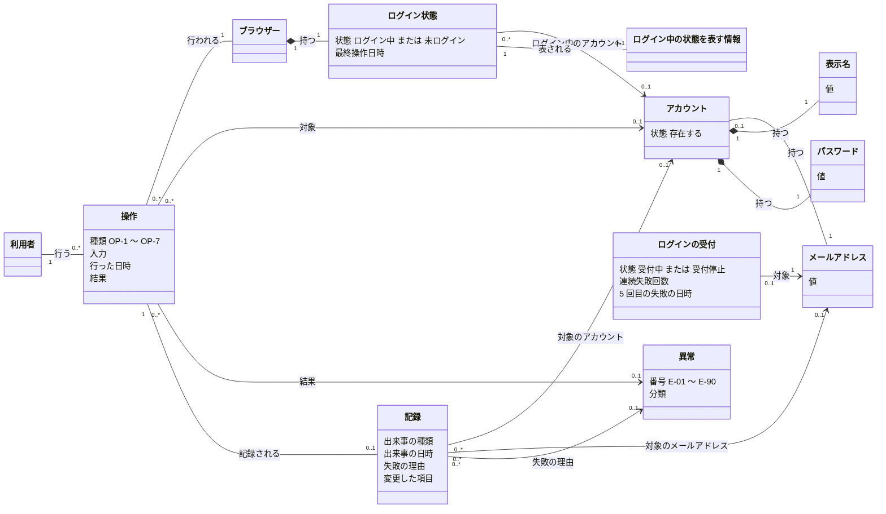

# 概念モデル: ユーザーの認証機能

## 1. この文書について

この文書は、[仕様書](specification.md) をもとに、ユーザーの認証機能に出てくる概念と、その関係を定める。概念の名前は、仕様書と [要件定義書](requirements.md) の用語に合わせる。

この文書は、業務や機能の概念を表す。データの持ち方、識別子の付け方、使う技術やフレームワークは扱わない。各概念の振る舞いの詳細 (処理の順番、知らせる内容など) は、仕様書の該当する章を正とする。

## 2. 概念の一覧

### 2.1 概要

| 名前 | 種類 | 意味 | 仕様の主な箇所 |
| --- | --- | --- | --- |
| 利用者 | 役割 | アプリケーションを使う人 | 要件定義書 3 章、仕様書 4 章 |
| ブラウザー | もの | 利用者がアプリケーションを使うためのブラウザー。ログイン状態を持つ単位 | 2 章、6.3、6.6、6.7、9.1 |
| アカウント | もの | 利用者を識別するための登録情報 | 要件定義書 3 章、6.1、6.5 ～ 6.7、9.2 |
| メールアドレス | 値 | アカウントを識別し、ログインに使う値 | 5.1、5.2 |
| 表示名 | 値 | アカウントの利用者を表す名前 | 5.1 |
| パスワード | 値 | 利用者が本人であることを確かめるための値 | 5.1、8.1、10.1 |
| ログイン状態 | 状態 | ブラウザーごとの、ログイン中か未ログインかを表す状態 | 2 章、6.8、8.2、9.1 |
| ログイン中の状態を表す情報 | もの | ブラウザーがログイン中であることを表す情報 | 6.3、7.1、10.2 |
| ログインの受付 | 状態 | メールアドレスごとの、ログインを受け付けるかどうかの状態。連続失敗回数と受付停止を含む | 8.3、9.3 |
| 操作 | こと | 利用者がアプリケーションに対して行う要求の 1 回分 (OP-1 ～ OP-7) | 2 章、4 章、6 章 |
| 異常 | こと | 操作が異常系で終わったときの、異常の種類 (E-01 ～ E-90) | 7 章 |
| 記録 | こと | 操作によって起きた出来事の記録 | 11 章 |

### 2.2 利用者

アプリケーションを使う人。ブラウザーを通してアプリケーションを使い、操作を行う。

| 属性 | 意味 |
| --- | --- |
| (なし) | この機能は、利用者そのものの情報を持たない。利用者を識別するのはアカウントで、どのアカウントの利用者かは、ブラウザーのログイン状態で決まる |

- 「自分のアカウント」とは、利用者が操作に使っているブラウザーで、ログイン中のアカウントをいう (7.2)
- 「ログイン中の利用者」とは、ログイン状態がログイン中のブラウザーで操作している利用者をいう

### 2.3 ブラウザー

利用者がアプリケーションを使うためのブラウザー。ログイン状態を 1 つ持つ。

| 属性 | 意味 |
| --- | --- |
| ログイン状態 | そのブラウザーのログイン状態 (2.8) |

- 同じアカウントで、複数のブラウザーからログインできる。ログイン状態はブラウザーごとに独立している (6.3 補足)

### 2.4 アカウント

利用者を識別するための登録情報。OP-1 利用者登録で作られ、OP-7 アカウントの削除で無くなる。

| 属性 | 意味 |
| --- | --- |
| メールアドレス | アカウントのメールアドレス (2.5)。利用者が入力したとおりの値 |
| 表示名 | アカウントの表示名 (2.6)。前後の空白を取り除いた後の値 |
| パスワード | アカウントのパスワード (2.7)。元のパスワードを復元できない形で保存する |

状態:

| 状態 | 意味 |
| --- | --- |
| 存在する | OP-1 で作られてから、OP-7 で削除されるまでの状態。ログイン、変更、削除の対象になる |

- 削除したアカウントは、存在しないものとして扱う。元に戻せない (9.2)
- 状態の遷移は、仕様書 9.2 の状態遷移図のとおりとする

### 2.5 メールアドレス

アカウントを識別し、ログインに使う値。

| 属性 | 意味 |
| --- | --- |
| 値 | 利用者が入力したとおりの文字列 (大文字と小文字を含む)。前後の空白も取り除かない |

- 2 つのメールアドレスが「同じ」かどうかは、英字の大文字と小文字を区別せずに比べる (5.2)。例: `User@Example.com` と `user@example.com` は同じ
- アカウントのメールアドレスとして受け付ける条件は、仕様書 5.1 の表と形式の定義のとおりとする (入力されていること、254 文字以内、メールアドレスの形式)
- ログイン (OP-2) で入力するメールアドレスには、文字数と形式の条件を当てはめない (6.2)

### 2.6 表示名

アカウントの利用者を表す名前。

| 属性 | 意味 |
| --- | --- |
| 値 | 入力から前後の空白 (半角スペース、全角スペース、タブ、改行) を取り除いた文字列。途中の空白は残す |

- 取り除いた後の文字数が 1 文字以上 50 文字以内であること (5.1、8.1)
- 文字数は、仕様書 2 章の「文字数」の定義 (Unicode の符号位置の数) で数える

### 2.7 パスワード

利用者が本人であることを確かめるための値。

| 属性 | 意味 |
| --- | --- |
| 値 | 入力したとおりの文字列。前後の空白も、パスワードの一部として扱う |

- アカウントのパスワードとして設定する値 (OP-1 のパスワード、OP-6 の新しいパスワード) は、12 文字以上 128 文字以内であること (5.1、8.1)
- 照合に使う値 (OP-2 のパスワード、OP-6 の今のパスワード、OP-7 のパスワード) には、文字数の条件を当てはめない。1 文字以上入力されていれば照合する (8.1)
- アカウントのパスワードは、元のパスワードを復元できない形で保存する。だれも見ることはできない (10.1)

### 2.8 ログイン状態

ブラウザーごとの、ログイン中か未ログインかを表す状態。

| 属性 | 意味 |
| --- | --- |
| 状態 | 「ログイン中」か「未ログイン」のどちらか |
| ログイン中のアカウント | ログイン中のときに、どのアカウントでログインしているか。未ログインのときは無い |
| 最終操作日時 | ログイン中の利用者が最後に操作を行った日時。未ログインのときは無い |

状態:

| 状態 | 意味 |
| --- | --- |
| 未ログイン | ログインしていない状態。ブラウザーの最初の状態 |
| ログイン中 | 利用者が本人であることを確かめた後、ログアウトするか、最終操作日時から 30 分が経つか、アカウントが削除されるまでの状態 |

- 状態の遷移は、仕様書 9.1 の状態遷移図と表のとおりとする
- 最終操作日時を更新する操作と更新しない操作は、仕様書 6.8 の補足のとおりとする (E-90 で終わった操作と、期限が切れた後の操作は更新しない)

### 2.9 ログイン中の状態を表す情報

ブラウザーがログイン中であることを表す情報。ログイン状態がログイン中の間だけ、ログイン中であることを表す。

| 属性 | 意味 |
| --- | --- |
| (この文書では定めない) | 情報の中身や形は、この概念モデルでは扱わない |

- ログアウトした後に、ログアウトの前に使っていた情報を再び使っても、ログイン中には戻らない (6.3 補足)
- 利用者に知らせる内容、エラーの内容、記録、その他のログに含めない (10.2)

### 2.10 ログインの受付

メールアドレスごとの、ログインを受け付けるかどうかの状態。仕様書 9.3 の「メールアドレスごとのログインの受付」にあたる。

| 属性 | 意味 |
| --- | --- |
| メールアドレス | 対象のメールアドレス。同じかどうかは 5.2 の規則で判断する |
| 状態 | 「受付中」か「受付停止」のどちらか |
| 連続失敗回数 | そのメールアドレスに対して、ログインに続けて失敗した回数。0 ～ 5 |
| 5 回目の失敗の日時 | 受付停止になったきっかけの、5 回目の失敗の日時。受付停止の長さ (15 分間) の起点。受付停止中だけ持つ |

状態:

| 状態 | 意味 |
| --- | --- |
| 受付中 | そのメールアドレスでのログインを受け付ける状態 |
| 受付停止 | 連続失敗回数が上限 (5) に達したために、そのメールアドレスでのログインを受け付けない状態。5 回目の失敗の日時から 15 分間続く |

- 対象のメールアドレスを持つアカウントがあるかどうかは問わない (8.3)。存在しないメールアドレスや、削除したアカウントのメールアドレスにも、ログインの受付がある
- 連続失敗回数に数える失敗は、E-04 で終わったログインだけとする。E-01、E-05、E-07、E-90 で終わったログイン、OP-6 と OP-7 の E-02 は数えない (6.2、6.6、6.7、8.3)
- 状態の遷移は、仕様書 9.3 の状態遷移図と表のとおりとする

### 2.11 操作

利用者がアプリケーションに対して行う要求の 1 回分。画面の表示や、入力の送信を含む。

| 属性 | 意味 |
| --- | --- |
| 種類 | OP-1 ～ OP-7 のどれか (下表) |
| 入力 | 操作の種類ごとの入力 (仕様書 6 章の各表の「入力」) |
| 行った日時 | 操作を行った日時。最終操作日時の更新、期限切れと受付停止の判断に使う |
| 結果 | 成功か、異常系で終わったか。異常系で終わった場合は、その異常 (2.12) |

| 種類 | 名前 | 事前の条件 (ログイン状態) | 対象のアカウント |
| --- | --- | --- | --- |
| OP-1 | 利用者登録 | 未ログイン | 作成するアカウント |
| OP-2 | ログイン | 未ログイン | 入力したメールアドレスを持つアカウント (無い場合もある) |
| OP-3 | ログアウト | 問わない | なし |
| OP-4 | 自分のアカウントの情報を見る | ログイン中 | ログイン中のアカウント |
| OP-5 | 表示名とメールアドレスの変更 | ログイン中 | ログイン中のアカウント |
| OP-6 | パスワードの変更 | ログイン中 | ログイン中のアカウント |
| OP-7 | アカウントの削除 | ログイン中 | ログイン中のアカウント |

- 各操作の振る舞いは、仕様書 6 章のとおりとする
- 仕様書 6.8 の「ログイン中の状態の期限切れ」は、利用者の操作ではなく、時間の経過によるログイン状態の変化として扱う。この概念モデルでは操作に含めない

### 2.12 異常

操作が異常系で終わったときの、異常の種類。

| 属性 | 意味 |
| --- | --- |
| 番号 | E-01 ～ E-08、E-90 のどれか |
| 分類 | 入力の誤り、競合、認証の失敗、権限の不足、外部の失敗のどれか |

- 番号ごとの条件、発生する操作、利用者に知らせる内容は、仕様書 7.1 の表のとおりとする
- ログインの失敗の記録では、失敗の理由として使う (11 章)

### 2.13 記録

操作によって起きた出来事の記録 (NFR-6)。

| 属性 | 意味 |
| --- | --- |
| 出来事の種類 | 利用者登録の成功、ログインの成功、ログインの失敗、アカウントの情報の変更、アカウントの削除のどれか |
| 出来事の日時 | 出来事が起きた日時 |
| 対象のアカウント | 出来事の対象のアカウント。ログインの失敗では、下記のとおりアカウントの代わりに別のものを対象とすることがある |
| 失敗の理由 | ログインの失敗の記録だけが持つ。E-01、E-04、E-05、E-07、E-90 のどれか |
| 変更した項目 | アカウントの情報の変更の記録だけが持つ。表示名、メールアドレス、パスワードのうち、変更した項目の名前 |

ログインの失敗の記録の対象は、次のとおりとする (11 章)。

| 状況 | 対象 |
| --- | --- |
| 入力したメールアドレスを持つアカウントがある | そのアカウント |
| 入力したメールアドレスを持つアカウントが無い | 入力したメールアドレス |
| メールアドレスが入力されていない (E-01) | 「特定できない」とし、メールアドレスが入力されていなかったことを含める |
| ログイン中に行った (E-07) | ログイン中のアカウント |

- 出来事の種類ごとの、記録する時と対象のアカウントは、仕様書 11 章の表のとおりとする
- 出来事の日時から 90 日間保存する。アカウントを削除した後も、保存期間が過ぎるまで残す (11 章、9.2)
- 利用者が記録を見る操作は無い

## 3. 概念どうしの関係

### 3.1 全体の図

### 3.2 関係の一覧

| 関係 | 意味 | 多重度 | 仕様の主な箇所 |
| --- | --- | --- | --- |
| 利用者 - 操作 (行う) | 利用者は、操作を行う。1 つの操作を行うのは 1 人の利用者 | 利用者 1 : 操作 0..* | 2 章、4 章 |
| 操作 - ブラウザー (行われる) | 操作は、いずれか 1 つのブラウザーから行われる。操作の事前の条件と結果は、そのブラウザーのログイン状態に関わる | 操作 0..* : ブラウザー 1 | 4 章、6 章 |
| ブラウザー - ログイン状態 (持つ) | ブラウザーは、ログイン状態を 1 つだけ持つ | ブラウザー 1 : ログイン状態 1 | 2 章、9.1 |
| ログイン状態 - アカウント (ログイン中のアカウント) | ログイン中のログイン状態は、1 つのアカウントでログインしている。1 つのアカウントで、複数のブラウザーからログインできる。未ログインのログイン状態は、アカウントと結びつかない | ログイン状態 0..* : アカウント 0..1 (ログイン中は 1、未ログインは 0) | 6.3 補足、6.7、9.1 |
| ログイン状態 - ログイン中の状態を表す情報 (表される) | ログイン中のログイン状態は、ログイン中の状態を表す情報で表される。未ログインのときは、ログイン中を表す情報は無い | ログイン状態 1 : 情報 0..1 | 6.3 補足、10.2 |
| アカウント - メールアドレス (持つ) | アカウントは、メールアドレスを 1 つ持つ。メールアドレスは値で、同じかどうかは 5.2 の規則で判断する。同じメールアドレスを持つ存在するアカウントは多くても 1 つ (制約 A-1) で、アカウントが無いメールアドレスもある (存在しないメールアドレス、削除したアカウントのメールアドレスなど)。アカウントが無いメールアドレスにも、ログインの受付と記録が結びつく | アカウント 0..1 : メールアドレス 1 | 要件定義書 3 章、5.2、6.1、8.3、11 章 |
| アカウント - 表示名、パスワード (持つ) | アカウントは、表示名とパスワードをそれぞれ 1 つずつ持つ | アカウント 1 : 各値 1 | 要件定義書 3 章、6.1 |
| ログインの受付 - メールアドレス (対象) | ログインの受付は、1 つのメールアドレス (5.2 の規則で同じとみなすものをまとめたもの) ごとにある。アカウントとは結びつかない | ログインの受付 0..1 : メールアドレス 1 | 5.2、8.3、9.3 |
| 操作 - アカウント (対象) | 操作の対象のアカウント。OP-4 ～ OP-7 では、常にログイン中のアカウント。OP-3 と、アカウントの無いメールアドレスでの OP-2 には、対象のアカウントは無い | 操作 0..* : アカウント 0..1 | 2.11 の表、7.2 |
| 操作 - 異常 (結果) | 異常系で終わった操作は、異常を 1 つ持つ。成功した操作は持たない | 操作 0..* : 異常 0..1 | 6 章、7.1 |
| 操作 - 記録 (記録される) | 記録の対象になる出来事を起こした操作は、記録を 1 つ持つ。記録しない操作 (OP-3、OP-4、異常系で終わった OP-1、OP-5 ～ OP-7 など) は持たない | 操作 1 : 記録 0..1 | 11 章、7.4 |
| 記録 - アカウント (対象のアカウント) | 記録の対象のアカウント。アカウントを削除した後も、記録は残り、削除したアカウントを対象とし続ける | 記録 0..* : アカウント 0..1 | 11 章、9.2 |
| 記録 - メールアドレス (対象のメールアドレス) | ログインの失敗で、入力したメールアドレスを持つアカウントが無い場合に、アカウントの代わりに対象とするメールアドレス | 記録 0..* : メールアドレス 0..1 | 11 章 |
| 記録 - 異常 (失敗の理由) | ログインの失敗の記録は、失敗の理由として異常を 1 つ持つ。ほかの出来事の記録は持たない | 記録 0..* : 異常 0..1 | 11 章 |

補足:

- 記録の対象は、「アカウント」「メールアドレス」「特定できない」のうち、ちょうど 1 つとする (制約 R-4)
- 利用者とブラウザーの恒久的な対応は定めない。利用者がどのブラウザーを使ったかは、操作を通して (利用者 - 操作 - ブラウザー) だけ表す。1 つのブラウザーを複数の利用者が使うことも、1 人の利用者が複数のブラウザーを使うこともある (2 章、6.3 補足)
- 「アカウントの利用者」と「利用者」の結びつきは、ブラウザーのログイン状態を通してだけ決まる。この機能は、1 人の利用者がいくつのアカウントを作るかを制限しない

## 4. 制約 (不変条件)

各概念が常に満たすべき条件を次に示す。「常に」とは、どの操作の前後でも、また操作が同時に行われた場合でも成り立つことをいう。

### 4.1 アカウント

| 番号 | 制約 | 仕様の主な箇所 |
| --- | --- | --- |
| A-1 | 存在するアカウントの中で、同じメールアドレス (5.2 の規則で、英字の大文字と小文字を区別せずに比べる) を持つものは、1 つだけとする。操作が同時に行われた場合も、2 つ以上にならない | 5.2、7.3 |
| A-2 | 削除したアカウントのメールアドレスは、どのアカウントのメールアドレスとも重ならないものとして扱う。削除した直後から、OP-1 と OP-5 で使える | 5.2、6.7 補足、9.2 |
| A-3 | アカウントのメールアドレスは、仕様書 5.1 の条件 (入力されていること、254 文字以内、メールアドレスの形式) を満たし、利用者が入力したとおりの値とする | 5.1、5.2 |
| A-4 | アカウントの表示名は、前後の空白を取り除いた値で、1 文字以上 50 文字以内とする | 5.1、8.1 |
| A-5 | アカウントのパスワードは、設定した時点で 12 文字以上 128 文字以内の値とする。元のパスワードを復元できない形で保存し、だれも見ることはできない | 5.1、8.1、10.1 |
| A-6 | アカウントの表示名とメールアドレスは、どちらも変わるか、どちらも変わらないかのどちらかとする。OP-5 で片方だけが変わることは無い | 6.5 補足 |
| A-7 | 削除したアカウントは元に戻らない。ログイン、変更、削除の対象にならない | 6.7 補足、9.2 |
| A-8 | 異常系で終わった操作では、アカウントの状態は変わらない | 7.1、7.4 |

### 4.2 ログイン状態

| 番号 | 制約 | 仕様の主な箇所 |
| --- | --- | --- |
| L-1 | 1 つのブラウザーは、ログイン状態を 1 つだけ持つ。ログイン状態は、ログイン中か未ログインのどちらか一方とする | 2 章、9.1 |
| L-2 | ログイン中のログイン状態は、存在するアカウントにちょうど 1 つ結びつき、最終操作日時を持つ。未ログインのログイン状態は、アカウントにも最終操作日時にも結びつかない | 9.1、9.2 |
| L-3 | ログイン中のログイン状態では、今の日時が最終操作日時から 30 分未満である。30 分以上経ったものは未ログインとして扱う | 6.8、8.2 |
| L-4 | 削除したアカウントでログイン中のログイン状態は、どのブラウザーにも無い | 6.7、9.1 |
| L-5 | ログアウトで終わるのは、その操作を行ったブラウザーのログイン状態だけとする。パスワードの変更 (OP-6) では、どのブラウザーのログイン状態も終わらない | 6.3 補足、6.6 補足 |
| L-6 | 一度終わったログイン中の状態を表す情報を再び使っても、ログイン中には戻らない | 6.3 補足 |
| L-7 | E-90 で終わった操作では、ログイン状態も最終操作日時も変わらない | 7.4 |

### 4.3 ログインの受付

| 番号 | 制約 | 仕様の主な箇所 |
| --- | --- | --- |
| C-1 | ログインの受付は、5.2 の規則で同じとみなすメールアドレスごとに 1 つとする。アカウントがあるかどうかは問わない | 5.2、8.3 |
| C-2 | 連続失敗回数は 0 以上 5 以下とする。受付中のときは 0 以上 4 以下、受付停止のときは 5 とする | 8.3、9.3 |
| C-3 | 受付停止は、今の日時が 5 回目の失敗の日時から 15 分未満の間だけ続く。15 分以上経ったら、受付中で連続失敗回数が 0 の状態とする | 8.3、9.3 |
| C-4 | 受付停止中のログインでは、パスワードを照合せず、連続失敗回数も 5 回目の失敗の日時も変えない (受付停止の長さは延びない) | 6.2 補足、8.3 |
| C-5 | 連続失敗回数を増やすのは、E-04 で終わったログインだけとする。同時に複数の失敗が起きても、漏れなく数える | 8.3、7.3 |
| C-6 | あるメールアドレスのログインの受付は、ほかのメールアドレスのログインの受付に影響しない | 8.3 |

### 4.4 操作

| 番号 | 制約 | 仕様の主な箇所 |
| --- | --- | --- |
| O-1 | OP-4 ～ OP-7 の対象のアカウントは、常に、操作を行ったブラウザーでログイン中のアカウントとする。自分以外のアカウントを対象にした操作は行われない (E-08) | 7.2 |
| O-2 | 操作は、2.11 の表の事前の条件 (ログイン状態) を満たす場合だけ行われる。満たさない場合は、E-06 または E-07 で終わる | 4 章、7.1 |
| O-3 | 異常系で終わった操作は、異常を 1 つだけ持つ。成功した操作は異常を持たない | 6 章、7.1 |

### 4.5 記録

| 番号 | 制約 | 仕様の主な箇所 |
| --- | --- | --- |
| R-1 | 利用者登録の成功、ログインの成功、アカウントの情報の変更、アカウントの削除による状態の変化には、必ず対応する記録がある。記録を書き込めなかった場合は、状態の変化を残さない | 7.4、11 章 |
| R-2 | 記録は、出来事の種類、出来事の日時、対象を必ず含む | 11 章 |
| R-3 | 記録には、パスワード (今のパスワード、新しいパスワードを含む) の値と、ログイン中の状態を表す情報を含めない。変更した項目がパスワードの場合も、項目の名前だけを含める | 10.2、11 章 |
| R-4 | 記録の対象は、アカウント、メールアドレス、「特定できない」のうち、ちょうど 1 つとする。アカウント以外を対象にできるのは、ログインの失敗の記録だけとする | 11 章 |
| R-5 | 失敗の理由を持つのはログインの失敗の記録だけ、変更した項目を持つのはアカウントの情報の変更の記録だけとする | 11 章 |
| R-6 | 記録は、出来事の日時から 90 日間残る。対象のアカウントを削除しても、保存期間の間は残る | 9.2、11 章 |

### 4.6 秘密情報

| 番号 | 制約 | 仕様の主な箇所 |
| --- | --- | --- |
| S-1 | パスワードとログイン中の状態を表す情報は、利用者に知らせる内容、エラーの内容、記録、その他のログに含めない。異常系で入力を返す場合も、パスワードの入力は返さない | 5.1、7.1、10.2 |

## 5. 仕様との対応

### 5.1 仕様書の章ごとの対応

| 仕様書の箇所 | 関わる概念 | 関わる制約 |
| --- | --- | --- |
| 2 章 用語 | 操作、ログイン状態、ログインの受付 (連続失敗回数、受付停止)、記録、表示名 (文字数) | L-1、C-2 |
| 4 章 操作の一覧 | 操作、ログイン状態 | O-2 |
| 5.1 入力の検査 | メールアドレス、表示名、パスワード、異常 (E-01) | A-3、A-4、A-5、S-1 |
| 5.2 メールアドレスの同一性 | メールアドレス、アカウント、ログインの受付 | A-1、A-2、C-1 |
| 6.1 OP-1 利用者登録 | 操作、アカウント、ログイン状態、記録 | A-1、L-2、R-1 |
| 6.2 OP-2 ログイン | 操作、アカウント、ログイン状態、ログインの受付、記録 | L-2、C-2 ～ C-5、R-4 |
| 6.3 OP-3 ログアウト | 操作、ブラウザー、ログイン状態、ログイン中の状態を表す情報 | L-5、L-6、L-7 |
| 6.4 OP-4 自分のアカウントの情報を見る | 操作、アカウント、ログイン状態 | O-1 |
| 6.5 OP-5 表示名とメールアドレスの変更 | 操作、アカウント、メールアドレス、表示名、記録 | A-1、A-6、O-1、R-1 |
| 6.6 OP-6 パスワードの変更 | 操作、アカウント、パスワード、記録 | A-5、L-5、O-1、R-1、R-3 |
| 6.7 OP-7 アカウントの削除 | 操作、アカウント、ログイン状態、記録 | A-2、A-7、L-4、O-1、R-1 |
| 6.8 ログイン中の状態の期限切れ | ログイン状態 (最終操作日時) | L-3、L-7 |
| 7.1 異常の一覧 | 異常、操作 | A-8、O-3、S-1 |
| 7.2 権限の不足 | 操作、ログイン状態、異常 (E-06、E-08) | O-1、O-2 |
| 7.3 競合 | アカウント、ログインの受付、操作 | A-1、C-5 |
| 7.4 外部の失敗 | 操作、異常 (E-90)、記録 | A-8、L-7、R-1 |
| 8.1 文字数 | メールアドレス、表示名、パスワード | A-3、A-4、A-5 |
| 8.2 ログイン中の状態の期限 | ログイン状態 | L-3 |
| 8.3 ログインの連続失敗と受付停止 | ログインの受付 | C-1 ～ C-6 |
| 9.1 ログイン状態 | ブラウザー、ログイン状態 | L-1 ～ L-5 |
| 9.2 アカウント | アカウント、記録 | A-2、A-7、R-6 |
| 9.3 メールアドレスごとのログインの受付 | ログインの受付 | C-2、C-3 |
| 10.1 パスワードの保存 | パスワード、アカウント | A-5 |
| 10.2 秘密情報の出力の禁止 | パスワード、ログイン中の状態を表す情報、記録 | R-3、S-1 |
| 10.3 通信の暗号化 | 操作 | (概念の不変条件としては扱わない。操作の受け付け方の条件) |
| 10.4 性能 | 操作 | (概念の不変条件としては扱わない) |
| 11 章 記録 | 記録、アカウント、メールアドレス、異常 | R-1 ～ R-6 |

### 5.2 仕様書の用語と概念の対応

仕様書の用語のうち、独立した概念ではなく、ほかの概念の属性や状態として表したものを次に示す。

| 仕様書の用語 | この文書での表し方 |
| --- | --- |
| ログイン中、未ログイン | ログイン状態の状態 (2.8) |
| 最終操作日時 | ログイン状態の属性 (2.8) |
| ログイン中のアカウント | ログイン状態とアカウントの関係 (3.2) |
| 連続失敗回数 | ログインの受付の属性 (2.10) |
| 受付停止、受付中 | ログインの受付の状態 (2.10) |
| 存在する (アカウント) | アカウントの状態 (2.4) |
| 出来事 (利用者登録の成功など) | 記録の属性「出来事の種類」 (2.13) |
| 文字数 | 表示名、メールアドレス、パスワードの条件で使う数え方 (2.5 ～ 2.7) |
