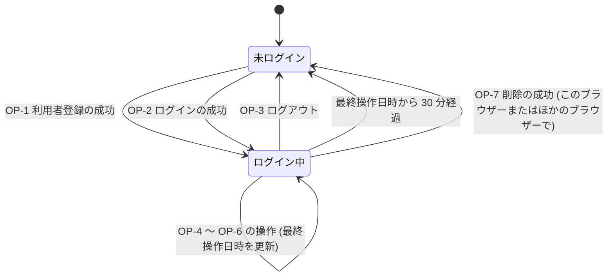
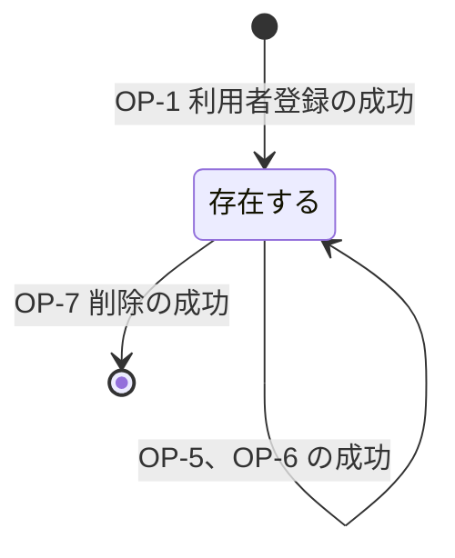
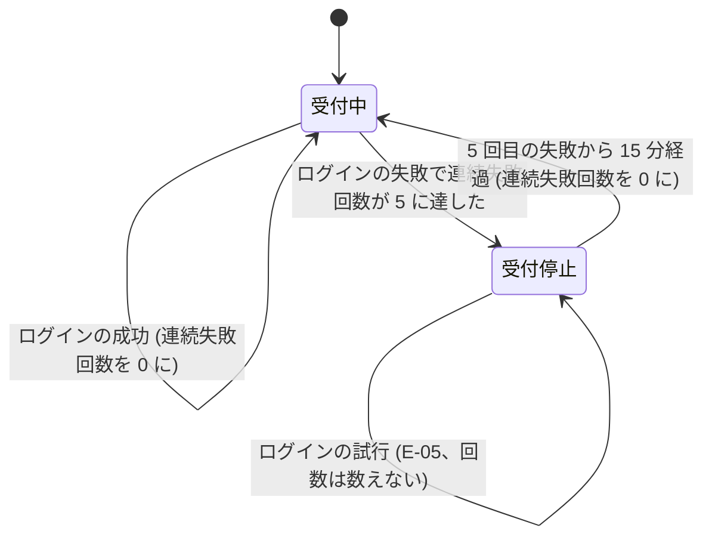

# 仕様書: ユーザーの認証機能

## 1. この文書について

この文書は、[要件定義書](requirements.md) をもとに、ユーザーの認証機能が外から見てどう振る舞うかを定める。画面の見た目、技術の選択、データの持ち方は扱わない。

この文書で扱う範囲は、要件定義書の「2.1 この機能で扱うこと」と同じとする。「2.2 この機能で扱わないこと」に挙げたもの (管理者による操作、パスワードの再設定、メールアドレスの確認、ソーシャルログイン、多要素認証、権限による出し分け) は扱わない。

## 2. 用語

要件定義書の「3. 用語」に加えて、この文書では次の用語を使う。

| 用語 | 意味 |
| --- | --- |
| 操作 | 利用者がアプリケーションに対して行う要求の 1 回分。画面の表示や、入力の送信を含む |
| ログイン状態 | 利用者が、ログイン中か、未ログインか、を表す状態。利用者がアプリケーションを使っているブラウザーごとに持つ |
| 最終操作日時 | ログイン中の利用者が最後に操作を行った日時 |
| 連続失敗回数 | あるメールアドレスに対して、ログインに続けて失敗した回数 |
| 受付停止 | 連続失敗回数が上限に達したために、そのメールアドレスでのログインを受け付けない状態 |
| 記録 | 要件定義書の NFR-6 で定める、操作の記録 |
| 文字数 | 文字 (Unicode の符号位置) の数。全角と半角を区別せず、どちらも 1 文字と数える |

## 3. 要件との対応

| 要件 | 内容 (要約) | 仕様の該当箇所 |
| --- | --- | --- |
| FR-1 | 未ログインの利用者がアカウントを作成できる | 6.1 |
| FR-2 | 使われているメールアドレスでは作成できない | 5.2、6.1、7.3 |
| FR-3 | 入力の誤りを、入力ごとに知らせる | 5.1、6.1、7.1 |
| FR-4 | 作成後はログイン中になる | 6.1、9.1 |
| FR-5 | メールアドレスとパスワードでログインできる | 6.2 |
| FR-6 | どちらが誤っているかは知らせない | 6.2、7.2 |
| FR-7 | ログアウトでき、その後はログインが必要な操作を行えない | 6.3、7.2、9.1 |
| FR-8 | 最後の操作から 30 分でログイン中が終わる | 6.8、8.2、9.1 |
| FR-9 | 表示名とメールアドレスを変更できる | 6.5 |
| FR-10 | 使われているメールアドレスには変更できない | 5.2、6.5、7.3 |
| FR-11 | 今のパスワードを入力してパスワードを変更できる | 6.6 |
| FR-12 | ほかの利用者のアカウントを見たり変更したりできない | 6.4、6.5、6.6、6.7、7.2 |
| FR-13 | パスワードを入力して自分のアカウントを削除できる | 6.7 |
| FR-14 | 削除後はログイン中が終わり、ログインできなくなる | 6.2、6.7、9.1、9.2 |
| FR-15 | 削除したアカウントのメールアドレスを再び使える | 5.2、6.7、9.2 |
| NFR-1 | パスワードを復元できない形で保存する | 10.1 |
| NFR-2 | 5 回続けて失敗したら 15 分間ログインを受け付けない | 6.2、8.3、9.3 |
| NFR-3 | パスワードやログイン中の状態を表す情報を出力しない | 7、10.2、11 |
| NFR-4 | 暗号化された通信で送受信する | 10.3 |
| NFR-5 | 100 人同時の操作で 95% が 1 秒以内に完了する | 10.4 |
| NFR-6 | 操作を日時と対象のアカウントを含めて記録する | 11 |
| NFR-7 | 記録を 90 日間保存する | 11 |

## 4. 操作の一覧

| 番号 | 操作 | 事前の条件 (ログイン状態) | 主な要件 |
| --- | --- | --- | --- |
| OP-1 | 利用者登録 | 未ログイン | FR-1 ～ FR-4 |
| OP-2 | ログイン | 未ログイン | FR-5、FR-6、NFR-2 |
| OP-3 | ログアウト | 問わない | FR-7 |
| OP-4 | 自分のアカウントの情報を見る | ログイン中 | FR-9、FR-12 |
| OP-5 | 表示名とメールアドレスの変更 | ログイン中 | FR-9、FR-10、FR-12 |
| OP-6 | パスワードの変更 | ログイン中 | FR-11、FR-12 |
| OP-7 | アカウントの削除 | ログイン中 | FR-13 ～ FR-15 |

OP-4 は、FR-9 で変更する前の今の値を利用者が確かめるため、また FR-12 の「見る」の対象を定めるために設ける。

## 5. 入力の扱い

### 5.1 入力の検査

要件定義書の「5. 入力の条件」を、次のとおりに検査する。

| 入力 | 検査の前に行う処理 | 条件 | 条件を満たさない場合に知らせる内容 |
| --- | --- | --- | --- |
| メールアドレス | なし (前後の空白も取り除かない) | 1. 入力されていること 2. 254 文字以内であること 3. メールアドレスの形式であること (下記) | 1. メールアドレスを入力してください 2. メールアドレスは 254 文字以内で入力してください 3. メールアドレスの形式で入力してください |
| 表示名 | 前後の空白 (半角スペース、全角スペース、タブ、改行を含む) を取り除く。途中の空白は残す | 1. 取り除いた後に 1 文字以上であること 2. 取り除いた後に 50 文字以内であること | 1. 表示名を入力してください 2. 表示名は 50 文字以内で入力してください |
| パスワード | なし (前後の空白も取り除かず、パスワードの一部として扱う) | 1. 12 文字以上であること 2. 128 文字以内であること | 1. パスワードは 12 文字以上で入力してください 2. パスワードは 128 文字以内で入力してください |

メールアドレスの形式は、次のすべてを満たすものとする。

- `@` をちょうど 1 つ含む
- `@` の前 (ローカル部) が 1 文字以上ある
- `@` の後 (ドメイン部) が 1 文字以上あり、`.` を 1 つ以上含み、`.` で始まらず `.` で終わらない
- 空白を含まない

検査の規則は次のとおりとする。

- 1 つの入力が複数の条件を満たさない場合は、表の番号の小さい条件の内容だけを知らせる (例: メールアドレスが 255 文字で形式も誤っている場合は、「254 文字以内で入力してください」だけを知らせる)
- 複数の入力が条件を満たさない場合は、条件を満たさないすべての入力について、それぞれ内容を知らせる
- 条件を満たさない入力がある場合、操作による状態の変化は一切起こらない
- 利用者に知らせる内容に、入力されたパスワードを含めない (NFR-3)
- 表示名は、前後の空白を取り除いた後の値を保存し、表示する

### 5.2 メールアドレスの同一性

- メールアドレスが「同じ」かどうかは、英字の大文字と小文字を区別せずに比べる (例: `User@Example.com` と `user@example.com` は同じとみなす)
- 保存し表示するメールアドレスは、利用者が入力したとおりの値 (大文字と小文字を含む) とする
- 「ほかのアカウントで使われている」とは、存在するアカウントのうち、操作している利用者自身のアカウント以外に、同じメールアドレスを持つものがあることをいう
- 削除したアカウントのメールアドレスは、使われていないものとして扱う (FR-15)
- 連続失敗回数と受付停止 (8.3) も、同じメールアドレスかどうかをこの規則で判断する

## 6. 操作ごとの振る舞い

各操作の結果、利用者に知らせる内容のうち、異常系の詳細は 7 章で定める。この章の「異常系」の欄には、起こりうる異常と、7 章の該当する番号を書く。

### 6.1 OP-1 利用者登録

| 項目 | 内容 |
| --- | --- |
| 入力 | メールアドレス、表示名、パスワード |
| 事前の条件 | 未ログインであること |
| 処理 | 1. 5.1 のとおりに入力を検査する 2. 入力したメールアドレスが、ほかのアカウントで使われていないかを確かめる (5.2) 3. アカウントを作成する 4. 作成したアカウントで、ログイン中の状態にする (FR-4)。最終操作日時を今の日時にする 5. 「利用者登録の成功」を記録する (11 章) |
| 状態の変化 | アカウントが 1 件増える。ログイン状態が未ログインからログイン中になる |
| 出力 | アカウントを作成したことと、ログイン中になったことを知らせる。作成したアカウントの表示名とメールアドレスを返す。パスワードは返さない |
| 異常系 | 入力の誤り (E-01)、メールアドレスの重複 (E-03)、ログイン中に行った (E-07)、外部の失敗 (E-90) |

### 6.2 OP-2 ログイン

| 項目 | 内容 |
| --- | --- |
| 入力 | メールアドレス、パスワード |
| 事前の条件 | 未ログインであること |
| 処理 | 1. メールアドレスとパスワードが入力されているかを確かめる。ログインでは、5.1 の文字数と形式の検査は行わない 2. 入力したメールアドレスが受付停止中かを確かめる (8.3)。受付停止中であれば、ここで終える (E-05) 3. 入力したメールアドレスを持つアカウントがあり、かつ入力したパスワードがそのアカウントのパスワードと一致するかを確かめる 4. 一致すれば、そのアカウントでログイン中の状態にし、最終操作日時を今の日時にする。そのメールアドレスの連続失敗回数を 0 にする。「ログインの成功」を記録する 5. 一致しなければ、連続失敗回数を 1 増やす。5 に達したら受付停止にする。「ログインの失敗」を記録する |
| 状態の変化 | 成功: ログイン状態が未ログインからログイン中になる。連続失敗回数が 0 になる 失敗: 連続失敗回数が 1 増える。5 に達した場合は受付停止になる |
| 出力 | 成功: ログインしたことを知らせる。ログインしたアカウントの表示名を返す 失敗: E-04 を知らせる |
| 異常系 | 入力されていない (E-01)、認証の失敗 (E-04)、受付停止中 (E-05)、ログイン中に行った (E-07)、外部の失敗 (E-90) |

補足:

- 存在しないメールアドレス (削除したアカウントのメールアドレスを含む) を入力した場合も、パスワードが誤っている場合と同じく、E-04 を知らせ、連続失敗回数を 1 増やす。これにより、アカウントがあるかどうかを利用者に知らせない (FR-6、FR-14)
- メールアドレスかパスワードが入力されていない場合 (E-01) は、連続失敗回数を増やさない
- 受付停止中に行ったログイン (E-05) は、パスワードが正しいかどうかを確かめず、連続失敗回数も増やさない

### 6.3 OP-3 ログアウト

| 項目 | 内容 |
| --- | --- |
| 入力 | なし |
| 事前の条件 | なし (ログイン中でも未ログインでも行える) |
| 処理 | ログイン中であれば、ログイン中の状態を終える。未ログインであれば、何もしない |
| 状態の変化 | ログイン状態が未ログインになる |
| 出力 | ログアウトしたことを知らせる。未ログインで行った場合も、同じ内容を知らせ、エラーとはしない |
| 異常系 | 外部の失敗 (E-90) |

補足:

- ログアウトで終わるのは、その操作を行ったブラウザーのログイン状態だけとする。同じアカウントでほかのブラウザーからログインしている場合、そのログイン状態は続く
- ログアウトした後に、ログインが必要な操作 (OP-4 ～ OP-7) を行った場合は、E-06 とする (FR-7)
- ログアウトの前に使っていたログイン中の状態を表す情報を、後から再び使っても、ログイン中には戻らない

### 6.4 OP-4 自分のアカウントの情報を見る

| 項目 | 内容 |
| --- | --- |
| 入力 | なし |
| 事前の条件 | ログイン中であること |
| 処理 | ログイン中のアカウントの情報を取り出す。最終操作日時を今の日時にする |
| 状態の変化 | 最終操作日時だけが変わる |
| 出力 | ログイン中のアカウントの表示名とメールアドレスを返す。パスワードは返さない |
| 異常系 | 未ログイン (E-06)、ほかのアカウントを対象にした (E-08)、外部の失敗 (E-90) |

### 6.5 OP-5 表示名とメールアドレスの変更

| 項目 | 内容 |
| --- | --- |
| 入力 | 新しい表示名、新しいメールアドレス。どちらか一方だけを変更する場合も、両方を入力する (変えないほうは今の値を入力する) |
| 事前の条件 | ログイン中であること |
| 処理 | 1. 5.1 のとおりに入力を検査する 2. 新しいメールアドレスが、ほかのアカウントで使われていないかを確かめる (5.2)。自分の今のメールアドレスと同じ値 (大文字と小文字だけが違う値を含む) は、使われているとはみなさない 3. ログイン中のアカウントの表示名とメールアドレスを、新しい値に変える 4. 最終操作日時を今の日時にする 5. 「アカウントの情報の変更」を記録する。記録には、変更した項目 (表示名、メールアドレス) を含める |
| 状態の変化 | アカウントの表示名とメールアドレスが変わる。ログイン状態は変わらない |
| 出力 | 変更したことを知らせる。変更後の表示名とメールアドレスを返す |
| 異常系 | 入力の誤り (E-01)、メールアドレスの重複 (E-03)、未ログイン (E-06)、ほかのアカウントを対象にした (E-08)、外部の失敗 (E-90) |

補足:

- 変更にパスワードの入力は求めない
- 入力した値が今の値とまったく同じ場合も、成功として扱う
- メールアドレスを変更した後は、新しいメールアドレスでだけログインできる。古いメールアドレスは、ほかのアカウントの作成や変更に使える
- 表示名とメールアドレスは、どちらも変わるか、どちらも変わらないかのどちらかとする。片方だけが変わることは無い

### 6.6 OP-6 パスワードの変更

| 項目 | 内容 |
| --- | --- |
| 入力 | 今のパスワード、新しいパスワード |
| 事前の条件 | ログイン中であること |
| 処理 | 1. 今のパスワードが入力されているかを確かめる。新しいパスワードを 5.1 のとおりに検査する 2. 今のパスワードが、ログイン中のアカウントのパスワードと一致するかを確かめる 3. ログイン中のアカウントのパスワードを、新しいパスワードに変える 4. 最終操作日時を今の日時にする 5. 「アカウントの情報の変更」を記録する。記録には、変更した項目 (パスワード) を含め、パスワードの値は含めない |
| 状態の変化 | アカウントのパスワードが変わる。ログイン状態は変わらない |
| 出力 | 変更したことを知らせる |
| 異常系 | 入力の誤り (E-01)、今のパスワードの誤り (E-02)、未ログイン (E-06)、ほかのアカウントを対象にした (E-08)、外部の失敗 (E-90) |

補足:

- 今のパスワードには、5.1 の文字数の検査を行わない。入力されていない場合だけ E-01 とする
- 新しいパスワードが今のパスワードと同じ場合も、成功として扱う
- 変更した後は、新しいパスワードでだけログインできる
- 変更しても、この操作を行ったブラウザーのログイン状態も、ほかのブラウザーのログイン状態も終わらない
- 今のパスワードの誤り (E-02) は、ログインの連続失敗回数 (8.3) に数えない

### 6.7 OP-7 アカウントの削除

| 項目 | 内容 |
| --- | --- |
| 入力 | パスワード |
| 事前の条件 | ログイン中であること |
| 処理 | 1. パスワードが入力されているかを確かめる 2. パスワードが、ログイン中のアカウントのパスワードと一致するかを確かめる 3. ログイン中のアカウントを削除する 4. そのアカウントのログイン中の状態を、すべてのブラウザーで終える (FR-14) 5. 「アカウントの削除」を記録する |
| 状態の変化 | アカウントが 1 件減る。そのアカウントでログインしていたすべてのブラウザーのログイン状態が未ログインになる |
| 出力 | 削除したことと、ログアウトしたことを知らせる |
| 異常系 | 入力されていない (E-01)、パスワードの誤り (E-02)、未ログイン (E-06)、ほかのアカウントを対象にした (E-08)、外部の失敗 (E-90) |

補足:

- パスワードには、5.1 の文字数の検査を行わない。入力されていない場合だけ E-01 とする
- 削除したアカウントのメールアドレスとパスワードでログインしようとした場合は、E-04 とする (FR-14)
- 削除したアカウントのメールアドレスは、すぐに OP-1 と OP-5 で使える (FR-15)
- 削除したアカウントを元に戻す操作は無い
- パスワードの誤り (E-02) は、ログインの連続失敗回数 (8.3) に数えない

### 6.8 ログイン中の状態の期限切れ

利用者の操作ではないが、時間が経つことで状態が変わるため、ここで定める (FR-8)。

| 項目 | 内容 |
| --- | --- |
| 条件 | ログイン中で、最終操作日時から 30 分以上経った |
| 状態の変化 | そのブラウザーのログイン状態が未ログインになる |
| 出力 | 期限が切れた後に、ログインが必要な操作 (OP-4 ～ OP-7) を行った場合は E-06 とし、ログインし直す必要があることを知らせる。期限が切れたことによる操作は行わない (入力していた内容は反映しない) |

補足:

- 最終操作日時を更新するのは、ログイン中の利用者が行った操作 (成功したもの、異常系で終わったもののどちらも含む) とする。ただし、期限が切れた後に行った操作は、最終操作日時を更新せず、ログイン中にも戻さない
- OP-3 ログアウトを期限が切れた後に行った場合は、未ログインで行った場合と同じく扱う

## 7. 異常系

### 7.1 異常の一覧

すべての異常系で、次の決まりを守る。

- 異常系で終わった操作では、アカウントの状態は変わらない (6.2 の連続失敗回数と受付停止の変化、6.8 の期限切れを除く)
- 利用者に知らせる内容に、パスワードとログイン中の状態を表す情報を含めない (NFR-3)
- 利用者が入力した内容は、異常を知らせた後も入力し直さずに済むように返してよい。ただし、パスワードの入力は返さない

| 番号 | 分類 | 発生する操作 | 条件 | 利用者に知らせる内容 |
| --- | --- | --- | --- | --- |
| E-01 | 入力の誤り | OP-1、OP-2、OP-5、OP-6、OP-7 | 入力が 5.1 の条件を満たさない。または、必要な入力が無い | 条件を満たさない入力ごとに、5.1 の表の内容 |
| E-02 | 入力の誤り | OP-6、OP-7 | 入力したパスワード (OP-6 では今のパスワード) が、ログイン中のアカウントのパスワードと一致しない | パスワードが正しくないこと |
| E-03 | 競合 | OP-1、OP-5 | 入力したメールアドレスが、ほかのアカウントで使われている (5.2) | このメールアドレスは使えないこと |
| E-04 | 認証の失敗 | OP-2 | 入力したメールアドレスを持つアカウントが無い、またはパスワードが一致しない | メールアドレスまたはパスワードが正しくないこと。どちらが誤っているかは知らせない (FR-6) |
| E-05 | 認証の失敗 | OP-2 | 入力したメールアドレスが受付停止中 (8.3) | 続けて失敗したため、しばらくログインできないこと。受付を再開するまでの時間の目安は知らせない |
| E-06 | 権限の不足 | OP-4 ～ OP-7 | 未ログイン (ログアウトした後、期限が切れた後、アカウントを削除した後を含む) | ログインが必要なこと |
| E-07 | 権限の不足 | OP-1、OP-2 | ログイン中に行った | 既にログインしていること |
| E-08 | 権限の不足 | OP-4 ～ OP-7 | ログイン中の利用者が、自分以外のアカウントを対象に操作しようとした (FR-12) | その操作は行えないこと。対象のアカウントがあるかどうかは知らせない |
| E-90 | 外部の失敗 | すべて | アカウントの情報の保存先や記録の書き込み先など、この機能が頼る仕組みが失敗した | 処理できなかったことと、時間をおいてやり直してほしいこと。失敗の原因の詳細は知らせない |

### 7.2 権限の不足

- OP-4 ～ OP-7 が対象にするのは、常にログイン中のアカウントだけとする。利用者が対象のアカウントを指定する手段は設けない
- 利用者が何らかの方法で自分以外のアカウントを指定して OP-4 ～ OP-7 を行おうとした場合は、E-08 とし、操作は行わない。対象のアカウントがあってもなくても、同じ内容を知らせる (FR-12)
- 未ログインで OP-4 ～ OP-7 を行った場合は、E-06 とする。E-06 と E-08 の両方に当てはまる場合は、E-06 とする

### 7.3 競合

| 状況 | 振る舞い |
| --- | --- |
| 同じメールアドレス (5.2) で、OP-1 が同時に複数行われた | 1 つだけが成功し、残りは E-03 とする |
| 同じメールアドレスへの OP-5 と OP-1 が同時に行われた、または OP-5 が同時に複数行われた | 1 つだけが成功し、残りは E-03 とする。同じメールアドレスを持つアカウントが 2 件以上になることは無い |
| 同じアカウントで、ほかのブラウザーから OP-5 または OP-6 が同時に行われた | 後に処理されたものの結果が残る。どちらも成功として扱う |
| あるブラウザーで OP-7 が成功した後に、同じアカウントのほかのブラウザーで OP-4 ～ OP-7 を行った | そのブラウザーのログイン状態は既に終わっているため、E-06 とする |
| OP-7 と、同じアカウントのほかのブラウザーでの OP-5 または OP-6 が同時に行われた | OP-7 が先に処理された場合は、もう一方を E-06 とする。もう一方が先に処理された場合は、その変更が成功した後に OP-7 が行われる |
| 同じメールアドレスへのログインの失敗が同時に複数行われた | 失敗の回数を漏れなく数える。5 回目の失敗の後は、受付停止とする |

### 7.4 外部の失敗

- この機能が頼る仕組み (アカウントの情報の保存先、記録の書き込み先など) が失敗した場合は、E-90 とする
- E-90 で終わった操作では、状態の変化を一切残さない。たとえば、OP-1 でアカウントは作成せず、ログイン中にもしない。OP-7 でアカウントは削除せず、ログイン状態も終えない
- 記録 (11 章) を書き込めなかった場合も E-90 とし、操作による状態の変化を残さない。これにより、記録の無い登録、変更、削除が起こらないようにする
- OP-3 ログアウトで、ログイン中の状態を確実に終えられなかった場合は E-90 を知らせる。利用者はログアウトをやり直せる
- 利用者は、E-90 の後に同じ操作をやり直せる。やり直しによって、アカウントが二重に作成されたり、ほかの異常が起きたりすることは無い (二重の作成は E-03 として扱われる)

## 8. 境界値

### 8.1 文字数

文字数は 2 章の定義で数える。表示名は、前後の空白を取り除いた後の文字数で判断する。

| 入力 | 受け付けない (下限の外) | 受け付ける (下限) | 受け付ける (上限) | 受け付けない (上限の外) |
| --- | --- | --- | --- | --- |
| メールアドレス | 0 文字 (E-01「入力してください」) | 形式を満たす最短の値 (例: `a@b.c` の 5 文字) | 254 文字 | 255 文字 (E-01「254 文字以内」) |
| 表示名 | 0 文字 (空白だけの入力を含む) | 1 文字 | 50 文字 | 51 文字 |
| パスワード (OP-1 と OP-6 の新しいパスワード) | 11 文字 | 12 文字 | 128 文字 | 129 文字 |

補足:

- 表示名の前後に空白を付けて 51 文字以上になっても、取り除いた後が 50 文字以内であれば受け付ける (例: 前後に 1 文字ずつ空白を付けた 50 文字の表示名は、52 文字の入力だが受け付ける)
- パスワードは空白も 1 文字と数える。前後に空白を付けたパスワードは、空白を含めた値がパスワードになる
- ログイン (OP-2) のパスワードと、OP-6 の今のパスワード、OP-7 のパスワードには、文字数の上限と下限を当てはめない。1 文字以上入力されていれば一致するかを確かめ、一致しなければ E-04 または E-02 とする

### 8.2 ログイン中の状態の期限 (FR-8)

| 最終操作日時から経った時間 | 振る舞い |
| --- | --- |
| 30 分未満 (例: 29 分 59 秒) | ログイン中のまま。操作を行えば、最終操作日時が今の日時に更新され、そこから 30 分の期限が数え直される |
| 30 分ちょうど以上 | ログイン中の状態は終わっている。OP-4 ～ OP-7 は E-06 とする |

- 期限は、操作の回数や、ログインしてからの合計の時間では制限しない。30 分以内に操作を続けている限り、ログイン中の状態は続く

### 8.3 ログインの連続失敗と受付停止 (NFR-2)

| 項目 | 内容 |
| --- | --- |
| 数える単位 | 入力したメールアドレス (5.2 の規則で同じかどうかを判断する)。アカウントがあるかどうかは問わない |
| 数える失敗 | E-04 で終わったログイン。E-01、E-05、E-07、E-90 で終わったログインは数えない |
| 0 に戻す条件 | そのメールアドレスでログインに成功したとき。または、受付停止が終わったとき |
| 受付停止にする条件 | 連続失敗回数が 5 に達したとき (5 回目の失敗の直後から) |
| 受付停止の長さ | 5 回目の失敗の日時から 15 分間 |
| 受付停止中の振る舞い | 正しいパスワードを入力しても、E-05 とする。受付停止の長さは延びない |
| 受付停止が終わった後 | 連続失敗回数が 0 の状態から、改めて数える |

境界値の振る舞いは次のとおりとする。

| 状況 | 振る舞い |
| --- | --- |
| 4 回続けて失敗した後に、正しいパスワードでログインした | ログインに成功し、連続失敗回数は 0 になる |
| 4 回続けて失敗した後に、5 回目も失敗した | 5 回目は E-04 とし、その直後から受付停止になる |
| 5 回目の失敗から 14 分 59 秒後にログインした | E-05 とする |
| 5 回目の失敗から 15 分ちょうど以上が経った後にログインした | 受付停止は終わっており、通常どおり確かめる。失敗した場合は、連続失敗回数を 1 とする |
| 受付停止中のメールアドレスとは別のメールアドレスでログインした | 受付停止の影響を受けない |

- 失敗と失敗の間の時間は問わない。成功するか受付停止が終わるまで、失敗の回数は数え続ける

## 9. 状態の遷移

### 9.1 ログイン状態

ログイン状態は、利用者がアプリケーションを使っているブラウザーごとに持つ。

| 今の状態 | きっかけ | 条件 | 次の状態 |
| --- | --- | --- | --- |
| 未ログイン | OP-1 | 6.1 の処理がすべて成功した | ログイン中 |
| 未ログイン | OP-2 | 6.2 の処理で、パスワードが一致した | ログイン中 |
| 未ログイン | OP-1、OP-2 が異常系で終わった | ― | 未ログイン |
| 未ログイン | OP-4 ～ OP-7 | ― (E-06) | 未ログイン |
| ログイン中 | OP-4 ～ OP-6、または異常系で終わった OP-7 | 最終操作日時から 30 分未満 | ログイン中 (最終操作日時を更新) |
| ログイン中 | OP-3 | ― | 未ログイン |
| ログイン中 | 時間の経過 | 最終操作日時から 30 分以上 | 未ログイン |
| ログイン中 | このブラウザーでの OP-7 | 6.7 の処理がすべて成功した | 未ログイン |
| ログイン中 | ほかのブラウザーでの、同じアカウントの OP-7 | 6.7 の処理がすべて成功した | 未ログイン |
| ログイン中 | OP-1、OP-2 | ― (E-07) | ログイン中 |

### 9.2 アカウント

- 「存在する」アカウントだけが、ログイン、変更、削除の対象になり、そのメールアドレスはほかのアカウントで使えない
- 削除したアカウントは存在しないものとして扱い、元に戻せない。削除したアカウントのメールアドレスでは、ログインできない (E-04)。そのメールアドレスは、新しいアカウントの作成や、ほかのアカウントのメールアドレスの変更に使える
- 削除した後も、そのアカウントの記録 (11 章) は保存期間の間は残る

### 9.3 メールアドレスごとのログインの受付

| 今の状態 | きっかけ | 条件 | 次の状態 |
| --- | --- | --- | --- |
| 受付中 | ログインの失敗 (E-04) | 失敗後の連続失敗回数が 5 未満 | 受付中 |
| 受付中 | ログインの失敗 (E-04) | 失敗後の連続失敗回数が 5 | 受付停止 |
| 受付中 | ログインの成功 | ― | 受付中 (連続失敗回数を 0 に) |
| 受付停止 | ログインの試行 | 5 回目の失敗から 15 分未満 | 受付停止 (E-05) |
| 受付停止 | 時間の経過 | 5 回目の失敗から 15 分以上 | 受付中 (連続失敗回数を 0 に) |

## 10. 非機能の振る舞い

### 10.1 パスワードの保存 (NFR-1)

- パスワードは、保存した情報から元のパスワードを復元できない形で保存する
- 利用者本人を含め、だれも保存したパスワードを見る操作は無い。利用者に返す情報 (6 章の「出力」) にも、パスワードは含めない

### 10.2 秘密情報の出力の禁止 (NFR-3)

- パスワード (今のパスワード、新しいパスワードを含む) と、ログイン中の状態を表す情報は、利用者に知らせる内容、エラーの内容、記録、その他のログに含めない
- 異常系で入力を返す場合も、パスワードの入力は返さない (7.1)

### 10.3 通信の暗号化 (NFR-4)

- OP-1 ～ OP-7 の入力と出力は、暗号化された通信でだけ受け付け、返す
- 暗号化されていない通信で OP-1 ～ OP-7 が行われた場合は、その操作を処理しない

### 10.4 性能 (NFR-5)

- 同時に 100 人の利用者が操作している状態で、OP-1 利用者登録、OP-2 ログイン、OP-5 表示名とメールアドレスの変更、OP-6 パスワードの変更のそれぞれについて、95% が 1 秒以内に完了する
- 「完了」とは、利用者が操作を行ってから、6 章の「出力」が返るまでをいう

## 11. 記録 (NFR-6、NFR-7)

次の出来事を記録する。

| 出来事 | 記録する時 | 対象のアカウント |
| --- | --- | --- |
| 利用者登録の成功 | OP-1 が成功したとき | 作成したアカウント |
| ログインの成功 | OP-2 が成功したとき | ログインしたアカウント |
| ログインの失敗 | OP-2 が E-04 または E-05 で終わったとき | 入力したメールアドレスを持つアカウント。アカウントが無い場合は、入力したメールアドレス |
| アカウントの情報の変更 | OP-5 または OP-6 が成功したとき | 変更したアカウント |
| アカウントの削除 | OP-7 が成功したとき | 削除したアカウント |

- 各記録には、出来事の種類、出来事の日時、対象のアカウントを含める。ログインの失敗の記録には、失敗の理由 (E-04 か E-05 か) を含める。アカウントの情報の変更の記録には、変更した項目の名前 (表示名、メールアドレス、パスワード) を含める
- 記録には、パスワードとログイン中の状態を表す情報を含めない (NFR-3、NFR-6)。変更した項目がパスワードの場合も、項目の名前だけを記録する
- 記録は、出来事の日時から 90 日間保存する。アカウントを削除した後も、そのアカウントの記録は 90 日間の保存期間が過ぎるまで残す
- 記録の書き込みに失敗した場合の振る舞いは、7.4 のとおりとする
- 利用者が記録を見る操作は、この機能では設けない
