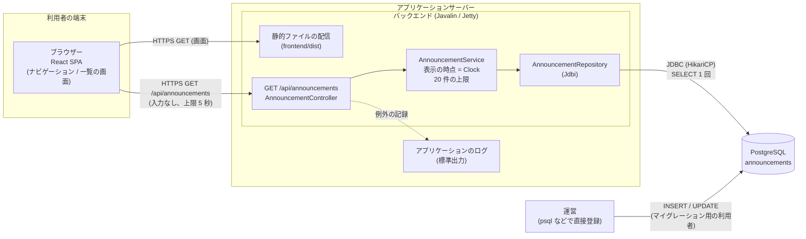
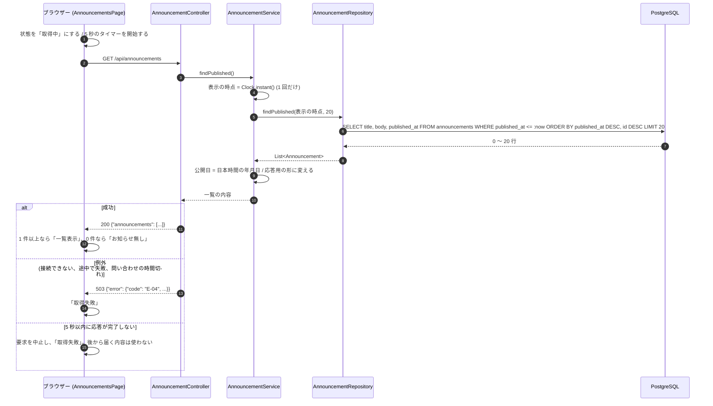

# アーキテクチャ設計: お知らせの一覧

## 1. この文書について

この文書は、[要件定義書](requirements.md)、[仕様書](specification.md)、[概念モデル](domain-model.md) をもとに、お知らせの一覧を実現するアーキテクチャを定める。後の実装計画と実装は、この文書に沿って行う。

- 振る舞い (選ぶ、並べる、件数、異常の扱い、境界値) は、仕様書を正とする。この文書は、その振る舞いを「どの構成要素が、どのデータを使って実現するか」を定める
- 文中の OP-n、E-nn は仕様書の操作と異常の番号、FR-n、NFR-n は要件定義書の要件の番号、A-n、L-n、R-n は概念モデルの制約の番号を指す
- 仕様書が設計の段階に委ねた「上限時間」(仕様書 7.4) は、この文書の 7.2 で決める

### 1.1 リポジトリの今の状態と前提

この文書を書いた時点で、リポジトリにはアプリケーションのコード (フロントエンド、バックエンド) がまだ無い。ルートの `package.json` は、コミットメッセージの検査 (commitlint、husky) と Coding Agent のスクリプトのためのもので、アプリケーションとは関係しない。

ユーザーの認証機能 ([#1 の設計](../1-user-auth/architecture.md)) は、設計書だけがあり、実装は無い。その設計書は、アプリケーションの土台 (Gradle のプロジェクト、`com.example.app` のパッケージ、Javalin の起動、PostgreSQL と Flyway、Vite の React のプロジェクト) の名前と置き場所を決めている。この機能も、技術構成を「フロントエンドは React、バックエンドは Javalin」とし、その土台の名前と置き場所に合わせる。

この機能は認証機能に依存しない (要件定義書 7 章、R-8)。そのため、次の決まりを守る。

- 土台のファイルは、先に実装した機能が作る。既にあるファイルは、作り直さず、そのまま使う。この文書の 3 章で「土台」と書いたものが対象である
- この機能のコードは、認証機能のパッケージ (`com.example.app.auth`) とフロントエンドの `auth/` に、依存しない。認証機能のコードが無くても、この機能は動く
- 土台を共有する場合の食い違いの扱いは、10 章に書く

## 2. 全体の構成

### 2.1 構成要素

| 構成要素 | 技術 | 役割 |
| --- | --- | --- |
| ブラウザー | ― | 利用者が使う。React で作った画面 (SPA) を動かし、`GET /api/announcements` を呼ぶ。ログインの状態や Cookie を、この機能では使わない |
| フロントエンド | React + TypeScript、Vite でビルド | 一覧の画面、共通のナビゲーション、API の呼び出し、上限時間の判定 |
| バックエンド | Java 21、Javalin、Jetty (Javalin に組み込み) | 静的ファイルの配信、一覧を返す API。表示の時点を決め、公開中のお知らせを選んで、並べて、20 件に絞る |
| データベース | PostgreSQL 16 | お知らせを `announcements` テーブルに保存する。運営は、このテーブルに直接登録する |
| アプリケーションのログ | 標準出力 (Logback) | 動作の確認と障害の調査のためのログ |

キャッシュの仕組み (Redis、サーバー内のメモリなど) は置かない (8.6)。

### 2.2 構成図



### 2.3 構成要素の間のやり取り

| やり取り | 方式 | 内容 |
| --- | --- | --- |
| ブラウザー → バックエンド (画面) | HTTPS の GET | `index.html` と、ビルドした JavaScript、CSS を受け取る。API 以外のパスは `index.html` を返す (SPA のルーティングのため。土台の決まり) |
| ブラウザー → バックエンド (API) | HTTPS、`GET /api/announcements` | 4 章。要求に、利用者が指定する値は無い。Cookie が付いていても、読まない |
| バックエンド → データベース | JDBC。コネクションプールは HikariCP、データアクセスは Jdbi | 1 回の取得につき、`SELECT` を 1 回だけ実行する (5.3)。読み取りだけで、書き込みは行わない |
| 運営 → データベース | SQL (psql など) | 運営が、お知らせを登録、変更する。アプリケーションは関与しない。手順は 7.4 の文書に書く |
| バックエンド → アプリケーションのログ | SLF4J + Logback、標準出力 | 取得の失敗の原因となった例外。タイトルや本文は書かない |

フロントエンドとバックエンドは、同じオリジンから配信する (土台の決まり)。この機能のために CORS の設定は加えない。

### 2.4 操作の流れ: OP-1 一覧を表示する

OP-2 (共通のナビゲーションからの移動) は、一覧の画面へ移ったあとに、この流れを行う。



## 3. ディレクトリとモジュールの構成

### 3.1 リポジトリのディレクトリ

認証機能の設計書 3.1 の構成に合わせる。次に、この機能が追加するファイルと、使う土台のファイルを示す。

```text
/
├── compose.yaml                         (土台。開発用の PostgreSQL)
├── compose/postgres/init.sql            (土台。2 つの利用者を作る)
├── backend/
│   ├── build.gradle.kts                 (土台)
│   └── src/
│       ├── main/java/com/example/app/
│       │   ├── Main.java                (土台。この機能のクラスの組み立てを加える)
│       │   ├── config/AppConfig.java    (土台。3.4 の設定を加える)
│       │   ├── web/WebServer.java       (土台。ルートの登録を加える)
│       │   ├── db/Database.java         (土台)
│       │   └── announcement/            (この機能。3.2)
│       ├── main/resources/db/migration/
│       │   └── V35_1__create_announcements.sql   (この機能。5 章)
│       └── test/java/com/example/app/announcement/...
├── frontend/
│   └── src/
│       ├── main.tsx、App.tsx            (土台。ルートと共通のナビゲーションを加える)
│       ├── api/announcements.ts         (この機能。3.3)
│       ├── announcements/...            (この機能。3.3)
│       └── components/AppNavigation.tsx (この機能が作る共通のナビゲーション。3.3)
├── perf/announcements.js                (この機能。k6。7.2)
└── docs/development/announcements.md    (この機能。運営の登録の手順。7.4)
```

### 3.2 バックエンドのパッケージ

パッケージ `com.example.app.announcement` を新しく作る。認証機能と同じく、「API (Controller)」「処理 (Service)」「データの読み書き (Repository)」に分ける。

```text
com.example.app.announcement
├── Announcement.java             record。title、body、publishedAt (OffsetDateTime)。データベースから読んだ 1 件
├── AnnouncementRepository.java   findPublished(Instant displayTime, int limit)。5.3 の SELECT を 1 回実行する
├── AnnouncementService.java      表示の時点を決め、Repository を呼び、応答の形に変える
├── AnnouncementController.java   GET /api/announcements。例外を E-04 の応答に変える
└── dto/
    ├── AnnouncementListResponse.java   record。announcements (List<AnnouncementItem>)
    └── AnnouncementItem.java           record。title、body、publishedDate (String)
```

| クラス | 責務 | 注意 |
| --- | --- | --- |
| `AnnouncementRepository` | `Jdbi` だけに依存する。5.3 の `SELECT` を、問い合わせの時間切れ (2 秒) を付けて 1 回だけ実行し、`Announcement` の一覧を返す | 列は `title`、`body`、`published_at` だけを選ぶ (`SELECT *` にしない)。`id` は並べ替えにだけ使い、読み出さない。この機能でデータを書き込むメソッドは作らない |
| `AnnouncementService` | `java.time.Clock` を受け取る。`clock.instant()` を 1 回だけ呼んで表示の時点とし (R-1)、Repository に渡す。件数の上限 `LIMIT = 20` を定数として持つ。`Announcement` を `AnnouncementItem` に変える | 公開日は `publishedAt.atZoneSameInstant(ZoneId.of("Asia/Tokyo")).toLocalDate().toString()` (`2026-10-12` の形) とする (A-6)。実行環境のタイムゾーン (`ZoneId.systemDefault()`) は使わない |
| `AnnouncementController` | 認証の確認をしない。クエリ文字列、Cookie、ヘッダーを読まない。成功なら 200 と本文を返す。`Service` が例外を投げたら、すべて E-04 の応答 (4.3) にする | `Cache-Control: no-store` を付ける (4.1)。例外は ERROR で記録し、応答には書かない |

- 依存の向きは `AnnouncementController` → `AnnouncementService` → `AnnouncementRepository` → `Jdbi` とする。`announcement` パッケージは、`auth` パッケージに依存しない
- 例外の変換を `AnnouncementController` の中で行う理由は、土台の `ErrorHandler` (認証機能の設計で、想定外の例外を E-90 の応答にするもの) と、番号と文言が食い違うためである (8.7)
- 日時は、`Clock` を `Main` で `Clock.systemUTC()` として作り、`AnnouncementService` に渡す。試験では、固定の `Clock` を渡す

### 3.3 フロントエンドの構成

```text
frontend/src
├── api/
│   └── announcements.ts            fetchAnnouncements(signal): Promise<Announcement[]>。4 章の API を呼び、応答の形を検査する
├── announcements/
│   ├── AnnouncementsPage.tsx       一覧の画面。状態 (取得中 / 一覧表示 / お知らせ無し / 取得失敗) に応じて表示を切り替える
│   ├── AnnouncementItem.tsx        お知らせ 1 件の表示 (タイトル、公開日、本文)
│   ├── useAnnouncements.ts         取得の状態を持つフック。取得、上限時間の判定、取り消しを行う
│   └── formatPublishedDate.ts      "2026-10-12" を "2026年10月12日" に変える
└── components/
    └── AppNavigation.tsx           共通のナビゲーション。項目「お知らせ」(`/announcements` へのリンク)
```

画面の経路は、次を加える。

| パス | 画面 | ガード |
| --- | --- | --- |
| `/announcements` | お知らせの一覧 | なし (ログインの有無を見ない) |

フロントエンドの決まり:

- **画面の状態**: 仕様書 9.2 の 4 つの状態を、`type State = { status: 'loading' } | { status: 'success'; items: Announcement[] } | { status: 'failure' }` で表す。`success` は、`items` が 0 件なら「お知らせ無し」、1 件以上なら「一覧表示」の表示にする。1 回の取得で、この 3 つの結果のどれか 1 つだけにする (R-3)
- **取得の開始**: `useAnnouncements` は、`useEffect` で、画面を開いたとき、および `useLocation().key` が変わったときに取得を始める。ナビゲーションの項目を、一覧の画面を見ている間に選び直した場合も、`location.key` が変わるため、取得をやり直す (仕様書 6.1、9.2 の「一覧を開き直す」)。取得を始めるたびに、状態を `loading` に戻す
- **キャッシュしない**: 前回の結果は、保存も再利用もしない (localStorage、モジュール内の変数、データ取得のライブラリーのキャッシュを使わない)。一覧を開いたままの間は、自動で取得し直さない (定期取得、画面の再表示での再取得をしない。R-5)
- **上限時間**: `fetch` に `AbortSignal.timeout(5000)` と、取り消し用の `AbortController` を組み合わせた `AbortSignal.any([...])` を渡す。応答の本文の読み込み (`response.json()`) が完了するまでが、5 秒の対象である (7.2)。中止された場合は、取得の失敗とする
- **古い取得の結果を使わない**: 新しい取得を始めたとき、画面から移動したときは、前の取得を `AbortController.abort()` で中止する。中止された取得の結果で、状態を更新しない (R-4)
- **失敗の判定**: 次のどれかを、取得の失敗とする。ネットワークの失敗、上限時間の超過、HTTP の状態が 200 以外、本文が JSON として読めない、本文が 4.2 の形でない (`announcements` が配列でない、要素の `title`、`body`、`publishedDate` が文字列でない、`publishedDate` が `YYYY-MM-DD` の形でない、配列の長さが 20 を超える)。一部の要素だけを使うことはしない (R-2)
- **失敗の文言**: 「お知らせを表示できませんでした。時間をおいて、もう一度開いてください」を、フロントエンドの定数として持つ。応答が無い場合 (ネットワークの失敗、上限時間の超過) でも表示する必要があるため、API の応答の `message` には頼らない。応答の本文や例外の内容は、画面に出さない
- **お知らせ無しの文言**: 「公開中のお知らせはありません」
- **文字としての表示**: タイトルと本文は、JSX の式 (`{item.title}`、`{item.body}`) で、文字列として出力する。`dangerouslySetInnerHTML`、`innerHTML`、Markdown の変換、URL のリンク化 (自動のリンク化を含む) は使わない (7.1)
- **改行の反映**: 本文を表示する要素に、CSS の `white-space: pre-wrap` を付ける。改行の位置と数が、そのまま見た目に反映される。長い語で表示が崩れないように、タイトルと本文の要素に `overflow-wrap: anywhere` を付ける。文字数での省略 (`text-overflow`、`line-clamp` など) はしない
- **公開日の表示**: `formatPublishedDate` は、`YYYY-MM-DD` の文字列を、`Date` に変えずに、文字列の部分から `${Number(年)}年${Number(月)}月${Number(日)}日` に組み立てる (ブラウザーのタイムゾーンの影響を受けないため。仕様書 5.2、8.4)
- **並べ替えと件数**: フロントエンドでは、並べ替えも件数の絞り込みも行わない。応答の順序のまま表示する
- **一覧の要素の key**: お知らせに識別子は無いため、配列の位置 (index) を `key` にする。一覧は、取得のたびに全体を置き換え、並べ替えや途中の挿入が無いため、index で問題ない
- **共通のナビゲーション**: `AppNavigation` は、一覧の画面へ移動する項目「お知らせ」を、ログインの有無に関係なく同じ内容で表示する (FR-9、仕様書 6.2)。`AuthContext` などの認証機能のコードを `import` しない。認証機能のナビゲーションの項目 (ログイン、アカウントなど) は、認証機能の実装が、`AppNavigation` に項目を足す形で加える。`AppNavigation` は、`main.tsx` / `App.tsx` の最上位のレイアウトとして、すべての画面に表示する

### 3.4 設定

バックエンドの設定 (`AppConfig`) に、次の環境変数を加える。ほかの設定 (ポート、データベースの接続など) は土台のものを使う。

| 環境変数 | 必須 | 既定値 | 意味 |
| --- | --- | --- | --- |
| `APP_DB_CONNECTION_TIMEOUT_MS` | いいえ | `1000` | HikariCP の `connectionTimeout`。コネクションを取れる時間の上限 (7.2) |

土台で既に同じ設定がある場合は、その値が 1,000 ミリ秒以下であることを確かめる。上回る場合は、1,000 ミリ秒に下げる。

## 4. API

### 4.1 共通の決まり

- パスは `/api` の下に置く。応答の本文は JSON (UTF-8、`Content-Type: application/json`) とする
- 応答には `Cache-Control: no-store` を付ける。ブラウザーや中継が、古い一覧や、公開前だった時点の内容を保持しないようにするため (R-5)
- この API には、利用者が指定できる値を設けない。クエリ文字列 (`?limit=`、`?now=`、`?all=` など) は、付いていても読まず、結果に影響させない。リクエストの本文、Cookie、`Authorization` ヘッダーも読まない。認証機能の `before` ハンドラーによるログイン状態の確認 (認証機能の設計 6.3) も、この API の要求では行わない (仕様書 6.1 の入力は無し、10.2、R-8。10 章)
- 認証を要求しない。ログインの有無で、応答は変わらない (FR-1、7.5)
- この機能の API は、データを書き換えない。`GET` だけを定義する。`GET` 以外のメソッドは、Javalin の既定の応答 (404) のままにする

### 4.2 `GET /api/announcements` (OP-1 一覧を表示する)

| 項目 | 内容 |
| --- | --- |
| 入力 | なし |
| 事前の条件 | なし |
| 成功の応答 | 200 |
| 異常の応答 | 503 (E-04) |

成功の応答の本文:

```json
{
  "announcements": [
    {
      "title": "メンテナンスのお知らせ",
      "body": "10 月 20 日の 2 時から 4 時まで、サービスを停止します。\n\nご不便をおかけします。",
      "publishedDate": "2026-10-12"
    },
    {
      "title": "新機能の案内",
      "body": "お知らせの一覧を追加しました。",
      "publishedDate": "2026-10-01"
    }
  ]
}
```

| フィールド | 型 | 内容 |
| --- | --- | --- |
| `announcements` | 配列 | 公開中のお知らせ。0 件から 20 件。公開日時の新しい順、同じ時点なら後に登録したものが先。0 件のときは `[]` (成功の応答) |
| `announcements[].title` | 文字列 | 登録されたタイトル。加工しない (全文、前後の空白も含む) |
| `announcements[].body` | 文字列 | 登録された本文。加工しない。改行は `\n` (登録されたとおりの位置と数。登録された改行が `\r\n` の場合は、そのまま `\r\n`) |
| `announcements[].publishedDate` | 文字列 | 公開日。公開日時を日本時間 (Asia/Tokyo) に直した年月日を、`YYYY-MM-DD` の形で返す。表示用の文字列 (`2026年10月12日`) への変換は、フロントエンドが行う (3.3) |

- 応答には、件数、全体の件数、次のページ、公開日時そのもの、お知らせの識別子、公開前のお知らせに関するものを、一切含めない (NFR-2、L-5)。応答の項目は、上の 3 つだけとする
- `publishedDate` を `YYYY-MM-DD` の文字列にするのは、日本時間への変換をバックエンドの 1 か所で行い、ブラウザーの設定で表示がずれないようにするため (8.5)

### 4.3 エラーの応答 (E-04)

取得を最後まで終えられなかった場合は、次を返す。

```http
HTTP/1.1 503 Service Unavailable
Cache-Control: no-store
Content-Type: application/json

{"error":{"code":"E-04","message":"お知らせを表示できませんでした。時間をおいて、もう一度開いてください"}}
```

| 起きること | 応答 |
| --- | --- |
| データベースに接続できない、コネクションを取れない (1 秒以内に取れない) | 503、E-04 |
| 問い合わせの途中で失敗した、問い合わせが 2 秒を超えた | 503、E-04 |
| 応答の組み立ての途中で例外が起きた (行の読み出しの失敗など) | 503、E-04 |
| そのほかの想定外の例外 | 503、E-04 |

- 本文には、保存先の名前、SQL、例外のクラス名やメッセージ、スタックトレースを含めない (仕様書 7.1)
- 例外の内容は、アプリケーションのログに ERROR で書く。ログにも、タイトル、本文は書かない (書くのは例外のクラス、メッセージ、スタックトレース。SQL の引数に表示の時点は含まれるが、お知らせの内容は含まれない)
- 取得の失敗の応答には、公開前のお知らせの情報を含めない (NFR-2)。そもそも、失敗した時点で Repository の結果を、応答に使わない。一部の行だけを返すこともしない (R-2)
- 上限時間 (7.2) を超えて応答が返らない場合は、フロントエンドが要求を中止して、取得の失敗にする。バックエンドの応答は不要である

### 4.4 操作と API の対応

| 操作 | メソッドとパス | 補足 |
| --- | --- | --- |
| OP-1 一覧を表示する | `GET /api/announcements` | 一覧の画面を開いたとき、および開き直したときに呼ぶ |
| OP-2 共通のナビゲーションから一覧の画面へ移動する | (API なし) | フロントエンドの画面の移動 (`/announcements`)。移動後に OP-1 の API を呼ぶ |

### 4.5 仕様書の振る舞いとの対応

| 仕様書の振る舞い | この API での実現 |
| --- | --- |
| 6.1 処理 1 (表示の時点を決める) | `AnnouncementService` が、`Clock` から 1 回だけ決める |
| 6.1 処理 2 ～ 3 (選ぶ、並べる、20 件) | 1 回の `SELECT` の `WHERE`、`ORDER BY`、`LIMIT` (5.3) |
| 6.1 処理 4 (タイトル、本文、公開日) | `AnnouncementItem` の 3 項目 |
| 6.1 処理 5 (0 件の表示) | `announcements: []` を、フロントエンドが「お知らせ無し」にする |
| 6.1 処理 6 (一覧の内容を返す) | 200 の応答 |
| 7.1 E-01 (公開日時の不備) | 5.2 のとおり、保存の段階で発生しないようにする |
| 7.1 E-02 (長さの条件外) | 長さを検査せず、登録された値のまま返す |
| 7.1 E-03 (競合) | 5.3 のスナップショットと、`id` による並び順 (6.3 の A-1、A-2、R-7)。エラーにはしない |
| 7.1 E-04 | 4.3 |

## 5. データの持ち方

### 5.1 保存先と方針

保存先は、PostgreSQL 16 の `announcements` テーブル 1 つとする。お知らせは、運営がデータベースに直接登録する (要件定義書 2.2)。お知らせ以外のテーブル (利用者との対応、既読の状態、閲覧の記録など) は作らない (範囲外)。

マイグレーションは Flyway で行う。ファイル名は `V35_1__create_announcements.sql` とする (バージョン `35.1`。10 章の理由による)。

### 5.2 `announcements` テーブル

```sql
CREATE FUNCTION announcement_published_at(value text) RETURNS timestamptz
    LANGUAGE sql IMMUTABLE AS $$ SELECT value::timestamptz $$;

CREATE TABLE announcements (
    id                bigint      GENERATED ALWAYS AS IDENTITY PRIMARY KEY,
    title             text        NOT NULL,
    body              text        NOT NULL,
    published_at_text text        NOT NULL,
    published_at      timestamptz GENERATED ALWAYS AS (announcement_published_at(published_at_text)) STORED,
    CONSTRAINT announcements_published_at_text_format CHECK (
        published_at_text ~ '^[0-9]{4}-[0-9]{2}-[0-9]{2}T[0-9]{2}:[0-9]{2}(:[0-9]{2}(\.[0-9]{1,6})?)?(Z|[+-][0-9]{2}:[0-9]{2})$'
    )
);

CREATE INDEX announcements_published_order_idx
    ON announcements (published_at DESC, id DESC);

GRANT SELECT ON announcements TO ${app_db_user};
```

| 列 | 型 | 制約 | 概念モデルとの対応 |
| --- | --- | --- | --- |
| `id` | `bigint` | 主キー。`GENERATED ALWAYS AS IDENTITY` (自動で採番する。運営が値を指定できない) | 登録の順序。値が大きいほど後に登録された。どの 2 件でも前後が決まる (A-2)。API には出さない |
| `title` | `text` | `NOT NULL`。長さの制約は付けない | タイトル |
| `body` | `text` | `NOT NULL`。長さの制約は付けない。改行を含められる | 本文 |
| `published_at_text` | `text` | `NOT NULL`。CHECK で 5.2 の形式だけを許す (ずれの無い値、空白区切り、`infinity` は拒否) | 公開日時の元の表記。登録されたとおりに保存する。API には出さない。タイムゾーンの無い値は保存されない (E-01、8.3) |
| `published_at` | `timestamptz` | 生成列 (`STORED`)。`published_at_text` から導く。運営は直接書けない | 公開日時。時点として比べる (タイムゾーンの違いや表記の違いで比べた結果が変わらない。A-3) |

- 公開日、公開状態 (公開中、公開前、対象外)、一覧の内容は、列として持たない。公開日は `published_at` から、公開状態は `published_at` と表示の時点から、取得のたびに導く (概念モデル 1 章、2.2)
- タイトルと本文の長さは、`CHECK` で制約しない。条件 (1 ～ 100 文字、1 ～ 2,000 文字) を外れた値も、登録された値のまま表示するため (E-02)。条件を守るのは、運営の登録の手順である (仕様書 5.1)
- `title`、`body` に `UNIQUE` は付けない (A-1)。同じタイトルと本文のお知らせを、別々に登録できる
- 公開日時は、`YYYY-MM-DDThh:mm[:ss[.ffffff]]` の後に `Z` または `±hh:mm` を必ず付けた形式だけを受け付ける。`published_at_text` の CHECK が、登録の時点で次の値を拒否する。公開日時が無い (`NULL`)、タイムゾーンを特定できない (例: `2026-10-12T00:00:00`)、形式が違う (例: 空白区切り、`infinity`)。拒否された行は保存されず、一覧の取得の時点では存在しないため、一覧に含めない (E-01 の結果と同じ)
- 形式は合うが日時として読めない値 (例: `2026-02-30T00:00:00Z`) は、`published_at` の計算の時点で登録が失敗する。`infinity` は形式の CHECK で拒否されるため、日本時間の年月日に変換できない値は保存されない
- `published_at` は、`published_at_text` から導く生成列である。関数 `announcement_published_at` は、ずれを含む値を `timestamptz` にキャストするだけで、結果はセッションのタイムゾーンに依らない。保存される値は必ず CHECK を通るため、`IMMUTABLE` と宣言でき、生成列に使える (8.3)
- 「タイムゾーンを特定できない」(例: `2026-10-12T00:00:00`) については、7.3 で扱う
- 登録の順序に `id` を使うのは、同じ公開日時のお知らせを 1 つの順序に決められるため。作成日時の列は設けない (同じ時刻になり得るため、順序の決定に使えない。この機能が必要としない値を、持たない)

### 5.3 一覧を取る問い合わせ

`AnnouncementRepository` は、次の問い合わせを、1 回の取得につき 1 回だけ実行する。

```sql
SELECT title, body, published_at
FROM announcements
WHERE published_at <= :displayTime
ORDER BY published_at DESC, id DESC
LIMIT 20;
```

- `:displayTime` は、`AnnouncementService` が決めた表示の時点 (`OffsetDateTime` の UTC。`timestamptz` と比べる)。SQL の `now()` は使わない (8.4)
- `<=` により、公開日時が表示の時点とちょうど同じ時点のお知らせも含める (仕様書 8.1)。`published_at` は `published_at_text` (`NOT NULL`) から導かれるため、`NULL` の行は存在しない
- `ORDER BY published_at DESC, id DESC` は、公開日時 (時刻まで) の新しい順、同じ時点なら `id` の大きい (後に登録した) 順 (L-2、A-2、仕様書 8.4、8.5)。`timestamptz` は時点として比べるため、`+09:00` と `Z` の表記の違いは影響しない (A-3)
- `LIMIT 20` は、`WHERE` と `ORDER BY` を適用した後に当てはまる。公開前のお知らせは、並べ替えにも件数にも入らない (L-1、L-3、仕様書 8.2)。20 は `AnnouncementService` の定数から、パラメーターとして渡す
- 公開前のお知らせの行は、データベースから読み出されない (`WHERE` で除かれる)。アプリケーションのメモリにも載らない (NFR-2)
- 索引 `announcements_published_order_idx` により、この問い合わせは、索引の先頭 (新しい側) から表示の時点以下の行を最大 20 件読むだけで済む。登録された件数に、ほぼ依存しない (7.2)
- 1 回の `SELECT` は、PostgreSQL の READ COMMITTED で、1 つのスナップショットを見る。登録の途中 (コミット前) の行は見えず、コミット済みの行だけが対象になる。取得の途中で登録が完了しても、その取得の結果は一部だけにならない (R-7、仕様書 7.3)

### 5.4 データベースの権限

認証機能の設計書 7.6 の、2 つの利用者を使う。

| 利用者 | `announcements` への権限 | 使う場面 |
| --- | --- | --- |
| マイグレーション用 (`app_owner`) | 所有者。すべて | Flyway のマイグレーション。運営の登録、変更 (7.4) |
| アプリケーション用 (`app_user`) | `SELECT` だけ (マイグレーションの `GRANT` で与える) | 一覧の取得 |

アプリケーション用の利用者は、`INSERT`、`UPDATE`、`DELETE` ができない。この機能のアプリケーションが、お知らせを書き換えられないことを、権限でも保証する (R-6)。

### 5.5 開発用のデータ

開発や試験のために、サンプルのお知らせを入れる SQL を、`backend/src/test/resources/announcements/sample.sql` に置く。マイグレーションには含めない (本番のデータベースに、サンプルを入れないため)。サンプルには、次を含める。

- 公開中のお知らせ 25 件以上 (21 件目以降が表示されないことの確認用)
- 公開前のお知らせ
- 改行を含む本文、`<script>alert(1)</script>` を含むタイトルと本文
- 公開日時が `2026-10-11T14:59:59Z` と `2026-10-11T15:00:00Z` のお知らせ (公開日の境界)
- 同じ公開日時のお知らせ (登録の順序の確認用)

## 6. 概念モデルとの対応

### 6.1 概念の対応

| 概念 | 対応するもの |
| --- | --- |
| 利用者 | モジュールを持たない。ブラウザーで `/announcements` を開く人。個人の情報を持たず、API に送らない (R-8) |
| 運営 | モジュールを持たない。`announcements` テーブルに SQL で直接登録する人。手順は `docs/development/announcements.md` (7.4) |
| お知らせ | `announcements` テーブルの 1 行。バックエンドでは `Announcement` (読み出した 1 件) と `AnnouncementItem` (応答の 1 件)。フロントエンドでは `api/announcements.ts` の `Announcement` 型 |
| 一覧の取得 | フロントエンドの `useAnnouncements` の 1 回の取得と、バックエンドの `GET /api/announcements` の 1 回の処理 (`AnnouncementController.list`) |
| 表示の時点 | `AnnouncementService` が `clock.instant()` で決める、1 回の取得につき 1 つの値。Repository の引数 `displayTime` |
| 一覧の内容 | `AnnouncementListResponse` (200 の応答の本文)。フロントエンドでは `State` の `success` の `items` |
| 取得の失敗 | バックエンドの 503 / E-04 の応答、または、フロントエンドが検出した失敗 (応答が無い、上限時間の超過、形が違う) |
| 一覧の画面 | `AnnouncementsPage`。状態は `useAnnouncements` の `State` |
| 共通のナビゲーション | `components/AppNavigation.tsx` の項目「お知らせ」 |

### 6.2 属性と状態の対応

| 属性・状態 | 対応するもの |
| --- | --- |
| タイトル、本文 | `title`、`body` 列。`Announcement`、`AnnouncementItem` の `title`、`body` |
| 公開日時 | `published_at_text` 列 (元の表記、CHECK で形式を限定)。`published_at` 列 (`timestamptz`、生成列) がそこから導かれる |
| 登録の順序 | `id` 列 |
| 公開日 | 保存しない。`AnnouncementService` が、`published_at` を日本時間の年月日に直して、`publishedDate` (`YYYY-MM-DD`) として応答に出す。画面で `YYYY年M月D日` に直す |
| 公開状態 (公開中、公開前、対象外) | 保存しない。公開中は 5.3 の `WHERE` の結果。公開前は `WHERE` で除かれたもの。対象外は、保存されない (5.2) |
| 一覧の画面の状態 (取得中、一覧表示、お知らせ無し、取得失敗) | `State` (`loading`、`success` で `items` が 1 件以上、`success` で `items` が 0 件、`failure`) |
| 件数 | 保存しない。応答の配列の長さから決まる。応答に件数の項目は設けない |

### 6.3 制約の対応

| 制約 | 守る仕組み |
| --- | --- |
| A-1 同じ内容を別々に扱う | `title`、`body` に `UNIQUE` を付けない。まとめる処理 (`DISTINCT`、`GROUP BY`) を書かない |
| A-2 登録の順序で前後が決まる | `id` (`GENERATED ALWAYS AS IDENTITY`)。`ORDER BY ... id DESC` |
| A-3 同じ時点かどうかで比べる | `timestamptz` と、時点同士の比較 (`<=`、`ORDER BY`) |
| A-4 公開日時の不備は公開中とみなさない | 5.2 と 7.3。`published_at_text` の CHECK で、ずれの無い値、形式違い、`NULL`、`infinity` の保存を拒否する。`published_at` は `published_at_text` から導く生成列で、日時として読めない値も保存時に拒否する |
| A-5 ちょうど同じ時点は公開中 | `WHERE published_at <= :displayTime` |
| A-6 公開日は日本時間の年月日 | `AnnouncementService` の `ZoneId.of("Asia/Tokyo")` による変換。`formatPublishedDate` の 0 埋めなしの組み立て |
| L-1 公開中だけを含める | `WHERE` |
| L-2 公開日時の新しい順、公開日では比べない | `ORDER BY published_at DESC, id DESC` (公開日の列は無い) |
| L-3 先頭から最大 20 件 | `LIMIT 20` (`WHERE`、`ORDER BY` の後に当てはまる) |
| L-4 全文を文字として表示する | 3.3 の「文字としての表示」「改行の反映」。バックエンドは加工せず返す |
| L-5 公開前の情報を応答に含めない | `WHERE` で読み出さない。応答の項目は 3 つだけ。入力を持たない (4.2、7.3) |
| R-1 表示の時点は 1 つ | `AnnouncementService` が 1 回だけ決め、Repository に引数で渡す |
| R-2 成功した場合だけ一覧を持つ | 1 回の `SELECT` の結果を、すべて組み立ててから返す。例外は 503。フロントエンドは、形が違う応答も失敗にする |
| R-3 3 つの結果は排他的 | `State` の型。失敗の文言は固定で、内部の情報を含まない |
| R-4 上限時間 | 7.2 |
| R-5 表示中の内容は更新しない | フロントエンドは自動で取得し直さない。`no-store` により、開き直したときは必ず新しく取得する |
| R-6 取得は何も変えない | `GET` だけ。アプリケーション用の利用者は `SELECT` だけ (5.4) |
| R-7 登録の完了前は含めない | 1 回の `SELECT` のスナップショット (5.3) |
| R-8 認証に依存しない、入力を持たない | 4.1。`announcement` パッケージは `auth` に依存しない。ナビゲーションは `AuthContext` を使わない |

## 7. 非機能要件への対応

### 7.1 NFR-1: タイトルや本文の HTML やスクリプトを文字として表示する

| 層 | 仕組み |
| --- | --- |
| バックエンド | 登録された文字列を、変換、除去、エスケープ、加工せず、JSON の文字列として返す。JSON のエスケープは、シリアライザー (Jackson。Javalin の既定) が行う。HTML を返す処理は作らない |
| フロントエンド | React の JSX の式で、文字列として出力する。React は、文字列を、HTML ではなく文字として DOM に入れる。`dangerouslySetInnerHTML`、`innerHTML`、`insertAdjacentHTML`、Markdown や URL の自動のリンク化を、この機能のコードで使わない |
| 防止の確認 | ESLint の `react/no-danger` を有効にし、`dangerouslySetInnerHTML` を使うとエラーになるようにする。単体試験で、`<script>alert(1)</script>` と `` を含む本文が、そのままの文字として表示され、DOM に `script`、`img` の要素が増えないことを確かめる |
| 追加の防御 | 土台で応答に付ける共通のヘッダー (認証機能の設計 9.1 の `SecurityHeaders`) に、`Content-Security-Policy` と `X-Content-Type-Options: nosniff` がある場合は、そのまま使う。この機能のために、新しい設定は加えない。この防御に頼らず、上の 3 つの仕組みで NFR-1 を満たす |

### 7.2 NFR-3: 性能 (1,000 件で 95% が 1 秒以内) と上限時間 (R-4)

**1 秒以内に収まる理由**

- 1 回の取得で、`SELECT` を 1 回だけ実行する。返すのは最大 20 行、3 列だけである
- 索引 `announcements_published_order_idx (published_at DESC, id DESC)` により、問い合わせは索引を新しい側から読み、`published_at <= :displayTime` の最初の 20 行で止まる。登録件数が 1,000 件でも、読む行数はほぼ 20 行である (全件の読み込みと並べ替えをしない)
- 取得ごとの処理 (表示の時点の決定、20 件の変換) は、軽く、状態を持たない。同時の取得は、互いに影響しない (仕様書 7.3)
- コネクションは HikariCP で共有する。プールの大きさは、土台の設定 (`APP_DB_POOL_SIZE`、既定 20) を使う

**性能の確認** (`perf/announcements.js`、k6)

- `announcements` に 1,000 件を入れる。内訳は、公開中 500 件、公開前 500 件とする (内訳は問わないため、公開前が多い側の条件を選ぶ。公開日時は重ならない値と、重なる値を混ぜる)
- 要件定義書に同時に利用する人数の条件は無い。試験の条件として、認証機能の性能試験 (認証機能の設計 9.2) と同じ、100 人 (仮想ユーザー) が同時に `GET /api/announcements` を繰り返す条件を使う。これは、設計の確認のための条件であり、要件ではない
- 条件: 1 分間の連続した要求で、`http_req_duration` の 95 パーセンタイルが 1,000 ミリ秒以内、失敗が 0 件であること (k6 の `thresholds`)。応答が 200 で、`announcements` の長さが 20 であることも、`check` で確かめる

**上限時間 (仕様書 7.4、R-4)**

仕様書が設計の段階に委ねた、応答が返らないと判定するまでの上限時間を、**5 秒**とする。NFR-3 の 1 秒は目標であり、上限時間ではない (仕様書 7.4)。

| 場所 | 設定 | 値 | 役割 |
| --- | --- | --- | --- |
| フロントエンド | `AbortSignal.timeout` | 5,000 ミリ秒 | 要求を始めてから、応答の本文の読み込みが終わるまでの上限。超えたら要求を中止し、取得の失敗にする。応答が無い場合を判定するのは、ここだけである |
| バックエンド | HikariCP `connectionTimeout` (`APP_DB_CONNECTION_TIMEOUT_MS`) | 1,000 ミリ秒 | コネクションを取れる時間の上限。超えたら例外にして E-04 を返す |
| バックエンド | 問い合わせの時間切れ (Jdbi の `Query.setQueryTimeout(2)` に相当する JDBC の `setQueryTimeout`) | 2 秒 | 問い合わせの実行の上限。超えたら例外にして E-04 を返す |

- バックエンドの最大の待ち時間は、1 秒 (コネクション) + 2 秒 (問い合わせ) = 3 秒で、フロントエンドの 5 秒より短い。そのため、データベース側の遅延は、通常はバックエンドの E-04 として、フロントエンドに届く。バックエンド自体が止まった場合や、通信が止まった場合は、5 秒で、フロントエンドが失敗にする
- 上限時間を超えた後に届いた応答や、途中まで届いた内容は使わない。`AbortSignal` で要求を中止すると、`fetch` と本文の読み込みは例外で終わり、状態は `failure` になる。さらに、古い取得は新しい取得を始めるときに中止する (3.3)
- フロントエンドとバックエンドの値は、それぞれ、`useAnnouncements.ts` の定数 `FETCH_TIMEOUT_MS = 5000` と、`AppConfig` の既定値、Repository の定数に置く

### 7.3 NFR-2: 公開前のお知らせを通信の応答に含めない

- 公開前のお知らせは、`WHERE published_at <= :displayTime` により、データベースから読み出さない。アプリケーションのメモリにも、応答にも載らない。フロントエンドで隠すのではなく、バックエンドで取り除く (8.2)
- API は、利用者の入力を持たない (4.1)。そのため、公開前のお知らせを取り出す手段は、この API に無い。表示の時点は、サーバーの時計だけで決まり、クライアントから指定できない (R-1)
- 応答の項目は `title`、`body`、`publishedDate` の 3 つだけで、件数や全体の数を含めない。取得の失敗の応答も、固定の文言だけで、お知らせの情報を含めない (4.3)
- 取得の途中で公開日時が表示の時点を過ぎた場合も、その取得は、表示の時点で判断する (R-1、仕様書 7.3)
- 試験で、公開前のお知らせの `title`、`body` の文字列が、応答の本文のどこにも現れないことを確かめる (9 章)

**登録の段階の不備 (E-01) の扱い**

- 公開日時が無い場合、日時として読めない場合、タイムゾーンを特定できない場合は、5.2 の CHECK と生成列により、PostgreSQL が登録を拒否する。保存されないため、一覧には不備のあるお知らせが現れず、利用者にも知らせない
- 「タイムゾーンを特定できない」値 (例: `'2026-10-12 00:00:00'`) は、CHECK の形式で拒否される。`timestamptz` へ補って保存されることは無い (仕様書 5.2 の「実行環境のタイムゾーンで補って解釈しない」を守る)
- 取得の処理は、保存された値をすべて有効なものとして扱う。文字列を解析して失敗を分ける処理は持たない
- 運営は、登録の時点でエラーになることで不備に気づく。登録の手順 (7.4) は、ずれを必ず付けて書くことを求める。この判断は 8.3 に書く

### 7.4 NFR-4: 運営の登録の手順を開発者向けの文書に書く

文書 `docs/development/announcements.md` を、この機能の成果物として作る。書く内容は次のとおり。

1. **接続**: マイグレーション用の利用者 (`app_owner`) で `announcements` に接続する (アプリケーション用の利用者は `SELECT` だけのため、登録できない)。接続の方法の例 (開発の環境: `docker compose exec` で `psql`)
2. **登録の条件** (要件定義書 5 章): タイトルは 1 文字以上 100 文字以内、本文は 1 文字以上 2,000 文字以内 (改行を含めてよい)、公開日時は必須でタイムゾーンを含める。文字数は Unicode の符号位置の数で、全角、半角、改行を 1 文字と数える。この機能は条件を検査せず、条件を外れた値も、登録された値のまま表示する (仕様書 5.1)
3. **公開日時の書き方** (仕様書 5.2): `YYYY-MM-DDThh:mm:ss` の後に `Z` または `±hh:mm` を必ず付ける。例: `'2026-10-12T09:00:00+09:00'`。ずれの無い書き方 (`'2026-10-12 09:00:00'`、`'2026-10-12T09:00:00'`) は、データベースが登録を拒否する (5.2) ため使えない。公開日は日本時間の年月日で表示されること、並び順は公開日時 (時刻まで) で決まること
4. **登録の SQL の例**: `INSERT INTO announcements (title, body, published_at_text) VALUES ('...', '...', '2026-10-12T09:00:00+09:00');`。改行を含む本文の書き方 (文字列の中に改行を書く、または `E'1 行目\n2 行目'`)。`id` は自動で採番され、`published_at` は `published_at_text` から導かれるため、どちらも指定しない (指定するとエラーになる)
5. **予約投稿**: 公開日時を未来にすると、その時点まで表示されない。時刻の経過だけで公開される。サーバーの再起動や操作は不要
6. **変更と取り消し**: 公開日時の変更の `UPDATE` の例 (`UPDATE announcements SET published_at_text = '2026-10-20T09:00:00+09:00' WHERE id = ...;`。`published_at` は生成列のため直接変更できない)。公開済みのお知らせを非表示にするには、公開日時を未来にする (仕様書 9.1)、または `DELETE` する。画面の変更の反映は、利用者が一覧を開き直したときに起こる (仕様書 7.3)
7. **登録後の確認**: 登録した行を `SELECT` で確かめる (`char_length(title)`、`char_length(body)`、`published_at AT TIME ZONE 'Asia/Tokyo'`)。一覧の画面で、新しい順の位置に表示されることを確かめる。公開日時が同じお知らせは、後に登録したものが先に表示されること、公開中が 21 件以上あると、古い方が表示されないこと
8. **注意**: タイトルと本文に HTML を書いても、解釈されず、文字としてそのまま表示される。URL はリンクにならない

### 7.5 そのほかの要件の対応

| 要件 | 仕組み |
| --- | --- |
| FR-1、前提 (認証に依存しない) | `GET /api/announcements` は認証を要求せず、Cookie を読まない。`announcement` パッケージは `auth` に依存しない。`/announcements` に、ガードを付けない。`AppNavigation` は `AuthContext` を使わない |
| FR-2、FR-3、FR-4 | 5.3 の問い合わせ |
| FR-5、FR-6 | 4.2 の応答の項目。3.3 の `white-space: pre-wrap` |
| FR-7 | `announcements: []` を「お知らせ無し」として表示する |
| FR-8 | 4.3、7.2 |
| FR-9 | `AppNavigation` の項目「お知らせ」 |
| 5 章 (登録の条件) | 7.4 の文書。アプリケーションは検査しない |

## 8. 判断の理由

### 8.1 お知らせを PostgreSQL に保存する

運営が「データベースに直接登録する」ことが、範囲の前提である (親 Issue の範囲外、要件定義書 2.2)。そのため、保存先は、SQL で直接登録できるデータベースとする。認証機能の設計が PostgreSQL 16 を選んでいるため、同じものを使い、運用する仕組みを増やさない。

- 採らなかった選択肢: JSON や Markdown のファイル。登録のたびに、デプロイや再起動が必要で、「データベースに直接登録する」前提と合わない。公開日時の予約投稿、並べ替え、絞り込みも、自前で実装することになる
- 採らなかった選択肢: 別のデータベース (SQLite、NoSQL など)。認証機能で使う PostgreSQL と別に、運用する対象が増える。1,000 件、読み取りだけの規模に、別の技術の利点が無い

### 8.2 公開前の除外を、バックエンドの SQL で行う

NFR-2 は、公開前のお知らせを、画面だけでなく通信の応答にも含めないことを求める。

- 採った方法: `WHERE published_at <= :displayTime` で、読み出す前に除く。データがアプリケーションにも載らないため、実装の誤りで漏れる余地が最も小さい
- 採らなかった選択肢: すべてを返し、フロントエンドで絞る。通信の応答に公開前の内容が含まれ、NFR-2 に反する
- 採らなかった選択肢: すべてを読み出し、Java で絞る。1,000 件を毎回読むため性能の余裕が減り、将来、件数が増えると悪化する。データベースの機能 (索引) で足りる処理を、アプリケーションに移す理由が無い
- 採らなかった選択肢: クライアントから表示の時点を受け取る。公開前のお知らせを取り出せてしまう。仕様書 6.1 の「入力なし」にも反する

### 8.3 公開日時を元の表記と `timestamptz` の 2 つの列で持ち、タイムゾーンの無い値を保存しない

- 採った方法: `published_at_text` (`text`、登録された表記) を CHECK で形式に限定し、`published_at` (`timestamptz`) を、その値から導く生成列とする。ずれの無い値、形式違い、`NULL`、`infinity` は、登録の時点で拒否される。保存される値は、必ずずれを含むため、`timestamptz` への変換の結果がセッションのタイムゾーンに依らない。SQL の比較と索引で、並べ替えと絞り込みができる (A-3、NFR-3)。取得の時点で文字列を解析しない
- 採らなかった選択肢: 文字列だけを保存し、取得のたびにアプリケーションで解析する。E-01 を取得のたびに検出でき、仕様書の文言には最も近い。しかし、SQL で絞り込み、並べ替え、`LIMIT` ができず、全件を読んでアプリケーションで解析することになる (7.2 に反する)。解析できない行の扱いや、文字列の比較の誤りという、新しい不具合の原因も生む
- 採らなかった選択肢: `timestamptz` の列だけを持つ。`'2026-10-12 00:00:00'` のようなずれの無い値を、セッションのタイムゾーンで補って保存してしまい、E-01 を満たせない (仕様書 5.2 に反する)。保存された後の値からは、補われたかどうかを知ることができない
- 採らなかった選択肢: `timestamp` (タイムゾーン無し)。実行環境や DB のタイムゾーンで解釈することになり、仕様書 5.2 に反する
- 採らなかった選択肢: `BEFORE INSERT` のトリガーで `published_at` を埋める。登録の効果は生成列と同じだが、トリガーは処理が別の場所に分かれ、列どうしの関係が読み取りにくい。生成列は、同じ表の定義の中で導出の関係を示せる
- 判断に残る点:
  - 生成列の式は `IMMUTABLE` な関数でなければならない。`timestamptz` へのキャストは、ずれの無い値では TimeZone に依存するため、関数を `IMMUTABLE` と宣言するのは、CHECK でずれの無い値を保存しないことが前提である。この前提を崩す変更 (CHECK の削除、この関数を別の表で使うこと) を行う場合は、この文書を見直す
  - 仕様書 9.1 の「対象外」(登録されるが、一覧に含めない状態) は、保存された状態としては持たず、登録そのものを拒否する。利用者の画面の結果 (表示されず、知らせない) は同じである。変わるのは運営が登録の時点で受け取る結果だけで、登録の手順 (7.4) の確認で、運営がこれを確かめられる
  - 登録の条件を満たすかどうかは、この機能では検査しない (仕様書 5.1)。この CHECK が保存の条件にするのは、公開日時の形式だけである。長さの条件は、運営が登録の手順 (7.4) で守る
- タイトルと本文に、長さの `CHECK` を付けない理由は、5.2 に書いた (E-02)

### 8.4 表示の時点を `Clock` で決め、SQL に渡す

- 採った方法: `AnnouncementService` が `Clock` から 1 回だけ決め、パラメーターとして渡す。R-1 (1 回の取得で表示の時点は 1 つ) を、コードの構造で守れる。試験で、固定の `Clock` を使い、仕様書 8.1 の境界 (1 秒後、ちょうど、1 秒前) を試せる。認証機能の設計も、同じ `Clock` の方針をとる
- 採らなかった選択肢: SQL の `now()` を使う。`now()` はトランザクションの開始の時刻で、問題は無いが、時刻を試験で固定できない。アプリケーションとデータベースの、時計のずれの扱いも曖昧になる

### 8.5 公開日をバックエンドで日本時間に直し、`YYYY-MM-DD` で返す

- 採った方法: 日本時間への変換を、バックエンドの 1 か所 (`AnnouncementService`) で、`ZoneId.of("Asia/Tokyo")` を明示して行う。フロントエンドは、文字列を `YYYY年M月D日` に組み立てるだけで、`Date` を使わない。ブラウザーのタイムゾーンや、利用者の端末の設定に、表示が影響されない (仕様書 8.4 の境界を、試験で確かめられる)
- 採らなかった選択肢: 公開日時 (ISO 8601) をそのまま返し、ブラウザーで日本時間に直す。`Intl.DateTimeFormat` の `timeZone: 'Asia/Tokyo'` で可能だが、ブラウザーの実装に依存する。公開日時そのものを応答に含める理由も無い (最小限の情報だけを返す)
- 採らなかった選択肢: バックエンドが `2026年10月12日` の文字列まで作る。表示の形式 (見た目) をバックエンドが持つことになり、表示の変更が API の変更になる。フロントエンドが形式を持つ方が、役割が分かれる

### 8.6 キャッシュを置かず、毎回データベースを読む

- 採った方法: 取得のたびに、データベースを 1 回読む。7.2 のとおり、1 回の問い合わせは軽く、NFR-3 を満たせる。キャッシュが無いため、運営の登録、変更が、次の取得で必ず反映される (R-5、仕様書 7.3)。公開前のお知らせを、有効期限で切り替える仕組みも要らない
- 採らなかった選択肢: サーバー内や Redis に一覧をキャッシュする。1,000 件、20 件の読み取りに、必要な性能は、キャッシュ無しで得られる。キャッシュは、公開日時 (時間の経過) による内容の変化と、直接のデータベースの変更に追従する仕組み (無効化) が必要になり、公開前の内容が漏れる、公開が遅れるという誤りを生みやすい
- 応答に `Cache-Control: no-store` を付け、ブラウザーや中継でも、古い一覧を再利用させない。HTTP のキャッシュ (`ETag`、`max-age`) は使わない

### 8.7 エラーの応答を、この機能で固有にする

認証機能の設計は、エラーの番号 (E-01 ～ E-08、E-90) と、想定外の例外を E-90 の応答 (503、「処理できませんでした。時間をおいてやり直してください」) にする土台の `ErrorHandler` を定めている。この機能の仕様書は、E-04 (取得の失敗) の文言を、「お知らせを表示できませんでした。時間をおいて、もう一度開いてください」と定めており、番号の意味も文言も異なる。

- 採った方法: `AnnouncementController` が、`Service` の例外をすべて受けて、この機能の E-04 の応答 (4.3) を返す。ほかの機能のエラーの種類 (`ErrorCode`) に依存せず、番号の意味の衝突を避けられる。フロントエンドも、`api/client.ts` (認証機能のエラーの扱い。E-06 での `/login` への移動を含む) を使わず、`api/announcements.ts` で独立して `fetch` する。この API が E-06 を返すことは無く、認証機能の画面の移動の規則を受けてはならない (R-8)
- 採らなかった選択肢: 土台の `ErrorHandler` の、想定外の例外を、E-90 のまま返す。仕様書の文言と異なる。フロントエンドが `message` を使うなら、`ErrorHandler` の中でパスごとに文言を分ける必要があり、土台がこの機能の知識を持つことになる
- フロントエンドが、失敗の文言を定数として持つのは、応答そのものが無い場合 (上限時間の超過、ネットワークの失敗) にも、同じ文言を表示する必要があるため (3.3)。バックエンドの `message` は、同じ文言を返すが、フロントエンドは使わない。2 か所に同じ文言があることは、試験 (9 章) で一致を確かめる

### 8.8 一覧のためだけの API を 1 つ、読み取りだけで作る

- 採った方法: `GET /api/announcements` の 1 つ。入力が無く、応答の形が 1 つで、仕様書の振る舞い (OP-1) と 1 対 1 に対応する。取得は、冪等で、副作用が無いため、やり直しの回数に制限がない (仕様書 7.4)
- 採らなかった選択肢: ページング (`?page=`、`?limit=`) や、検索のパラメーター。仕様書が「21 件目以降を見る手段は設けない」「利用者が件数や並び順を指定する手段は設けない」としている (L-3、6.3)。範囲外の入力を、将来のために先に設けない
- 採らなかった選択肢: GraphQL や、`/api/v1` などのバージョンの付いたパス。API が 1 つで、利用者の入力も無く、利点が無い。認証機能の設計の、API の形 (`/api` の下、JSON) に合わせる
- 採らなかった選択肢: サーバーでの HTML の描画 (SSR)、サーバーからの更新の通知 (WebSocket、定期の取得)。「一覧を開いたままの間は更新しない」(仕様書 6.1、R-5) に反する。フロントエンドは React の SPA という、リポジトリの構成にも合わない

### 8.9 フロントエンドを、データ取得のライブラリーを使わずに作る

- 採った方法: `fetch` と、`useEffect`、`useState` による、小さなフック `useAnnouncements`。要件は、取得 1 回、上限時間、取り消し、キャッシュしない、の 4 つで、ライブラリーを入れずに、数十行で実現できる
- 採らなかった選択肢: TanStack Query や SWR。キャッシュ、再取得、再試行を、標準で行う。この機能は、前回の結果を使わず、自動で取得し直さないため (R-5)、標準の振る舞いを、ほとんど無効にする設定が必要になる。依存を増やす理由が無い

### 8.10 登録の順序に `id` (自動採番) を使う

- 採った方法: `bigint GENERATED ALWAYS AS IDENTITY`。どの 2 件でも前後が決まる (A-2)。運営が値を指定できず (`ALWAYS`)、登録の順序を壊せない。`published_at_text` の変更 (`UPDATE`) で `id` は変わらず、登録の順序が保たれる
- 限界: 識別子の採番は、`INSERT` の時点で行われ、コミットの順序とは一致しない場合がある (同時に登録した 2 件のうち、後に採番された方が、先にコミットされるなど)。運営が 1 件ずつ登録する運用では、問題にならない。仕様書も、登録の順序の基準を、これ以上定めていない (概念モデル 4.3)
- 採らなかった選択肢: UUID。順序を持たない。`created_at` の列: 同じ時刻が起こり得て、順序が決まらない。`id` とは別に作成日時を持つ必要が、この機能に無い

### 8.11 件数の上限を Service に持たせ、SQL に渡す

`LIMIT 20` を SQL に直接書かず、`AnnouncementService` の定数 (`LIMIT = 20`) をパラメーターとして渡す。件数の決まり (FR-4) が、業務の決まりであり、データベースの表現ではないため。決まりを変えるときの変更の場所が 1 か所になり、試験でも、Service の定数を使って確かめられる。

## 9. 試験の方針

| 対象 | 方法 |
| --- | --- |
| `AnnouncementService` | JUnit 5 の単体試験。固定の `Clock` を使い、表示の時点を 1 回だけ決めること、公開日の変換 (仕様書 8.4 の `2026-10-11T14:59:59Z` → `2026-10-11`、`2026-10-11T15:00:00Z` → `2026-10-12`、月と日が 1 桁の場合)、`LIMIT` が 20 であることを試す。Repository は、試験用の実装 (スタブ) で置き換える |
| `AnnouncementRepository` | Testcontainers (PostgreSQL 16) と、本物のマイグレーション。仕様書 8.1 (1 秒後、ちょうど、1 秒前)、8.2 (0、1、20、21 件、公開前 25 件、公開中 3 件と公開前 25 件)、8.5 (表記の違う同じ時点、3 件が同じ時点) の並び順と件数を試す。`published_at_text` に NULL、ずれの無い値 (`'2026-10-12T00:00:00'`、`'2026-10-12 00:00:00'`)、形式の違う値 (`'infinity'`、空白区切りで `+09:00` を付けたもの)、日時として読めない値 (`'2026-02-30T00:00:00Z'`) を `INSERT` と `UPDATE` すると、いずれも失敗することを試す。`published_at` に直接 `INSERT` すると失敗することも試す。`+09:00` と `Z` の同じ時点の値が、`published_at` で同じ時点になることを試す。アプリケーション用の利用者で `INSERT` が失敗することを試す |
| `AnnouncementController` | `javalin-testtools` と Testcontainers。未ログイン (Cookie 無し) と、任意の Cookie 付きで、同じ 200 の応答になること。認証機能の `before` ハンドラーを組み込んだ状態でも、この API の要求で `SessionService.resolve` が呼ばれないこと (呼び出し回数を数える、または `sessions` を参照できない状態でも 200 になること)。クエリ文字列 (`?limit=1`、`?now=...`) を付けても結果が変わらないこと。応答の項目が `title`、`body`、`publishedDate` だけであること。`Cache-Control: no-store`。公開前のお知らせの `title`、`body` の文字列が、応答の本文に現れないこと。データベースを止めた状態で、503、E-04、固定の文言で、内部の情報 (保存先の名前、例外の内容) を含まないこと。0 件のとき `{"announcements":[]}` |
| 同時の取得 | 複数のスレッドから同時に取得し、互いに影響しない (どれも成功し、同じ内容) ことと、取得と登録を同時に行っても、一部だけの一覧にならないことを試す |
| フロントエンド | Vitest と React Testing Library。`fetch` を差し替えて、次を試す。(a) 取得中の表示、(b) 1 件以上で一覧表示 (タイトル、公開日 `2026年1月5日`、本文)、(c) 0 件で「公開中のお知らせはありません」、(d) HTTP の状態が 503、ネットワークの失敗、本文が壊れた JSON、形の違う応答で、失敗の文言を表示し、お知らせ無しの表示にしない、(e) 上限時間 (偽のタイマーで 5 秒を進める) を超えると失敗になり、その後に届いた内容を使わないこと、(f) `<script>` や `` を含む文字列が、文字のまま表示されること (DOM に `script`、`img` が増えない)、(g) 本文の改行を保つ表示 (`white-space: pre-wrap` が付いていること)、(h) 一覧の画面で、ナビゲーションの項目を選び直すと、再び取得すること、(i) 未ログイン、ログイン中のどちらでも、同じ項目が表示されること |
| 認証機能との併用 | 認証機能を組み込んだ状態で、(a) 未ログイン、(b) 期限切れや存在しないトークンの Cookie、(c) `SessionService.resolve` が例外 (E-90 相当) を投げる状態、のいずれでも `GET /api/announcements` が同じ 200 の内容を返すこと。フロントエンドは、`GET /api/me` が E-06 を返す状態と、確認中の状態で `/announcements` を開き、`/login` へ移らず、一覧 (または「お知らせ無し」、取得失敗) を表示すること |
| 失敗の文言の一致 | バックエンドの E-04 の `message` と、フロントエンドの定数が、同じ文字列であることを、試験で確かめる (文字列を、試験の定数として 2 か所で比べる) |
| 性能 | k6 (`perf/announcements.js`)。7.2 のとおり |
| 文書 | `docs/development/announcements.md` に、7.4 の 8 項目が書かれていることを、レビューで確かめる |

## 10. 認証機能の設計との関係

認証機能 (#1) は、設計書があり、実装は無い。この機能は、それに依存せず、同じ土台を使う。両方の機能を実装する場合の、食い違いと、その扱いを定める。

| 項目 | 扱い |
| --- | --- |
| 土台の作成 | 先に実装した機能が作る (1.1)。この機能が先に実装される場合は、認証機能の設計書 3 章、4 章、7.6 の名前、置き場所、設定で、土台を作る。ただし、認証機能にだけ必要なもの (`SessionCookie`、`PasswordHasher`、`AuditLogger`、`AuthContext` など) は、この機能で作らない。認証機能の設計書 13 章の 1、2、11 の「土台」にあたるものだけを作る |
| Flyway のバージョン | この機能は `V35_1__create_announcements.sql` とする。認証機能の設計 7.1 は `V1__create_auth_tables.sql` を定めている。同じ番号の衝突を避けるため、この機能は Issue の番号を使い、`V35_1` とする。2 つの機能は、テーブルを互いに参照しない (外部キーが無い) ため、どちらが先に適用されても結果は変わらない。ただし、先に `35.1` が適用された後に `V1` が加わると、Flyway は既定では、より小さい版の適用を拒否する。そのため、`Database.java` の Flyway の設定で `outOfOrder(true)` を有効にする (土台の決まり。両方の機能の実装計画で、この設定を前提にする)。認証機能の番号 (`V1`) は変えない |
| データベースの利用者と `GRANT` | 認証機能の 7.6 の 2 つの利用者を使う。この機能のマイグレーションは、`${app_db_user}` に `announcements` の `SELECT` だけを与える (5.2)。プレースホルダーは、土台の `Database.java` が設定する |
| エラーの番号と文言 | 8.7 のとおり、この機能のエラーの応答は、`AnnouncementController` が作る。土台の `ErrorHandler`、`ErrorCode` を、この機能は使わない |
| フロントエンドの `api/client.ts` | 使わない (8.7)。認証機能の「どの API の応答でも E-06 を受け取ったら `/login` へ移る」という規則を、この機能の API には適用しない |
| `/` (ルート) | この機能は `/` の動作を定めない。認証機能の設計では、`/` はログインの状態により移動する。この機能が定めるのは、`/announcements` と、ナビゲーションの項目「お知らせ」だけである |
| 共通のナビゲーション | `AppNavigation` は、この機能が作る (認証機能の設計にナビゲーションは無い)。認証機能が先に実装される場合は、認証機能がナビゲーションを作ることもあり得る。その場合は、既にあるものに、項目「お知らせ」を加える。いずれの場合も、項目「お知らせ」は、ログインの有無で変えない |
| ブラウザーの Cookie | この機能は、Cookie を送らず、読まない。認証機能の Cookie `SESSION` が、同じオリジンの API 要求に付くことはあるが、`GET /api/announcements` は読まず、応答も変えない (下の「認証の `before` ハンドラー」の除外による) |
| 認証の `before` ハンドラー (`SessionService.resolve`) | 認証機能の設計 6.3 は、すべての `/api/*` の要求で `resolve` を呼ぶ。この機能の API は、その対象から外す。認証機能の `before` ハンドラーは、`ctx.path()` が `/api/announcements` の要求では `resolve` を呼ばず、何もしない (未ログインとして扱う) 形にする。これにより、Cookie の有無、`sessions` テーブルの状態、`resolve` の例外 (E-90 を含む) が、この API の応答に影響しない。この除外は、認証機能の実装計画で反映する (認証機能の設計書は、この文書に合わせて変えない) |
| フロントエンドの起動時の認証確認 (`GET /api/me`) | 認証機能の設計 3.3 は、起動時に `GET /api/me` を呼び、結果が出るまで「確認中」としてガードの付いた画面を待たせる。`/announcements` は、この確認の結果を描画の条件にしない。確認中の表示も、E-06 での `/login` への移動も行わない。`AuthProvider` が `/announcements` を包む場合も、この条件を満たすように、認証機能の実装で組み立てる |

## 11. 実装の単位の目安

実装計画で作業を分けるときの目安を、依存の順に示す。各単位は、前の単位が済んでいることを前提とする。

1. **バックエンドの土台** (既にある場合は省く): Gradle の設定、`Main`、`AppConfig` (`APP_DB_CONNECTION_TIMEOUT_MS` を含む)、`WebServer` (HTTPS、静的ファイル、ルートの登録)。`compose.yaml`、`compose/postgres/init.sql`
2. **データベースの土台** (既にある場合は省く): `Database` (Flyway。`outOfOrder(true)` を設定する (10 章)、HikariCP、Jdbi)
3. **データ**: `V35_1__create_announcements.sql` (5.2 のテーブル、索引、`GRANT`)、`backend/src/test/resources/announcements/sample.sql` (5.5)
4. **取得の処理**: `Announcement`、`AnnouncementRepository` (5.3 の問い合わせ、問い合わせの時間切れ)、`AnnouncementService` (`Clock`、20 件、公開日の変換)。Repository と Service の試験
5. **API**: `AnnouncementController`、`dto/`、`WebServer` へのルートの登録 (`GET /api/announcements`)、E-04 の応答、`Cache-Control: no-store`。認証の `before` ハンドラーの対象からこのパスを外す (10 章。認証機能の実装と合わせて行う)。API の試験
6. **フロントエンドの土台** (既にある場合は省く): Vite、React Router、`main.tsx`、`App.tsx`、ESLint (`react/no-danger`)、Vitest
7. **API の呼び出し**: `api/announcements.ts` (応答の形の検査)、`announcements/useAnnouncements.ts` (状態、上限時間、取り消し、`location.key` での再取得)
8. **画面**: `announcements/AnnouncementsPage.tsx`、`AnnouncementItem.tsx`、`formatPublishedDate.ts`、`/announcements` のルート。フロントエンドの試験
9. **共通のナビゲーション**: `components/AppNavigation.tsx`、最上位のレイアウトへの組み込み。ナビゲーションの試験 (ログインの有無で同じ項目)
10. **性能試験**: `perf/announcements.js` (7.2)
11. **運営向けの文書**: `docs/development/announcements.md` (7.4)

3 と 4 と 5 (バックエンド) と、6 以降 (フロントエンド) は、4.2 の応答の形を前提に、並行して進められる。11 は、3 の後に、いつでも行える。
