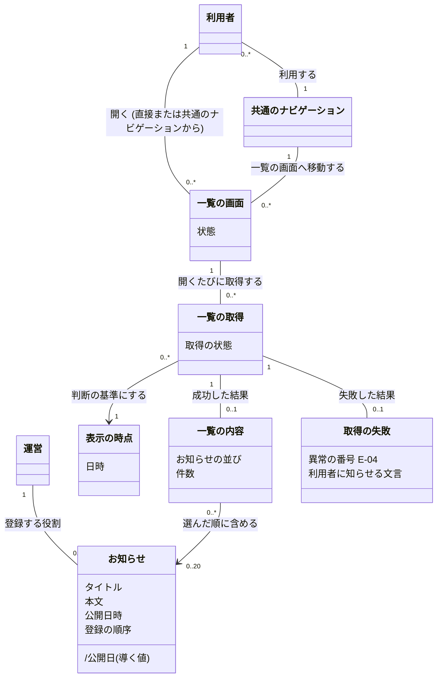

# 概念モデル: お知らせの一覧

## 1. この文書について

この文書は、[仕様書](specification.md) をもとに、お知らせの一覧に出てくる概念、その関係、制約を定める。用語は、仕様書と、仕様書が参照する [要件定義書](requirements.md) に合わせる。章番号だけを記した参照先は、仕様書とする。

登録されたお知らせと、1 回の取得で利用者に見せる一覧の内容を区別する。公開中かどうかは、取得ごとの表示の時点から決まる。公開日や公開状態は、登録された公開日時から導くものであり、独立して設定するものではない。

この文書は、業務や機能の概念を扱う。データの保存方法、識別子の付け方、フレームワークのクラスは定めない。

## 2. 概念の一覧

### 2.1 主な概念

| 名前 | 意味 | 主な属性 | 仕様の主な箇所 |
| --- | --- | --- | --- |
| 利用者 | アプリケーションを使い、一覧を閲覧する人。ログインしているかどうかは問わない | この機能では、利用者個人の属性を定めない | 要件定義書 3 章、6.1、7.2 |
| 運営 | アプリケーションを提供し、お知らせを登録する役割 | この機能では、担当者個人の属性や登録者情報を定めない | 要件定義書 3 章、5 章、10.4 |
| お知らせ | 運営から利用者への案内。登録された 1 件ごとに区別する | タイトル、本文、公開日時、登録の順序。公開日と公開状態は、ほかの値から導く | 2 章、5 章、6.3、9.1 |
| 一覧の取得 | 一覧を開くたびに行う、一覧の内容を取り出す 1 回の処理 | 表示の時点、取得の状態。完了した結果は、一覧の内容または取得の失敗 | 4 章、6.1、6.2、7.3、7.4、9.2 |
| 表示の時点 | 一覧の取得を要求されて、それを処理する時点の日時。公開中かどうかを判断する基準 | 日時。1 回の取得で使う値は 1 つ | 2 章、5.2、6.1、8.1 |
| 一覧の内容 | 取得に成功したときに一覧の画面に表示する、お知らせの並び。空の並びも成功した結果 | 順序付きのお知らせの並び、各お知らせのタイトル・本文・公開日。件数は並びから決まる | 2 章、6.1、6.3、8.2 |
| 取得の失敗 | 一覧の内容をすべて取り出せなかったこと | 異常の番号 E-04、利用者に知らせる文言 | 2 章、7.1、7.4、9.2 |
| 一覧の画面 | 利用者が一覧の内容や取得の失敗を確認する画面。ここでは、利用者が開いた画面ごとに扱う | 状態。取得中、一覧表示、お知らせ無し、取得失敗のいずれか | 6.1、6.2、7.3、9.2 |
| 共通のナビゲーション | 利用者が一覧の画面へ移動するための共通の導線 | 一覧の画面へ移動する項目。ログインの有無で変わらない | 6.2 |

「運営」は登録する役割を表す。担当者の人数や、お知らせと担当者個人との対応は、このモデルで定めない。

### 2.2 お知らせに関わる値と状態

次の用語は、お知らせの属性、属性から導く値、取得ごとに判断する状態として表す。

| 名前 | 意味 | 主な属性・表し方 | 仕様の主な箇所 |
| --- | --- | --- | --- |
| タイトル | お知らせの見出し | 登録された文字列。全文を表示する | 5.1、8.3、10.1 |
| 本文 | お知らせの案内の内容 | 登録された文字列。全文を表示し、改行の位置と数を保つ | 5.1、6.1、8.3、10.1 |
| 公開日時 | お知らせを利用者に見せ始める日時 | タイムゾーンを含む日時。欠けている、日時として読めない、またはタイムゾーンを特定できない値も、登録の不備として扱う | 5.1、5.2、8.1 |
| 公開日 | 公開日時を日本時間 (Asia/Tokyo) に直したときの年月日 | 公開日時から導く年、月、日。有効な公開日時からのみ導ける | 2 章、5.2、8.4 |
| 登録の順序 | 運営がお知らせを登録した順序 | どの 2 件についても、どちらが先でどちらが後かを決められる順序。公開日時が同じ場合に使う | 2 章、6.3、8.5 |
| 公開中のお知らせ | 有効な公開日時が、その取得の表示の時点以前のお知らせ | お知らせの公開状態「公開中」。公開日時と表示の時点が同じ場合も含む | 6.3、8.1、9.1 |
| 公開前のお知らせ | 有効な公開日時が、その取得の表示の時点より後のお知らせ | お知らせの公開状態「公開前」 | 2 章、6.3、8.1、9.1 |
| 対象外 | 公開日時が無い、日時として読めない、またはタイムゾーンを特定できないお知らせの状態 | お知らせの公開状態「対象外」。公開中にも公開前にも分類しない | 5.1、7.1 (E-01)、9.1 |
| 文字数 | 登録条件で使う文字の数 | Unicode の符号位置の数。全角、半角、改行をそれぞれ 1 文字として数える | 2 章、5.1 |

「公開中」と「公開前」は、お知らせの有効な公開日時と、その取得の表示の時点との組み合わせで決まる。「対象外」は、公開日時が無い、日時として読めない、またはタイムゾーンを特定できないことで決まる。時間が経過した場合や運営が公開日時を変更した場合も、開いている画面の内容は変わらず、次に取得した結果に反映される (7.3、9.1)。

### 2.3 操作と画面の状態

| 仕様の用語 | このモデルでの意味・表し方 |
| --- | --- |
| OP-1 一覧を表示する | 一覧を直接開く、または開き直す操作。1 回の一覧の取得を行う。利用者が件数、期間、並び順などを指定する入力は無い |
| OP-2 共通のナビゲーションから一覧の画面へ移動する | 共通のナビゲーションの項目を選び、一覧の画面へ移動して OP-1 を行う操作 |
| 共通のナビゲーション | OP-2 の入口となる導線。主な要素は、一覧の画面へ移動する項目。ログインの有無で項目が消えたり切り替わったりしない |

一覧の画面の状態は、その画面で行った取得の状態に対応する。

| 状態 | 条件 | 結果の概念・表示 |
| --- | --- | --- |
| 取得中 | 一覧を開き、取得の結果がまだ確定していない | 確定した一覧の内容も取得の失敗も無い |
| 一覧表示 | 取得に成功し、一覧の内容が 1 件以上ある | 一覧の内容にある各お知らせのタイトル、本文、公開日を表示する |
| お知らせ無し | 取得に成功し、一覧の内容が 0 件である | 空の一覧の内容。「公開中のお知らせはありません」と表示する |
| 取得失敗 | 取得が失敗した、または応答が上限時間を超えた | 取得の失敗。「お知らせを表示できませんでした。時間をおいて、もう一度開いてください」と表示する |

一覧表示、お知らせ無し、取得失敗は、1 回の取得について互いに排他的な結果である。開き直した場合は、新しい取得の取得中に戻る。取得中の画面の見た目は、このモデルでは定めない。

## 3. 概念どうしの関係

### 3.1 全体図

図では、お知らせに関わる値は属性として表す。公開日は公開日時から導く値であり、公開状態は表示の時点との関係から導く。共通のナビゲーションも、一覧の画面へ移動する導線として示す。

### 3.2 関係の意味と多重度

| 関係 | 意味 | 多重度 |
| --- | --- | --- |
| 運営 - お知らせ | お知らせは運営が登録する案内。運営は複数のお知らせを登録できる | 運営の役割 1 : お知らせ 0..*。担当者個人の人数を表さない |
| 利用者 - 一覧の画面 | 利用者が一覧の画面を開く。直接開く場合と、共通のナビゲーションから移動する場合がある | 利用者 1 : 開いた一覧の画面 0..* |
| 利用者 - 共通のナビゲーション | 利用者は共通のナビゲーションを利用する | 利用者 0..* : 共通のナビゲーション 1 |
| 共通のナビゲーション - 一覧の画面 | 共通のナビゲーションの項目から一覧の画面へ移動する | 共通のナビゲーション 1 : 移動先の一覧の画面 0..* |
| 一覧の画面 - 一覧の取得 | 一覧の画面で、開くたびに取得する。開き直す場合は、以前の取得とは別の取得になる | 一覧の画面 1 : 一覧の取得 0..*。各取得が行われる画面は 1 つ |
| 一覧の取得 - 表示の時点 | 公開状態を判断する基準を持つ。異なる取得の表示の時点が、同じ日時になることもある | 一覧の取得 0..* : 表示の時点の値 1。各取得には必ず 1 つ |
| 一覧の取得 - 一覧の内容 | 成功した取得は、空の並びを含め、一覧の内容を 1 つ持つ | 一覧の取得 1 : 一覧の内容 0..1。取得中・失敗は 0、成功は 1 |
| 一覧の取得 - 取得の失敗 | 失敗した取得は、取得の失敗を 1 つ持つ | 一覧の取得 1 : 取得の失敗 0..1。取得中・成功は 0、失敗は 1 |
| 一覧の内容 - お知らせ | 一覧の内容は、条件に合うお知らせを順序付きで含める。同じお知らせは、異なる取得の一覧にも含まれ得る | 一覧の内容 0..* : お知らせ 0..20。1 つの一覧の内容に同じ 1 件を複数回含めない |

成功した結果と失敗した結果の結びつきは排他的である。同じタイトルと本文を持つ別々のお知らせは、同じ 1 件とはみなさない。0 件の一覧の内容と、一覧の内容を持たない取得の失敗は異なる。

## 4. 制約

### 4.1 お知らせと日時

| 番号 | 制約 | 仕様の主な箇所 |
| --- | --- | --- |
| A-1 | タイトルや本文が一致しても、登録された別々のお知らせをまとめず、別々のお知らせとして扱う。これは重複をまとめない意味であり、すべての件を表示する意味ではない。件数の上限 L-3 は同じタイトルと本文のお知らせにも適用する。タイトル、本文、公開日時には、一意であることを要求しない | 6.3、7.3、8.2 |
| A-2 | 登録の順序では、異なるどの 2 件についても前後が決まる。公開日時が同じ時点のときは、後に登録したお知らせを先にする | 2 章、6.3、8.5 |
| A-3 | 公開日時と表示の時点は、同じ時点を指すかどうかで比較する。タイムゾーンの違いや表記の違いで比較結果を変えない | 5.2、8.1、8.5 |
| A-4 | 公開日時が無い、日時として読めない、またはタイムゾーンを特定できないお知らせは、公開中とみなさない。実行環境のタイムゾーンで補わず、一覧に含めず、利用者にも不備を知らせない | 5.1、5.2、7.1 (E-01)、8.1 |
| A-5 | 有効な公開日時が表示の時点以前なら公開中、より後なら公開前とする。ちょうど同じ時点なら公開中とする。処理中に時間が進んでも、同じ表示の時点で判断する | 6.3、7.3、8.1、9.1 |
| A-6 | 公開日は、公開日時を日本時間 (Asia/Tokyo) に直した年月日と必ず一致する。西暦、月、日の順で、月と日は 0 埋めせず表示する。例: `2026年1月5日` | 5.2、8.4 |

### 4.2 一覧の内容

| 番号 | 制約 | 仕様の主な箇所 |
| --- | --- | --- |
| L-1 | 一覧の内容に含めるお知らせは、すべてその取得の表示の時点で公開中である。公開前と対象外のお知らせは、並べ替えや件数に含めない | 6.3、8.1、8.2 |
| L-2 | 公開中のお知らせを公開日時の新しい順に並べ、同じ時点なら登録の順序が後のものを先にする。公開日だけで並べ替えない | 5.2、6.3、8.4、8.5 |
| L-3 | 公開中のお知らせを選び、L-2 の順に並べた後、先頭から最大 20 件を含める。対象が 20 件以下ならすべて、21 件以上なら先頭の 20 件だけを含める。21 件目以降を見るための追加取得やページの切り替えは設けない | 6.3、8.2 |
| L-4 | タイトルと本文は、登録された値のまま全文を文字として表示し、省略しない。HTML やスクリプトを解釈・実行せず、URL をリンクに変えない。本文の改行の位置と数を保つ | 6.1、8.3、10.1 |
| L-5 | 公開前のお知らせの情報は、画面と、その画面が使う通信の応答に含めない。タイトル、本文、公開日、件数、そのほかの情報すべてが対象であり、取得の失敗の応答も同じ制約を満たす | 10.2 |

### 4.3 取得と閲覧

| 番号 | 制約 | 仕様の主な箇所 |
| --- | --- | --- |
| R-1 | 1 回の取得は、表示の時点を 1 つだけ使う。処理中に実際の時間が進んでも、この値を変えない | 2 章、6.1、7.3 |
| R-2 | 取得に成功した場合だけ、一覧の内容を持つ。すべて取り出せなかった場合は取得の失敗とし、一部だけの一覧や 0 件の一覧に置き換えない。成功した 0 件の一覧でのみ「公開中のお知らせはありません」と表示する | 6.1、7.1、7.4、9.2 |
| R-3 | 一覧表示、お知らせ無し、取得失敗は、1 回の取得につきいずれか 1 つだけとする。失敗の表示は 2.3 の文言とし、保存先の名前やエラーの詳細などの内部情報を含めない | 7.1、9.2 |
| R-4 | 応答が返らない場合は、有限の上限時間を超えた時点で取得の失敗とする。その後に届いた応答や途中までの内容を、一覧の内容に使わない | 7.4 |
| R-5 | 表示中の一覧の内容は、時間の経過や運営による登録・公開日時の変更で更新しない。開き直したときに、新しい表示の時点で取得する。やり直しの回数は制限しない | 6.1、7.3、7.4、9.1、9.2 |
| R-6 | 取得は登録されたお知らせを変更しない。成功、失敗、やり直し、同時に行う複数の取得のいずれでも同じとする。各取得は、ほかの利用者の取得の表示の時点や結果に影響しない | 6.1、6.2、7.1、7.3、7.4 |
| R-7 | 登録が完了していないお知らせは取得の結果に含めず、登録が完了した後に行った取得から表示する | 7.3 |
| R-8 | 閲覧にログインや権限を要求しない。利用者が件数、期間、並び順などを指定する手段を設けず、利用者個人やログインの有無で一覧の内容を変えない。認証機能 (#1) に依存しない | 4 章、6.1、6.2、7.2、10.2 |

R-7 は、仕様書 7.3 の登録完了前後の決まりを表す。取得の処理中に登録が完了した場合の、その取得への包含を決める具体的な基準は、仕様書に定められていない。このモデルで新しい基準は加えない。

R-4 の上限時間の秒数は、仕様書 7.4 に従い、設計の段階で決める。性能目標の 1 秒を上限時間として扱わない。

### 4.4 運営が守る登録条件

次の条件は、運営が登録の手順で守る条件である。すべての登録済みのお知らせが常に満たす不変条件や、一覧の取得で検査する条件にはしない。条件を外れたお知らせについても、仕様書の扱いを維持する。

| 項目 | 運営が守る条件 | 条件を外れた場合の一覧での扱い |
| --- | --- | --- |
| タイトル | 1 文字以上 100 文字以内 | 登録された値のまま表示する。利用者に不備を知らせない (E-02) |
| 本文 | 1 文字以上 2,000 文字以内。改行を含めてよい | 登録された値のまま表示する。利用者に不備を知らせない (E-02) |
| 公開日時 | 必須。タイムゾーンを含める | A-4 のとおり、対象外として一覧に含めない (E-01) |

文字数は 2.2 の数え方を使う。登録条件と公開日時の扱いは、運営向けの登録の手順に記載する対象である (5.1、10.4)。このモデルに登録・変更・削除の画面や、登録条件の検査処理は加えない。

## 5. 仕様との対応

| 仕様書の箇所 | 関わる概念・値・状態 | 関わる制約・扱い |
| --- | --- | --- |
| 1 章、4 章 範囲と操作 | 利用者、一覧の画面、一覧の取得、共通のナビゲーション | 2.3、R-8。詳細の画面、既読・未読、通知、利用者ごとの出し分け、検索・絞り込みを追加しない |
| 2 章 用語 | 表示の時点、公開前のお知らせ、公開日、登録の順序、一覧の内容、取得の失敗、文字数 | 2 章、A-2、A-5、A-6、R-1、R-2 |
| 3 章 要件との対応 | この文書の各概念 | 下記の操作・制約を通して FR-1 ～ FR-9、NFR-1 ～ NFR-4 と対応する |
| 5.1 登録の条件 | 運営、お知らせ、タイトル、本文、公開日時、文字数 | A-4、L-4、4.4。登録条件と、条件を外れた場合の扱いを区別する |
| 5.2 日時と公開日 | 公開日時、表示の時点、公開日 | A-3、A-4、A-6、L-2 |
| 6.1 OP-1 (FR-1、FR-5 ～ FR-8) | 利用者、一覧の取得、一覧の内容、一覧の画面 | 2.3、L-4、R-1 ～ R-3、R-5、R-6、R-8 |
| 6.2 OP-2 (FR-9) | 利用者、共通のナビゲーション、一覧の画面、一覧の取得 | 2.3、R-6、R-8 |
| 6.3 選択・順序・件数 (FR-2 ～ FR-4、FR-7) | お知らせ、公開日時、登録の順序、一覧の内容 | A-1、A-2、A-5、L-1 ～ L-3、R-2 |
| 7.1 異常の一覧 | お知らせ、対象外、一覧の取得、取得の失敗 | A-1、A-2、A-4、L-4、R-2、R-3、R-6、4.4 |
| 7.2 権限の不足 | 利用者、一覧の取得 | R-8 |
| 7.3 競合 | お知らせ、登録の順序、表示の時点、一覧の取得、一覧の内容 | A-1、A-2、A-5、L-3、R-1、R-5 ～ R-7。登録完了の基準に関する未確定点は 4.3 に記載 |
| 7.4 外部の失敗 (FR-8) | 一覧の取得、取得の失敗、一覧の画面 | R-2 ～ R-6。上限時間の具体値は設計に委ねる |
| 8.1 公開日時の境界 | 公開日時、表示の時点、公開中のお知らせ、公開前のお知らせ、対象外 | A-3 ～ A-5 |
| 8.2 件数の境界 | 一覧の内容、お知らせ | L-1、L-3、R-2 |
| 8.3 文字数と改行の境界 | タイトル、本文、文字数 | L-4、4.4 |
| 8.4 公開日の境界 | 公開日時、公開日 | A-6、L-2 |
| 8.5 同じ公開日時 | 公開日時、登録の順序 | A-2、A-3、L-2 |
| 9.1 お知らせの表示の状態 | お知らせ、表示の時点、公開中のお知らせ、公開前のお知らせ、対象外 | 2.2、A-4、A-5、R-5 |
| 9.2 一覧の画面の状態 | 一覧の取得、一覧の内容、取得の失敗、一覧の画面 | 2.3、R-2 ～ R-5 |
| 10.1 文字としての表示 (NFR-1) | タイトル、本文 | L-4 |
| 10.2 未来のお知らせの非公開 (NFR-2) | 公開前のお知らせ、一覧の内容、取得の失敗 | L-5、R-8 |
| 10.3 性能 (NFR-3) | お知らせ、一覧の取得 | 登録 1,000 件で、取得の 95% が要求から応答まで 1 秒以内に完了する目標。概念の不変条件にはしない。同時利用人数は定められていない |
| 10.4 運用 (NFR-4) | 運営、お知らせ、公開日時 | 4.4。登録条件と日時の扱いを登録の手順に記載する。手順そのものは、この成果物の対象に含めない |
