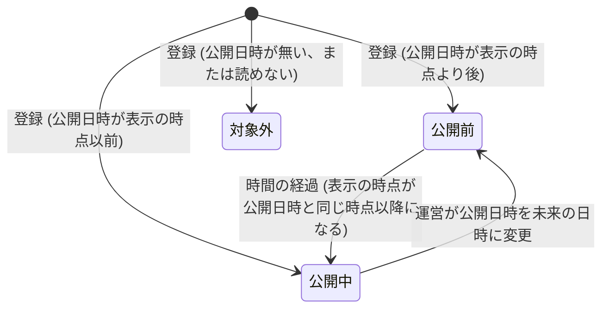
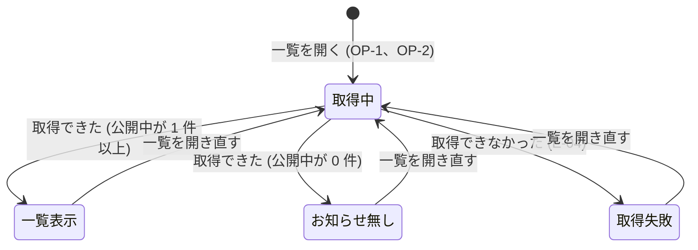

# 仕様書: お知らせの一覧

## 1. この文書について

この文書は、[要件定義書](requirements.md) をもとに、お知らせの一覧が外から見てどう振る舞うかを定める。画面の見た目、技術の選択、データの持ち方は扱わない。

この文書で扱う範囲は、要件定義書の「2.1 この機能で扱うこと」と同じとする。「2.2 この機能で扱わないこと」に挙げたもの (画面からの登録、変更、削除、お知らせ 1 件ごとの詳細の画面、既読と未読の管理、通知、利用者ごとの出し分け、一覧の検索や絞り込み) は扱わない。

## 2. 用語

要件定義書の「3. 用語」に加えて、この文書では次の用語を使う。

| 用語 | 意味 |
| --- | --- |
| 表示の時点 | 一覧の取得を要求されて、それを処理する時点の日時。公開中かどうかは、この日時を基準に判断する。1 回の取得の中で使う表示の時点は 1 つとする |
| 公開前のお知らせ | 公開日時が表示の時点より後のお知らせ。一覧には表示しない |
| 公開日 | 公開日時を日本時間 (Asia/Tokyo) に直したときの年月日 |
| 登録の順序 | 運営がお知らせを登録した順序。公開日時が同じお知らせどうしの並び順に使う。どの 2 件のお知らせについても、登録の順序で前後が必ず決まるものとする |
| 一覧の内容 | 一覧の画面に表示する、お知らせの並び。0 件から 20 件まで |
| 取得の失敗 | 一覧の内容を、すべて取り出せなかったこと (7.4) |
| 文字数 | 文字 (Unicode の符号位置) の数。全角と半角を区別せず、どちらも 1 文字と数える。改行も 1 文字と数える |

## 3. 要件との対応

| 要件 | 内容 (要約) | 仕様の該当箇所 |
| --- | --- | --- |
| FR-1 | 未ログインでも一覧を開ける | 6.1、7.2 |
| FR-2 | 公開中のお知らせだけを表示する。未来のお知らせは、その日時になるまで表示しない | 6.3、8.1、9.1 |
| FR-3 | 公開日時の新しい順に並べる。同じ公開日時なら、後に登録したものを先に並べる | 6.3、8.5 |
| FR-4 | 公開中のお知らせのうち、新しいものから最大 20 件を表示する | 6.3、8.2 |
| FR-5 | 各お知らせに、タイトル、本文、公開日を表示する | 6.1、8.3、8.4 |
| FR-6 | 本文の改行を、表示にも改行として反映する | 6.1、8.3 |
| FR-7 | 公開中のお知らせが 1 件も無い場合は、お知らせが無いことを表示する | 6.1、6.3、8.2 |
| FR-8 | 取得できなかった場合は、一覧を表示できなかったことを知らせる | 7.1 (E-04)、7.4、9.2 |
| FR-9 | 共通のナビゲーションから、一覧の画面へ移動できる | 6.2 |
| 5 章 (登録の条件) | 運営が登録するお知らせの条件 | 5.1 |
| NFR-1 | タイトルや本文の HTML やスクリプトを、解釈や実行をせず文字として表示する | 10.1 |
| NFR-2 | 公開日時が未来のお知らせを、画面の通信の応答にも含めない | 10.2 |
| NFR-3 | 1,000 件登録された状態で、一覧の取得の 95% が 1 秒以内に完了する | 10.3 |
| NFR-4 | 運営の登録の手順を、開発者向けの文書に書く | 10.4 |
| 前提 | 公開日は、日本時間 (Asia/Tokyo) の年月日で表示する | 5.2、8.4 |
| 前提 | 認証の機能 (#1) に依存しない | 6.1、7.2 |

## 4. 操作の一覧

| 番号 | 操作 | 事前の条件 (ログイン状態) | 主な要件 |
| --- | --- | --- | --- |
| OP-1 | 一覧を表示する (一覧の画面を直接開く場合を含む) | 問わない | FR-1 ～ FR-8 |
| OP-2 | 共通のナビゲーションから一覧の画面へ移動する | 問わない | FR-9 |

この機能は、利用者の入力を受け付けない。一覧の内容は、取得を要求された時点の表示の時点と、登録されているお知らせから決まる。

## 5. 登録されたお知らせの扱い

お知らせは、運営がデータベースに直接登録する。この機能には登録の画面を設けない。この章は、登録されたお知らせを一覧がどう扱うかを定める。

### 5.1 登録の条件と、条件を外れた場合の扱い

| 項目 | 登録の条件 (要件定義書の 5 章) | 条件を外れている場合の一覧での扱い |
| --- | --- | --- |
| タイトル | 1 文字以上 100 文字以内 | 登録された値のまま表示する (8.3、E-02) |
| 本文 | 1 文字以上 2,000 文字以内。改行を含めてよい | 登録された値のまま表示する (8.3、E-02) |
| 公開日時 | 必須。タイムゾーンを含めて扱う | 公開日時が無い、または日時として読めない場合は、公開中とみなさず、一覧に含めない (E-01) |

登録の条件を満たすかどうかは、この機能では検査しない。条件は、運営が登録の手順 (10.4) で守る。

### 5.2 日時と公開日の扱い

- 公開日時は、タイムゾーンを含む日時として扱う。公開日時と表示の時点は、同じ時点を指すかどうかで比べる。表し方 (タイムゾーンの違いや、表記の違い) は比べた結果に影響しない。例: `2026-10-12T00:00:00+09:00` と `2026-10-11T15:00:00Z` は同じ時点である
- 公開日は、公開日時を日本時間 (Asia/Tokyo) に直したうえで、その年月日とする
- 公開日は、西暦、月、日の順に、月と日を 0 埋めせずに表示する。例: `2026年10月12日`、`2026年1月5日`
- 並べ替えは公開日ではなく、公開日時 (時刻まで含む) で行う

## 6. 操作ごとの振る舞い

### 6.1 OP-1 一覧を表示する

| 項目 | 内容 |
| --- | --- |
| 入力 | なし。利用者が件数、期間、並び順を指定する手段は設けない |
| 事前の条件 | なし (ログイン中でも未ログインでも行える。ログインの有無は結果に影響しない) |
| 処理 | 1. 表示の時点を決める 2. 登録されたお知らせのうち、公開日時が表示の時点以前のもの (公開中のお知らせ) を選ぶ 3. 選んだお知らせを 6.3 の順に並べ、先頭から最大 20 件を取り出す 4. 取り出したお知らせごとに、タイトル、本文、公開日を一覧の内容に含める 5. 取り出したお知らせが 0 件であれば、お知らせが無いことを一覧の内容に含める 6. 一覧の内容を返す |
| 状態の変化 | なし。登録されたお知らせは変わらない |
| 出力 | 成功: 一覧の内容 (0 件から 20 件)。0 件の場合は「公開中のお知らせはありません」と表示する |
| 異常系 | 登録データの不備 (E-01、E-02)、競合 (E-03)、外部の失敗 (E-04) |

補足:

- 本文の改行は、登録されたとおりの位置と数で、改行として表示する (FR-6)
- タイトルと本文は、文字としてそのまま表示する (10.1)
- 一覧を開いたままにしている間は、表示の内容を更新しない。最新の内容は、一覧を開き直したとき (OP-1) に得られる

### 6.2 OP-2 共通のナビゲーションから一覧の画面へ移動する

| 項目 | 内容 |
| --- | --- |
| 入力 | 共通のナビゲーションの、一覧の画面へ移動する項目を選ぶ操作 |
| 事前の条件 | なし (ログイン中でも未ログインでも、同じ項目を使える) |
| 処理 | 一覧の画面へ移動し、移動した時点で OP-1 を行う |
| 状態の変化 | 利用者が見ている画面が一覧の画面になる。登録されたお知らせは変わらない |
| 出力 | OP-1 の出力と同じ |
| 異常系 | 外部の失敗 (E-04)。移動した後の取得で起こる |

補足:

- 共通のナビゲーションの、一覧の画面へ移動する項目は、ログインの有無によって消えたり、切り替わったりしない

### 6.3 一覧に載せるお知らせの決まり

OP-1 の処理のうち、お知らせを選ぶ、並べる、件数を決める部分は、次のとおりとする。

1. 選ぶ: 公開中のお知らせだけを選ぶ。公開前のお知らせは、並べ替えにも件数にも含めない (FR-2)
2. 並べる: 公開日時の新しい順に並べる。比べるのは公開日時の全体 (時刻まで) であり、公開日 (年月日) では比べない。公開日時が同じ時点のお知らせは、登録の順序が後のものを先にする (FR-3)
3. 件数: 並べた順の先頭から最大 20 件を取り出す。件数の上限を当てはめるのは、1 の選ぶ処理の後とする (FR-4)
4. 0 件: 選んだお知らせが 0 件の場合は、お知らせが無いことを表示する (FR-7)
5. 同じ内容: タイトルや本文が同じお知らせが複数あっても、まとめず、別々のお知らせとして表示する
6. 21 件目以降: 取り出さなかったお知らせを見る手段は設けない。続きを読む操作や、ページを切り替える操作は無い

## 7. 異常系

### 7.1 異常の一覧

すべての異常系で、次の決まりを守る。

- 異常系で終わった取得では、一覧の内容を一部だけ表示しない。0 件の表示にもしない。全部を取り出せた場合だけ一覧を表示する
- 利用者に知らせる内容に、保存先の名前やエラーの詳しい内容など、内部の情報を含めない
- 異常系で、登録されたお知らせは変えない。この機能は読み取りだけを行う

| 番号 | 分類 | 発生する操作 | 条件 | 振る舞い |
| --- | --- | --- | --- | --- |
| E-01 | 登録データの不備 | OP-1、OP-2 | 公開日時が無い、または日時として読めない | そのお知らせを公開中とみなさず、一覧に含めない。利用者には知らせない。ほかのお知らせは、通常どおり表示する |
| E-02 | 登録データの不備 | OP-1、OP-2 | タイトルまたは本文が、5.1 の条件を外れている | 登録された値のまま表示する。利用者には知らせない |
| E-03 | 競合 | OP-1、OP-2 | 同じ公開日時のお知らせがある、同じ内容のお知らせが複数ある、取得と登録が同時に行われた | 7.3 のとおりとする。エラーにはしない |
| E-04 | 外部の失敗 | OP-1、OP-2 | お知らせを保存している仕組みに接続できない、取り出しの途中で失敗した、応答が返らない | 取得の失敗として、次の文言を表示する: 「お知らせを表示できませんでした。時間をおいて、もう一度開いてください」。お知らせが無いという表示はしない (FR-8) |

### 7.2 権限の不足

該当しない。一覧は、だれでも閲覧できる。権限による制限は無い。未ログインであることを理由に、一覧が表示されない、またはエラーになることは無い (FR-1、前提)。

### 7.3 競合

| 状況 | 振る舞い |
| --- | --- |
| 同じ公開日時 (同じ時点) のお知らせが 2 件以上ある | 登録の順序が後のものを先に並べる (6.3)。エラーにはしない |
| タイトルと本文が同じお知らせが複数ある | 別々のお知らせとして、すべて表示する |
| 一覧の取得の処理中に、お知らせが登録された | 登録が完了していないお知らせは、その取得の結果に含めない。登録が完了した後に行った取得から表示する |
| 一覧を開いたままの間に、お知らせが登録された、または公開日時が変わった | 表示中の一覧は変わらない。一覧を開き直す (OP-1) と、その時点の内容になる |
| 取得の処理中に、公開日時が表示の時点を過ぎた | 判断は表示の時点で行う。表示の時点より後の公開日時のお知らせは、その取得の結果に含めない |
| 同時に多くの利用者が一覧を開いた | 読み取りだけのため、互いに影響しない。それぞれ、自分の取得の表示の時点で判断する |

### 7.4 外部の失敗

- お知らせを保存している仕組みに接続できない、取り出しの途中で失敗した、または応答が返らない場合は、取得の失敗 (E-04) とする
- 取得の失敗では、一覧の内容を一部だけ表示せず、お知らせが無いという表示もしない。取得の失敗の文言を表示する (E-04)
- 利用者は、一覧を開き直す (OP-1 を行い直す) ことでやり直せる。やり直しの回数は制限しない。読み取りだけのため、やり直しによる二重の登録や、ほかの異常は起こらない
- 応答が返らないと判断するまでの時間の上限は、この仕様では数値で定めない。要件定義書に上限が無いため、要件の側で定めてから、実装に反映する

## 8. 境界値

### 8.1 公開日時と表示の時点 (FR-2)

| 公開日時と表示の時点の関係 | 振る舞い |
| --- | --- |
| 公開日時が表示の時点より後 (わずかでも後。例: 1 秒後) | 公開前のお知らせとして、表示しない |
| 公開日時が表示の時点と同じ時点 (ちょうど) | 公開中のお知らせとして、表示する |
| 公開日時が表示の時点より前 (例: 1 秒前) | 公開中のお知らせとして、表示する |
| 公開日時が無い、または日時として読めない | 公開中とみなさず、表示しない (E-01) |

補足:

- 「ちょうど同じ時点」を公開中とするのは、用語の定義 (公開日時が表示の時点以前) に従うため。FR-2 の「その日時を過ぎるまで表示しない」という文言は、ちょうどの時点では表示しないとも読めるが、この仕様では用語の定義を優先する
- 例: 公開日時が `2026-10-12T00:00:00+09:00` のお知らせは、表示の時点が `2026-10-11T15:00:00Z` のとき、同じ時点のため表示する

### 8.2 件数 (FR-4、FR-7)

| 登録の状況 | 表示の結果 |
| --- | --- |
| 登録されたお知らせが 0 件 | 「公開中のお知らせはありません」を表示する |
| 公開前のお知らせだけが 25 件ある | 「公開中のお知らせはありません」を表示する。公開前のお知らせは件数に数えない |
| 公開中のお知らせが 1 件 | その 1 件を表示する |
| 公開中のお知らせが 20 件 | 20 件すべてを表示する |
| 公開中のお知らせが 21 件 | 新しい順に 20 件を表示する。21 件目 (いちばん古いもの) は表示しない |
| 公開中のお知らせが 3 件、公開前のお知らせが 25 件 | 公開中の 3 件を表示する |

### 8.3 タイトルと本文の長さと改行 (FR-5、FR-6)

| 項目 | 境界 | 振る舞い |
| --- | --- | --- |
| タイトル | 1 文字 (下限)、100 文字 (上限) | 全文を表示する。途中で省略しない |
| タイトル | 101 文字以上 (登録の条件の外) | 登録された値のまま、全文を表示する (E-02) |
| 本文 | 1 文字 (下限)、2,000 文字 (上限) | 全文を表示する。途中で省略しない |
| 本文 | 2,001 文字以上 (登録の条件の外) | 登録された値のまま、全文を表示する (E-02) |
| 本文 | 改行が無い | 改行を含まない 1 つの文として表示する |
| 本文 | 空行を含む (連続する改行) | 登録されたとおりの数の改行を、改行として表示する |

### 8.4 公開日の境界 (前提)

| 公開日時 | 日本時間 (Asia/Tokyo) の日時 | 公開日 |
| --- | --- | --- |
| `2026-10-11T14:59:59Z` | 2026-10-11 23:59:59 | `2026年10月11日` |
| `2026-10-11T15:00:00Z` | 2026-10-12 00:00:00 | `2026年10月12日` |

同じ公開日のお知らせが複数ある場合 (例: 公開日時が `2026-10-12T09:00:00+09:00` と `2026-10-12T20:00:00+09:00` のお知らせ) は、どちらも公開日は `2026年10月12日` と表示する。並び順は、公開日時が新しい 20:00 のお知らせを先にする。

### 8.5 同じ公開日時 (FR-3)

| 状況 | 並び順 |
| --- | --- |
| 2 件の公開日時が同じ時点で、表し方だけが違う (例: `2026-10-12T10:00:00+09:00` と `2026-10-12T01:00:00Z`)。登録の順序は A が先、B が後 | B を先、A を後に並べる |
| 3 件の公開日時が同じ時点 | 登録の順序が新しいものから順に並べる |

## 9. 状態の遷移

### 9.1 お知らせの表示の状態

お知らせが一覧に載るかどうかは、一覧の取得ごとに、その取得の表示の時点で判断する。

| 今の状態 | きっかけ | 条件 | 次の状態 |
| --- | --- | --- | --- |
| (なし) | 運営が登録する | 公開日時が表示の時点より後 | 公開前 |
| (なし) | 運営が登録する | 公開日時が表示の時点以前 | 公開中 |
| (なし) | 運営が登録する | 公開日時が無い、または日時として読めない | 対象外 (一覧に含めない) |
| 公開前 | 一覧の取得 | 表示の時点が公開日時と同じ時点以降になった | 公開中 |
| 公開中 | 運営が公開日時を変更する | 新しい公開日時が、次の取得の表示の時点より後 | 公開前 |

- 状態が変わるのは、次の取得の時点から反映される。取得を行わない間は、利用者の画面に表示されていた内容は変わらない (7.3)
- 対象外のお知らせは、利用者には表示されず、知らせもしない (E-01)

### 9.2 一覧の画面の状態

一覧表示、お知らせ無し、取得失敗の 3 つの結果は、互いに排他的である。1 回の取得につき、いずれか 1 つだけになる。

## 10. 非機能の振る舞い

### 10.1 文字としての表示 (NFR-1)

- タイトルと本文は、登録された文字を、そのまま文字として表示する。HTML のタグやスクリプトは、解釈も実行もしない。例: 本文に `<script>` という文字の並びが含まれる場合は、その文字の並びのまま表示する
- URL は、リンクにせず、文字としてそのまま表示する

### 10.2 未来のお知らせを含めない (NFR-2)

- 一覧の画面が使う通信の応答には、公開前のお知らせのタイトル、本文、公開日、件数、そのほかの情報を含めない。取得の失敗の応答にも含めない
- 一覧の取得の要求には、利用者が指定する値を持たせない (6.1 の入力は無し)。そのため、公開前のお知らせを取り出す手段は、この画面の通信には無い

### 10.3 性能 (NFR-3)

- 登録されたお知らせが 1,000 件ある状態 (公開中と公開前の内訳は問わない) で、一覧の取得 (OP-1) を行ったとき、95% が 1 秒以内に完了する
- 「完了」とは、一覧の取得を要求してから、一覧の内容を含む応答が返るまでをいう
- 同時に利用する人数の条件は、要件定義書に無いため、この仕様では定めない

### 10.4 運用 (NFR-4)

- 運営がお知らせをデータベースに登録する手順は、開発者向けの文書に書く。この仕様の対象は一覧の振る舞いであり、登録の手順は含めない
- 登録の手順には、5.1 の登録の条件と、5.2 の公開日時の扱い (タイムゾーンを含めること) を書く
