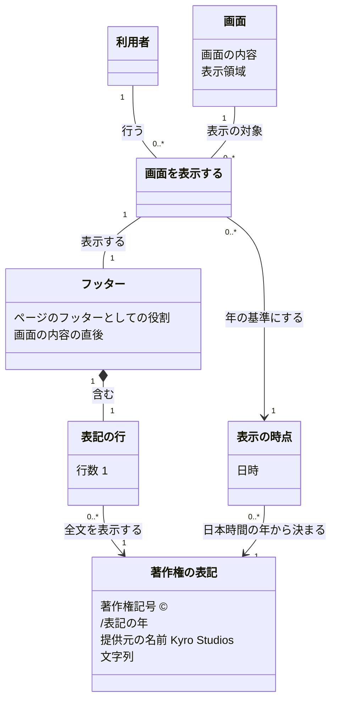

# 概念モデル : フッターの著作権の表記

## 1. この文書について

この文書は、[仕様書](specification.md) をもとに、フッターの著作権の表記に出てくる概念、その関係、制約を定める。用語は、仕様書と、仕様書が参照する [要件定義書](requirements.md) に合わせる。章番号だけを記した参照先は、仕様書とする。

同じ画面でも、初めて開く、ほかの画面から移動する、再読み込みする、戻る操作で再表示する場合は、それぞれ別の「画面を表示する (OP-1)」として扱う。表示の時点と、その表示で見せるフッターを、1 回の表示ごとに対応付ける。

この文書の関係は、画面が利用者に表示された場合について表す。画面そのものが利用者の端末に届かない場合は、仕様書 7.4 と同じく対象外とする。表示の処理途中の状態も定めない。

業務や機能の概念を扱い、保存方法、識別子の付け方、フレームワークのクラスは定めない。

## 2. 概念の一覧

### 2.1 主な概念

| 名前 | 意味 | 主な属性 | 仕様の主な箇所 |
| --- | --- | --- | --- |
| 利用者 | ブラウザーでアプリケーションを使い、画面とフッターを見る人。ログインしているかどうかは問わない | この機能では、利用者個人の属性を定めない | 要件定義書 3 章、4 章、6 章、6.1、7.2 |
| 画面 | 利用者のブラウザーに表示されるアプリケーションの画面。ログインの前後、利用者の権限、エラーを知らせる画面を含む | 画面の内容、表示領域。個々の画面の内容や機能は、このモデルで定めない | 2 章、5.4、6.1、7.1 (E-02)、8.3 |
| 画面を表示する | OP-1 に対応する、画面を利用者に表示する 1 回の出来事。再表示も新しい出来事として扱う | 表示の時点。利用者が表記のために入力する値は無い | 4 章、6.1、7.1 (E-04、E-05)、9 章 |
| 表示の時点 | その 1 回の表示で画面を利用者に表示する時点の日時。表記の年を求める基準 | 日時。1 回の表示で使う値は 1 つ | 2 章、5.3、6.1、8.1 |
| フッター | 画面の内容の直後に続く、表記の行を含む領域。すべての画面で共通の決まりに従う | ページのフッターとしての役割、画面の内容との順序 (直後) | 2 章、5.4、6.1、8.3、10.2 |
| 表記の行 | フッターの中で著作権の表記を表示する、1 行の部分 | 著作権の表記、行数 (常に 1) | 2 章、5.2、6.1、8.2、10.2 |
| 著作権の表記 | アプリケーションの提供元と年を示す文字列。表示の時点から決まる | 著作権記号 (`©`)、表記の年、アプリケーションの提供元の名前 (`Kyro Studios`)、これらを並べた文字列 | 要件定義書 3 章、5.1、5.3、6.1、6.2 |

「フッター」は領域、「表記の行」はその中の表示部分、「著作権の表記」はそこで読める文字列を表す。共通のフッターとは、すべての画面で同じ表記・位置・認識の決まりを使う意味であり、異なる表示の結果を 1 つのフッターとして共有する意味ではない。

### 2.2 値と表示の条件に関わる用語

次の用語は、主な概念の属性、値を導く規則、または閲覧に関わる条件として表す。

| 名前 | 意味 | 主な属性・表し方 | 仕様の主な箇所 |
| --- | --- | --- | --- |
| 表記の年 | 表示の時点を日本時間 (Asia/Tokyo) に直したときの西暦の年 | 著作権の表記の属性。表示の時点から導く値で、4 桁の算用数字で表す。独立して設定する値ではない | 2 章、5.1、5.3、8.1 |
| アプリケーションの提供元 | 著作権の表記によって利用者が確認する提供元 | 著作権の表記に含める名前は `Kyro Studios` に固定する。提供元の登録や変更の機能は無い | 要件定義書 1 章、3 章、5.1 |
| 画面の内容 | フッターより前に表示する画面の内容。空の場合や取得の失敗を知らせる場合もある | 画面の属性。内容が無い、表示領域より短い、表示領域より長い、という位置の条件に使う | 5.4、7.1 (E-02)、7.4、8.3 |
| 表示領域 | ブラウザーで画面を見る領域 | 画面の表示条件。幅は表記の全文を読む条件に、高さは画面の内容の長さとフッターの位置の説明に使う。幅や高さの値は固定しない | 5.2、5.4、8.2、8.3 |
| 支援技術 | フッターの領域や表記を認識するために利用者が使う技術 | フッターの役割の認識、領域への直接の移動、読み上げの順序に関する条件として表す。具体的な技術や認識させる方法は定めない | 10.2 |

日本時間 (Asia/Tokyo) は、表示の時点から表記の年を求める固定の基準とする。利用者が選択する設定としては扱わない。

### 2.3 操作の対応

| 操作 | 関わる概念と意味 |
| --- | --- |
| OP-1 画面を表示する | 利用者が画面を表示するたびに、1 つの表示の時点を基準に表記の年と著作権の表記を求め、その表示のフッターと表記の行を表示する |
| OP-2 フッターの表記をクリックする | 表示中の表記の行に対する操作。画面の移動、表記の変更、状態の変化は起こらず、新しい OP-1 にもならない |

## 3. 概念どうしの関係

### 3.1 全体図

図は 2.1 の主な概念の関係を示す。2.2 の値と表示条件は属性や制約として表す。図中の英字は Mermaid の記述に使う名前であり、実装のクラス名ではない。

### 3.2 関係の意味と多重度

| 関係 | 意味 | 多重度 |
| --- | --- | --- |
| 利用者 - 画面を表示する | 利用者が画面を開く、移動する、再読み込みする、戻る操作で再表示する。1 人の利用者が複数のタブで表示する場合も、別々の表示として扱う | 利用者 1 : 画面を表示する 0..*。各表示を行う利用者は 1 人 |
| 画面 - 画面を表示する | 1 回の表示は、1 つの画面を対象とする。同じ画面を繰り返し表示できる | 画面 1 : 画面を表示する 0..* |
| 画面を表示する - 表示の時点 | その表示で使う年の基準を持つ。異なる表示の日時が同じになることもある | 画面を表示する 0..* : 表示の時点の値 1。各表示には必ず 1 つ |
| 画面を表示する - フッター | その表示の画面の内容の直後に、フッターを 1 つ表示する | 画面を表示する 1 : その表示のフッター 1 |
| フッター - 表記の行 | その表示のフッターは、著作権の表記を載せる行を 1 つ含む | フッター 1 : 表記の行 1 |
| 表記の行 - 著作権の表記 | 表記の行は、1 つの著作権の表記を全文表示する。同じ年の異なる表示では、文字列の値が同じになる | 表記の行 0..* : 著作権の表記の値 1 |
| 表示の時点 - 著作権の表記 | 表示の時点を日本時間に直した年から、1 つの文字列が決まる。同じ日本時間の年に属する異なる日時は、同じ文字列に対応する | 表示の時点の値 0..* : 著作権の表記の値 1 |

表示の時点と著作権の表記は値として扱う。同じ値に複数の表示が対応しても、それらの表示が互いに影響することはない。この多重度は、値を保存したり共有したりする仕組みを要求しない。

## 4. 制約

ここでの不変条件は、画面が表示されている間と、操作の前後や同時の表示で常に守る条件を指す。フッターや表記のための保存状態、状態の遷移は設けない。

### 4.1 表示の時点と表記の年

| 番号 | 制約 | 仕様の主な箇所 |
| --- | --- | --- |
| T-1 | 1 回の OP-1 では、表示の時点を 1 つだけ使う。対応するフッターの表記は、必ずその表示の時点から決める | 2 章、6.1 |
| T-2 | 表記の年は、表示の時点を日本時間 (Asia/Tokyo) に直した西暦の年と一致する。固定の年、利用者の端末のタイムゾーン、国や地域、ブラウザーの言語で置き換えない | 5.3、8.1 |
| T-3 | OP-1 のたびに表示の時点から年と表記を求め直す。戻る操作による再表示も、その再表示の時点の年にする。以前の表示の結果を引き継がない | 5.3、6.1、9 章 |
| T-4 | 画面を開いたままにしている間は、表示中の表記を変えない。日本時間の年が変わっても、新しい年が反映されるのは次の OP-1 とする | 6.1、7.1 (E-05)、7.3 |
| T-5 | 同時に行う複数の表示は、それぞれの表示の時点を使う。ほかのタブや画面の表示の時点、表記に影響しない | 7.1 (E-04)、7.3 |
| T-6 | 表示の時点の日時が得られ、日本時間の年を求められることを前提とする。得た日時は正しいものとして扱い、時刻のずれを補正しない。取得の失敗の分岐、代わりの年、誤った年の表示を追加しない | 5.3、7.1 (E-01) |

T-6 は設計上の必須条件を表す。この条件を満たせないと判明した場合は、仕様書の指示どおり、要件定義書の FR-1 と FR-3 を先に変更し、仕様書を改める。このモデルで別の振る舞いを定めない。

年の境界は次のとおりとする (8.1)。

| 表示の時点 (UTC) | 日本時間 (Asia/Tokyo) | 著作権の表記 |
| --- | --- | --- |
| `2026-12-31T14:59:59Z` | 2026 年 12 月 31 日 23:59:59 | `© 2026 Kyro Studios` |
| `2026-12-31T15:00:00Z` | 2027 年 1 月 1 日 00:00:00 | `© 2027 Kyro Studios` |
| `2026-12-31T15:30:00Z` | 2027 年 1 月 1 日 00:30:00 | `© 2027 Kyro Studios` |

### 4.2 フッターと著作権の表記

| 番号 | 制約 | 仕様の主な箇所 |
| --- | --- | --- |
| F-1 | 表示された各画面には、その表示に対応するフッターが 1 つあり、その中に表記の行が 1 つある。ログインの有無、利用者の権限、画面の種類によって表示の有無や表記の決まりを変えない | 6.1、7.2、7.4 |
| F-2 | 著作権の表記は、`©` (U+00A9) の 1 文字、半角スペース 1 つ、4 桁の算用数字の表記の年、半角スペース 1 つ、`Kyro Studios` の順とする。大文字と小文字、スペースの数、文字の並びは固定し、利用者の言語の設定によって変えない | 5.1 |
| F-3 | 表記には改行を含めず、画面上でも必ず 1 行とする。表示領域が極端に狭い場合も、折り返しや文字の省略をせず、利用者が全文を読めるようにする | 5.2、8.2 |
| F-4 | フッターは画面の内容の直後に置き、表示領域の下端に固定しない。内容が無い場合は画面の上部の直後、内容が短い場合はその直後、長い場合は内容の最後に続き、スクロールして見る位置となる | 5.4、8.3 |
| F-5 | フッターの表記は、画面の内容の取得や、認証 (#1)、お知らせ (#35)、外部のサービスの状態に依存しない。内容の取得が失敗した場合やエラーを知らせる画面でも、通常どおり表示する。内容の失敗を知らせる方法は、その画面の仕様に従う | 7.1 (E-02)、7.4 |
| F-6 | 著作権の表記には、リンク、ボタン、利用規約、バージョン番号、住所など、ほかの文言を含めない。利用者が表記を変更する手段を設けず、クリックや表記の上での操作によって画面の移動や状態の変化を起こさない | 1 章、5.1、6.2 |
| F-7 | URL の追加の値、画面の入力の値、Cookie など、利用者が指定する値は表記に影響しない。表記は表示の時点と仕様の固定の決まりだけで決まる | 4 章、7.1 (E-03) |

### 4.3 表示に関わる条件

次の条件は、概念の値や多重度だけでは表せない表示の条件として、仕様から引き継ぐ。

| 番号 | 条件 | 仕様の主な箇所 |
| --- | --- | --- |
| V-1 | 著作権の表記は画面の中で組み立て、表記のためだけの追加の通信や外部のサービスへの問い合わせを行わない。表記のために保存されたデータを読み書きしない。異常系でも保存されたデータを変えない | 6.1、7.1、7.4、10.1 |
| V-2 | 支援技術は、フッターを画面の内容とは別のページのフッターとして認識でき、利用者はその領域へ直接移動できる。読み上げでは画面の内容の後にフッターが続き、表記の文字は `©`、年、`Kyro Studios` の順で読まれる | 10.2 |
| V-3 | 異常時に利用者へ知らせる内容に、時刻の取得元の名前、エラーの詳しい内容などの内部情報を含めない | 7.1 |

## 5. 仕様との対応

| 仕様書の箇所 | 関わる概念・値・条件 | 対応する制約・扱い |
| --- | --- | --- |
| 1 章 範囲 | フッター、著作権の表記、利用者 | F-1、F-6。リンク、表記の変更、画面ごとの出し分けは追加しない |
| 2 章 用語 | 画面、表示の時点、表記の年、表記の行、フッター | 2 章、T-1、T-2、F-3、F-4 |
| 3 章 要件との対応 | この文書の各概念 | FR-1 は F-1、F-5、FR-2 は F-2、F-3、FR-3 は T-1 ～ T-4、FR-4 は F-4、NFR-1 は V-1、NFR-2 は V-2 に対応する |
| 4 章 操作の一覧 | 利用者、画面を表示する、表記の行 | 2.3、F-1、F-6、F-7 |
| 5.1 形式 | 著作権の表記、表記の年、アプリケーションの提供元 | F-2、F-6 |
| 5.2 1 行 | 表記の行、著作権の表記、表示領域 | F-3 |
| 5.3 年 | 表示の時点、表記の年、著作権の表記 | T-1 ～ T-3、T-6 |
| 5.4 位置 | 画面、画面の内容、フッター、表示領域 | F-4 |
| 6.1 OP-1 | 利用者、画面を表示する、表示の時点、フッター、表記の行、著作権の表記 | 3 章、T-1 ～ T-4、F-1、F-4、V-1 |
| 6.2 OP-2 | 表記の行、著作権の表記 | 2.3、F-6 |
| 7.1 E-01 | 表示の時点、表記の年 | T-6。時刻の取得の失敗を異常系として追加しない |
| 7.1 E-02 | 画面の内容、フッター | F-5 |
| 7.1 E-03 | 著作権の表記、利用者 | F-7 |
| 7.1 E-04、E-05、7.3 競合 | 画面を表示する、表示の時点、著作権の表記 | T-4、T-5 |
| 7.1 異常系の共通の決まり | 表記の年、画面を表示する、利用者 | T-6、V-1、V-3 |
| 7.2 権限の不足 | 利用者、画面、フッター | F-1 |
| 7.4 外部の失敗 | 画面、画面の内容、フッター、著作権の表記 | F-5、V-1。画面が端末に届かない場合は 1 章の対象外 |
| 8.1 年の切り替わり | 表示の時点、表記の年、著作権の表記 | T-2、4.1 の境界の例。日本時間の 1 月 1 日 0 時ちょうどから新しい年になる |
| 8.2 表記の幅 | 表示領域、表記の行、著作権の表記 | F-3 |
| 8.3 画面の内容の量 | 画面の内容、表示領域、フッター | F-4 |
| 9 章 状態の遷移 | 画面を表示する、表示の時点、フッター、著作権の表記 | T-3、T-4、4 章。保存状態や状態の遷移を追加しない |
| 10.1 通信と組み立て | 画面を表示する、著作権の表記 | V-1 |
| 10.2 支援技術による認識 | 支援技術、フッター、表記の行、著作権の表記 | V-2 |
| 11 章 後の段階に委ねる事項 | 表示の時点、表示領域、フッター、著作権の表記、支援技術 | 下記の事項はこのモデルで具体的な方法を追加せず、仕様の条件を後の設計に引き継ぐ |

仕様書 11 章に挙げられた、日時の取得元、狭い表示領域で全文を読めるようにする方法、表記を組み立てる仕組みと文字列を置く場所、文字の大きさ・色・配置・余白、支援技術に認識させる方法と確かめ方、再表示時に年を求め直す方法は、後の設計に委ねる。どの方法を選んでも、この文書の T-1 ～ T-6、F-1 ～ F-7、V-1 ～ V-3 を満たすことを条件とする。
