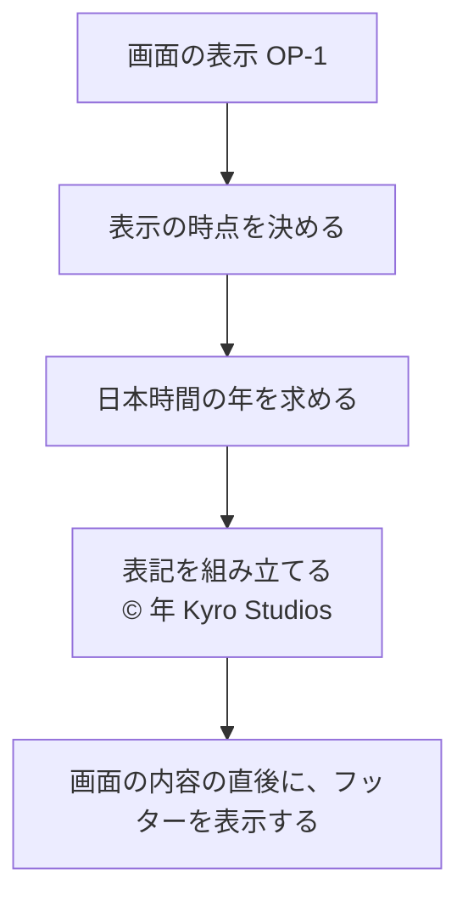

# 仕様書: フッターの著作権の表記

## 1. この文書について

この文書は、[要件定義書](requirements.md) をもとに、フッターの著作権の表記が外から見てどう振る舞うかを定める。画面の見た目、技術の選択、データの持ち方は扱わない。

この文書で扱う範囲は、要件定義書の「2.1 この機能で扱うこと」と同じとする。「2.2 この機能で扱わないこと」に挙げたもの (利用規約やプライバシーポリシーへのリンク、表記の変更、画面ごとの表示の出し分け) は扱わない。

## 2. 用語

要件定義書の「3. 用語」に加えて、この文書では次の用語を使う。

| 用語 | 意味 |
| --- | --- |
| 画面 | 利用者のブラウザーに表示される、アプリケーションのすべての画面。ログインの前後、利用者の権限、エラーを知らせる画面を含む |
| 表示の時点 | 画面を利用者に表示する時点の日時。1 回の表示の中で使う表示の時点は 1 つとする |
| 表記の年 | 表示の時点を日本時間 (Asia/Tokyo) に直したときの西暦の年 |
| 表記の行 | 著作権の表記を表示する、1 行の部分 |
| フッター | 画面の内容の直後に続く、表記の行を含む領域 |

## 3. 要件との対応

| 要件 | 内容 (要約) | 仕様の該当箇所 |
| --- | --- | --- |
| FR-1 | すべての画面の下部に共通のフッターを表示する。未ログインでも表示する | 6.1、7.1 (E-01、E-02)、7.2、7.4 |
| FR-2 | 表記を 1 行で表示する。形式は `© <年> Kyro Studios` | 5.1、5.2、8.2 |
| FR-3 | 表記の年は、表示の時点の日本時間の年にする | 5.3、6.1、8.1 |
| FR-4 | 画面の内容の後に表示する。表示領域の下端に固定しない | 5.4、8.3 |
| NFR-1 | サーバーとの通信を増やさない。表記は画面の中だけで組み立てる | 6.1、10.1 |
| NFR-2 | 支援技術が、ページのフッターとして認識できる | 10.2 |
| 前提 | ブラウザーで使う。認証 (#1) とお知らせ (#35) に依存しない | 6.1、7.4 |
| 2.2 (範囲外) | リンクにしない。表記を変えられない。画面ごとに出し分けない | 5.1、6.2 |

## 4. 操作の一覧

| 番号 | 操作 | 事前の条件 (ログイン状態) | 主な要件 |
| --- | --- | --- | --- |
| OP-1 | 画面を表示する (初めて開く、ほかの画面へ移動する、再読み込みする、戻る操作で再表示する場合を含む) | 問わない | FR-1 ～ FR-4、NFR-1 |
| OP-2 | フッターの表記をクリックする | 問わない | 2.2 |

この機能は、利用者の入力を受け付けない。表記は、利用者の操作や指定によって変わらない (E-03)。

## 5. 表記の決まり

### 5.1 形式

- 表記は、次の 1 行の文字列とする: `© <年> Kyro Studios`
  - 先頭は著作権記号 `©` (U+00A9) の 1 文字、続けて半角スペース 1 つ、西暦の年 (4 桁の算用数字)、半角スペース 1 つ、`Kyro Studios` の順とする
  - 文字の並び、大文字と小文字、スペースの数は固定とする
- 例: 表示の時点が 2026 年 10 月 12 日 (日本時間) の場合は `© 2026 Kyro Studios` と表示する
- 表記は、利用者の言語の設定によらず、同じ文字列とする
- 表記に、リンク、ボタン、ほかの文言 (利用規約、バージョン番号、住所など) を含めない

### 5.2 1 行

- 表記は、途中に改行を入れず、1 つの文字列として表示する
- 画面の幅によらず、表記は画面上でも 1 行を保つ。表示領域が表記より狭いときも、折り返さず、表記の文字を省略しない。利用者が表記の全文を読めるようにする (8.2)
- 狭い表示領域で全文を読めるようにする具体的な方法 (文字の縮小、横方向のスクロールなど) は、この仕様では定めない。見た目の段階で決める (11)

### 5.3 年

- 表記の年は、表示の時点を日本時間 (Asia/Tokyo) に直したときの年とする
- 利用者の端末のタイムゾーンの設定、利用者の国や地域、ブラウザーの言語の設定によらず、日本時間の年を使う
- 年を固定の値 (例: 2026) にしない。表示のたびに、その表示の時点から求め直す
- 表示の時点の日時を、どこから得るか (利用者の端末か、サーバーか) は、この仕様では定めない。設計の段階で決める。得た日時は正しいものとし、この仕様は時刻のずれを補正しない
- 表示の時点の日時を得て、日本時間の年を求めることを、設計上の必須条件とする。設計は、この条件を必ず満たす方法を選ぶこと
- この条件を満たせないと判明した場合は、この仕様で分岐を追加せず、要件定義書 (FR-1 と FR-3) を先に変更して、この仕様を改める (7.1 E-01)

### 5.4 位置

- フッターは、画面の内容の直後に置く。画面の内容が表示領域より長いときは、フッターは内容の最後に来る
- フッターは、表示領域の下端に固定しない (FR-4)
- 表記の見た目 (文字の大きさ、色、配置、余白) は、この仕様では定めない

## 6. 操作ごとの振る舞い

### 6.1 OP-1 画面を表示する

| 項目 | 内容 |
| --- | --- |
| 入力 | 画面の表示の要求 (URL を開く、ほかの画面へ移動する、再読み込みする、戻る操作で再表示する)。利用者が値を入力する項目は無い |
| 事前の条件 | なし。ログインの有無、利用者の権限、画面の種類によらず行う |
| 処理 | 1. 表示の時点を決める 2. 表示の時点を日本時間に直し、表記の年を求める 3. 表記 `© <年> Kyro Studios` を組み立てる 4. 画面の内容の直後に、フッターを表示し、表記の行を 1 行で表示する |
| 状態の変化 | なし。保存されたデータは変わらず、表記のためのサーバーへの追加の通信も行わない (NFR-1) |
| 出力 | 成功: フッターに表記の行が表示される。年は表示の時点の日本時間の年 |
| 異常系 | 画面の内容の取得の失敗 (E-02)。時刻の取得は設計上の必須条件のため、異常系には含めない (E-01) |

補足:

- 画面を開いたままにしている間は、表示中の表記を書き換えない。年が変わった後の表記は、次の表示 (OP-1) で得られる (E-05)
- 戻る操作などで以前の画面が再び表示される場合は、その再表示の時点を表示の時点とし、その時点の年を表示する

### 6.2 OP-2 フッターの表記をクリックする

| 項目 | 内容 |
| --- | --- |
| 入力 | 表記の行をクリックする、または表記の上で操作する |
| 事前の条件 | なし |
| 処理 | 何もしない。表記はリンクではないため、移動も起こさない |
| 状態の変化 | なし |
| 出力 | なし。画面は変わらない |
| 異常系 | なし |

## 7. 異常系

### 7.1 異常の一覧

すべての異常系で、次の決まりを守る。

- 誤った年を表示しない。年を確かめられない状況は、設計上の必須条件 (5.3) で防ぐ。扱いは E-01 のとおり
- 利用者に知らせる内容に、時刻の取得元の名前、エラーの詳しい内容など、内部の情報を含めない
- 異常系で、保存されたデータは変えない。この機能は読み取りだけを行う

| 番号 | 分類 | 発生する操作 | 条件 | 振る舞い |
| --- | --- | --- | --- | --- |
| E-01 | 時刻の取得の失敗 | OP-1 | 表示の時点の日時が得られない、または日本時間の年を求められない | 実装の異常系には含めない。表示の時点の日時を得て日本時間の年を求めることは、設計上の必須条件 (5.3) とする。そのため、実装は取得の失敗に対する分岐を持たない。この条件を満たせないと判明した場合は、要件定義書 (FR-1 と FR-3) を先に変更し、この仕様を改める |
| E-02 | 画面の内容の取得の失敗 | OP-1 | 画面の内容 (例: お知らせの一覧) を取得できない、またはエラーを知らせる画面を表示する | フッターは、通常どおり表示する。内容の取得の失敗の表示は、その画面の仕様に従う。フッターは内容の取得に依存しない |
| E-03 | 入力の誤り | OP-1 | URL の追加の値、画面の入力の値、Cookie など、利用者が指定したもの | 表記に影響しない。表記は、表示の時点とこの仕様だけで決まる |
| E-04 | 競合 | OP-1 | 同じ画面を複数のタブや画面で同時に表示する | 各表示は、それぞれの表示の時点で表記を組み立てる。互いに影響しない |
| E-05 | 競合 | OP-1 | 画面を開いたままにしている間に、日本時間の年が変わる | 開いている画面の表記は変えない。次の表示 (OP-1) で新しい年になる。エラーにはしない |

### 7.2 権限の不足

該当しない。フッターは、ログインの有無や利用者の権限によらず、すべての利用者に表示する (FR-1)。

### 7.3 競合

同時に表示する場合と、表示の途中で年が変わる場合は、7.1 の E-04 と E-05 のとおりとする。

### 7.4 外部の失敗

- 表記は、外部のサービスに問い合わせずに組み立てる (NFR-1)。そのため、外部のサービスの失敗は、表記に影響しない
- 画面の内容の取得が失敗しても、フッターは表示する (E-02)
- 認証 (#1) や お知らせ (#35) の状態によって、表記や表示の有無は変わらない (要件定義書の前提)
- 画面そのものが利用者の端末に届かない場合 (通信が切れている場合など) は、フッターも表示されない。この仕様では、画面を届けられない場合の振る舞いは扱わない

## 8. 境界値

### 8.1 表記の年の切り替わり (FR-3)

| 表示の時点 (UTC) | 日本時間 (Asia/Tokyo) | 表記 |
| --- | --- | --- |
| `2026-12-31T14:59:59Z` | 2026 年 12 月 31 日 23:59:59 | `© 2026 Kyro Studios` |
| `2026-12-31T15:00:00Z` | 2027 年 1 月 1 日 00:00:00 | `© 2027 Kyro Studios` |
| `2026-12-31T15:30:00Z` | 2027 年 1 月 1 日 00:30:00 | `© 2027 Kyro Studios` |

補足:

- 利用者の端末が UTC に設定されていて、端末の日付がまだ 2026 年 12 月 31 日でも、日本時間が 2027 年になっていれば、表記は 2027 を表示する (3 行目)
- 日本時間の 1 月 1 日 0 時ちょうどは、新しい年とする

### 8.2 表記の幅 (FR-2)

| 表示領域の幅 | 振る舞い |
| --- | --- |
| 表記が 1 行に収まる | 1 行で表示する |
| 表記が 1 行に収まらない | 折り返さず、1 行のままとする。表記の文字を省略せず、利用者が表記の全文を読めるようにする |
| 表示領域が極端に狭い (数文字分など) | 同じく 1 行のままとし、改行や省略はしない。利用者が表記の全文を読めるようにする |

### 8.3 画面の内容の量 (FR-4)

| 画面の内容 | 振る舞い |
| --- | --- |
| 内容が無い | フッターを、画面の上部の直後に表示する。表示領域の下端に固定しない |
| 内容が表示領域より短い | フッターを内容の直後に表示する。表示領域の途中に現れる |
| 内容が表示領域より長い | フッターを内容の最後に表示する。利用者は、画面をスクロールして見る |

## 9. 状態の遷移

フッターと表記は、状態を持たない。表記は表示のたびに組み立て直し、前の表示の結果を引き継がない。

OP-1 の処理を図にすると、次のとおり。

表示の時点の日時を得ることは設計上の必須条件 (5.3) のため、図に取得の失敗の分岐は含めない (7.1 E-01)。

## 10. 非機能の振る舞い

### 10.1 通信と組み立て (NFR-1)

- 表記のためだけの追加の通信を行わない
- 表記のために、保存されたデータを読み書きしない
- 表記は、画面の中で組み立てる

### 10.2 支援技術による認識 (NFR-2)

- 支援技術は、フッターを、画面の内容とは別の、ページのフッター (ページの下部の領域) として認識できる
- 支援技術の利用者は、ページのフッターの領域へ直接移動できる
- 画面の読み上げの順序では、画面の内容の後にフッターが続く
- 表記の行が読み上げられるとき、表記の文字 (`©`、年、`Kyro Studios`) が、この順で読まれる

## 11. 後の段階に委ねる事項

この仕様は次の事項を決めない。後の段階 (アーキテクチャ設計、概念モデル、実装) で決める。

- 表示の時点の日時を、利用者の端末とサーバーのどちらで得るか (5.3)
- 狭い表示領域で表記の全文を読めるようにする具体的な方法 (5.2、8.2)
- 表記を組み立てる仕組みと、表記の文字列をどこに置くか (10.1 の範囲で)
- フッターの見た目 (文字の大きさ、色、配置、余白) (5.4)
- 支援技術にページのフッターとして認識させる具体的な方法と、その確かめ方 (10.2)
- 戻る操作などで以前の画面が再表示されるときに、表記の年を再表示の時点の年にする具体的な方法 (6.1)
